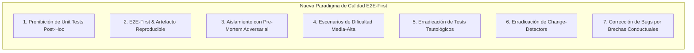

# Contexto Técnico: Estándares de Testing E2E-First y Diseño Adversarial

Este documento establece la metodología oficial, inmutable y exhaustiva de aseguramiento de calidad (QA) y testing para QuestFest. Todo desarrollo, refactorización o corrección implementada por el Agente Único debe regirse estrictamente por este estándar.

---

## 1. El Paradigma de Calidad: Los 7 Principios Inmutables



### Principio 1: Cero Pruebas Unitarias Post-Hoc
- **Fundamento Técnico**: Escribir pruebas unitarias después de escribir el código genera un grave sesgo de confirmación. El desarrollador o la IA escribe tests que simplemente certifican "lo que el código ya hace", en lugar de verificar "lo que el sistema de negocio requiere". Produce un falso sentido de cobertura (vanity metrics) y un acoplamiento vicioso a la implementación interna.
- **Directiva Obligatoria**: Queda **terminantemente prohibido** redactar pruebas unitarias sintéticas sobre código ya implementado. La verificación de funcionalidades o refactorizaciones ya existentes se realiza exclusivamente en los límites reales del sistema mediante pruebas E2E.
- **Única Excepción**: Si un algoritmo puro o subsistema debe probarse en aislamiento, las pruebas deben concebirse y escribirse **antes** de redactar el código de negocio, siguiendo el Principio 3.

---

### Principio 2: E2E-First como Mecanismo Prioritario y Artefacto Reproducible
- **Fundamento Técnico**: En arquitecturas desacopladas como QuestFest, los fallos reales emergen de la interacción de capas:
  - Middlewares de autenticación y verificación de cookies `HttpOnly`.
  - Serialización y validación estricta en esquemas Pydantic v2.
  - Transacciones atómicas en PostgreSQL con bloqueo pesimista (`.with_for_update()`).
  - Reactividad de la interfaz PWA bajo condiciones Mobile-First y desconexión.
- **Directiva Obligatoria**: La suite E2E es el mecanismo de verificación primario.
- **Generación Obligatoria del Artefacto**: Toda verificación E2E debe culminar en la producción de un artefacto formal, verificable y reproducible (por ejemplo, en el directorio de artefactos o reporte documentado) que contenga:
  1. **Matriz de Ejecución**: Escenario probado, actores participantes (Admin, Jugador 1, Jugador 2) e inputs emitidos.
  2. **Trazas y Estado Contable**: Estado inicial en BD -> Requests HTTP / Acciones UI -> Códigos de respuesta -> Estado resultante en `LedgerTransaccion` y balance de QuestCoins.
  3. **Evidencias Forenses**: Referencia a trazas de Playwright (`.zip`), capturas de pantalla o logs de red.
  4. **Comando Determinista de Reproducción**: La orden exacta de terminal para reejecutar la prueba idénticamente en cualquier entorno (`npm run test:e2e` o `pytest tests/...`).

---

### Principio 3: Aislamiento Condicionado a Pre-Mortem Adversarial
- **Fundamento Técnico**: Probar una pieza en aislamiento suele degradarse en comprobar únicamente el "camino feliz" bajo suposiciones complacientes.
- **Directiva Obligatoria**: Si un componente de cálculo puro o lógica interna requiere pruebas en aislamiento:
  1. Se redacta **PRIMERO** una **Matriz de Modos de Fallo (Failure Modes Matrix)** enumerando explícitamente todas las formas posibles en que la pieza puede fallar:
     - Condiciones de carrera y concurrencia.
     - Parámetros negativos, nulos, ceros o valores fuera de rango.
     - Rupturas de invariantes del Ledger.
     - Payload maliciosos o desbordamientos.
  2. Se escriben las pruebas para verificar que el sistema rechaza y maneja con gracia cada modo de fallo.
  3. **DESPUÉS** se implementa la lógica de código que satisface las pruebas.

---

### Principio 4: Escenarios E2E de Dificultad Media a Alta
- **Fundamento Técnico**: Las pruebas triviales ("crear usuario y recibir 201") son cosméticas y ocultan el 90% de los defectos en producción (deadlocks, desincronización de saldos, fugas de permisos entre grupos).
- **Directiva Obligatoria**: Todo escenario E2E de verificación debe ser de dificultad media a alta, debiendo satisfacer obligatoriamente al menos **3 de los siguientes 4 criterios**:

| Dimensión | Requisito Mínimo | Ejemplo Funcional en QuestFest |
| :--- | :--- | :--- |
| **1. Multi-Actor** | Mínimo 2 usuarios independientes interactuando concurrentemente | `Usuario_Admin` registra `Grupo_Protegido`; `Usuario_Miembro` se une con código y credencial. |
| **2. Mutación Contable en Ledger** | Modificación y verificación atómica de QuestCoins | Asignación inicial de saldo, apuesta o recompensa con auditoría en `LedgerTransaccion`. |
| **3. Inyección de Fallos y Resiliencia** | Acción ilegal deliberada durante el flujo con rechazo limpio | Intento de unirse con clave errónea o transferir sin saldo suficiente; verificar error 400/401 y no corrupción contable posterior. |
| **4. Transición Multi-Estado** | Cadena de al menos 3 estados consecutivos en el ciclo de vida | Misión creada -> Misión aceptada -> Progreso validado -> Misión reclamada. |

> [!IMPORTANT]
> **Nomenclatura Estrictamente Funcional (Cero Nombres Anecdóticos)**:
> Queda terminantemente prohibido utilizar nombres informales, cómicos, folclóricos o anecdóticos (como "Peña El Chupinazo", "fiesta_secreta", "usuario_pobre", etc.) en datos de prueba, fixtures, planes o aserciones. Toda entidad sintética debe nombrarse según su rol técnico o de negocio (`Grupo_E2E_[Timestamp]`, `Usuario_Admin`, `Usuario_Miembro_A`, `Password_Valido_123`, `Password_Invalido_456`, `Mision_Verificacion_Ledger`).

---

### Principio 5: Erradicación de Pruebas Tautológicas
- **Fundamento Técnico**: Una prueba tautológica afirma lo que es verdadero por definición de la propia prueba. No comprueba el comportamiento real del sistema.
  - ❌ *Anti-patrón*: Mockear un servicio para que devuelva `{ "ok": true }` y luego asertar `assert response.json() == { "ok": true }`.
  - ❌ *Anti-patrón*: Duplicar la fórmula de negocio dentro de la prueba (`assert calcular(x) == x * 1.21` cuando la prueba define `x * 1.21`).
- **Directiva Obligatoria**: Prohibidas las aserciones sobre mocks autocomplacientes o definiciones circulares. Las aserciones deben evaluar invariantes externas e independientes: registros persistidos en base de datos, códigos de estado HTTP de límite y saldos auditados en el Ledger.

---

### Principio 6: Erradicación de Pruebas Detectoras de Cambios (Change-Detectors)
- **Fundamento Técnico**: Las pruebas detectoras de cambios se acoplan a la estructura interna del código (nombres de métodos privados, orden exacto de llamadas internas o snapshots masivos de HTML/JSON). Cuando se realiza un refactor legítimo que preserva el comportamiento, estas pruebas se rompen innecesariamente, penalizando la evolución del código.
- **Directiva Obligatoria**: Los tests deben operar como **caja negra sobre los límites del sistema** (Black-box at boundaries):
  - En UI (Playwright): Localizar elementos mediante roles accesibles y textos visibles (`getByRole`, `getByLabel`), nunca mediante clases CSS de Tailwind o nombres internos de componentes React.
  - En API (Pytest/HTTPX): Validar contratos DTO y códigos de respuesta, sin inspeccionar llamadas a métodos privados del servicio.

---

### Principio 7: Corrección de Bugs por Brechas Conductuales
- **Fundamento Técnico**: El hábito de crear micro-tests de regresión reactivos (`test_fix_bug_issue_99`) satura el repositorio de pruebas frágiles, aisladas y sin contexto de negocio.
- **Directiva Obligatoria**: Ante un defecto o bug detectado:
  1. Identificar cuál fue la **brecha conductual en la suite E2E** que permitió que el defecto pasara desapercibido.
  2. Ampliar o enriquecer el escenario E2E de comportamiento real para que cubra la situación de forma natural y duradera.
  3. Prohibido crear micro-tests unitarios sintéticos para corregir fallos si no representan una brecha de contrato o comportamiento del sistema.

---

## 2. El Modelo E2E en Dos Niveles (Dual-Tier E2E)

QuestFest adopta dos herramientas complementarias según la capa de límite a evaluar:

```
                               ┌────────────────────────────────────────────────────────┐
                               │                     QUESTFEST E2E                      │
                               └───────────────────────────┬────────────────────────────┘
                                                           │
                        ┌──────────────────────────────────┴──────────────────────────────────┐
                        ▼                                                                     ▼
     ┌────────────────────────────────────┐                                ┌────────────────────────────────────┐
     │       Nivel 1: E2E de API          │                                │       Nivel 2: E2E de UI y PWA     │
     │     (pytest + httpx.AsyncClient)   │                                │             (Playwright)           │
     ├────────────────────────────────────┤                                ├────────────────────────────────────┤
     │ • FastAPI + SQLAlchemy transaccional│                                │ • Next.js 16 + React 19 + PWA      │
     │ • Bloqueo pesimista en Ledger      │                                │ • Emulación Mobile (Pixel 7 / iOS) │
     │ • Contratos REST DTO y Middlewares │                                │ • Safe-area-inset & Touch >= 48px  │
     │ • Velocidad en milisegundos        │                                │ • Multi-Actor con BrowserContexts  │
     │ • Ejecución: pytest tests/ -v      │                                │ • Ejecución: npm run test:e2e      │
     └────────────────────────────────────┘                                └────────────────────────────────────┘
```

---

## 3. Guía de Ejecución y Gestión de Artefactos

### A. Política de Git para Archivos de Prueba
- **Archivos que SÍ se suben a Git**:
  - `frontend/e2e/**/*.ts`: Especificaciones de prueba de Playwright.
  - `frontend/playwright.config.ts`: Configuración oficial de pruebas.
  - `backend/tests/**/*.py`: Especificaciones de prueba de backend.
- **Archivos que NUNCA se suben a Git (en `.gitignore`)**:
  - `frontend/test-results/`: Vídeos `.webm`, trazas `.zip` y capturas temporales.
  - `frontend/playwright-report/`: Reporte HTML generado localmente.
  - `frontend/.playwright/`: Caché interna del navegador.

### B. Formato Estándar del Artefacto de Verificación E2E
Cada ciclo de verificación concluido debe documentar un artefacto con el siguiente esquema:
```markdown
# Reporte de Verificación E2E: [Nombre de la Funcionalidad / Escenario]

## 1. Identificación y Reproducibilidad
- **Comando Determinista**: `npm run test:e2e` (o `pytest tests/...`)
- **Herramienta Empleada**: Playwright v1.63.0 / Pytest 9.1
- **Entorno**: Mobile Chrome (Pixel 7) / ASGI AsyncClient

## 2. Matriz de Escenarios y Actores
- **Actor A (Admin)**: Creación de entidad y reglas.
- **Actor B (Jugador)**: Intento ilegítimo (Rechazo 401/403) -> Operación legítima.

## 3. Auditoría Contable y Estado Persistido
- Saldo Previo: X QuestCoins
- Operación en Ledger: Delta +/- Y QuestCoins (Concepto: "...")
- Saldo Posterior Auditado: Z QuestCoins
- Integridad Referencial: Verificada

## 4. Veredicto
- Estado: APROBADO (Cero defectos, trazas limpias)
```
