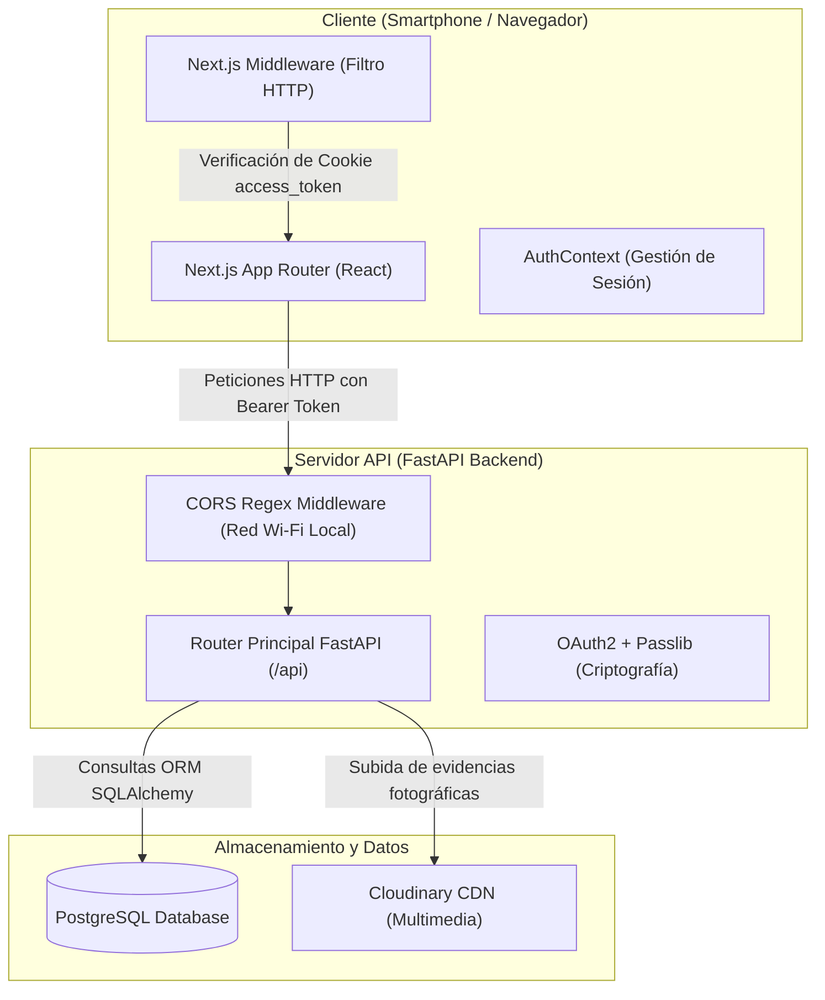

# 01.2 - El Mapa del Sistema (Arquitectura Global)

> Enlace de navegación: Volver al [[01.0 - Indice y Mapa de Vision General]]

---

## Visión General de la Arquitectura

El proyecto **QuestFest** está estructurado bajo una arquitectura cliente-servidor desacoplada que permite el funcionamiento independiente del cliente de usuario y del servidor de procesamiento.



---

## Análisis Técnico de la Infraestructura

### 1. Configuración [[06.3 - Politicas CORS y Seguridad en Navegadores|CORS]] para Redes Locales Wi-Fi
En `app/main.py`, el backend implementa una expresión regular en la capa de middleware CORS (`CORSMiddleware`):
```python
allow_origin_regex=r"^http://(localhost|127\.0\.0\.1|192\.168\.\d+\.\d+|10\.\d+\.\d+\.\d+|172\.(1[6-9]|2[0-9]|3[0-1])\.\d+\.\d+):3000$"
```
Esta especificación responde a un requisito operativo: durante la celebración de un evento, los dispositivos móviles de los usuarios acceden mediante direcciones IP privadas asignadas dinámicamente por la red Wi-Fi local (por ejemplo: `http://192.168.1.45:3000`). La expresión regular autoriza las peticiones procedentes de cualquier IP de la subred privada sin comprometer la seguridad.

### 2. Gestión de Sesión mediante Pase de Acceso Dual ([[06.5 - Autenticacion con Tokens JWT|Tokens JWT]])
El proceso de autenticación implementado en `src/context/AuthContext.tsx` y `src/proxy.ts` opera del siguiente modo:
- Tras la validación exitosa del usuario mediante credenciales en formato OAuth2 (`application/x-www-form-urlencoded`), el backend emite un token de acceso firmado digitalmente.
- **Inyección Dual**:
  1. `localStorage.setItem('access_token', token)`: Utilizado por la biblioteca cliente **Axios** para adjuntar la cabecera `Authorization: Bearer <token>` en las peticiones de datos.
  2. `document.cookie = access_token=...`: Utilizado por el [[06.14 - Middleware y Proteccion de Rutas HTTP|Proxy Perimetral de Next.js]] para interceptar y validar las solicitudes de navegación en el servidor antes de renderizar páginas protegidas.

### 3. Capa de Datos Relacional: PostgreSQL + [[06.8 - Que es un ORM y como funciona SQLAlchemy|SQLAlchemy 2.0]] + [[06.9 - Migraciones de Base de Datos con Alembic|Alembic]]
- El esquema relacional se modela mediante declaraciones de tipo en SQLAlchemy 2.0 (`Mapped[...]`).
- La evolución del esquema y las modificaciones estructurales se ejecutan mediante scripts de migración en **Alembic**, preservando la integridad de los saldos de QuestCoins y el historial contable.

---

## Modelo Conceptual de Analogía: Arquitectura de Servicios

Para ilustrar el comportamiento global de la arquitectura, puede analizarse el funcionamiento mediante la analogía de un recinto de eventos:

1. **El Torno de Control de Accesos (Next.js Proxy & AuthContext)**:
   Funciona como el torno de seguridad situado en la entrada del recinto. Antes de permitir el acceso a una zona restringida, comprueba la presencia de la credencial de acceso (Cookie `access_token`). En caso de ausencia, redirige al usuario a la taquilla de registro (`/login`).

2. **El Mostrador Central de Atención (Backend FastAPI)**:
   Actúa como la oficina central donde se aplican las reglas del evento. Las peticiones de saldo, envíos de fotos o validaciones de duelos son procesadas en este mostrador, el cual verifica los permisos y actualiza los registros.

3. **El Libro Contable Inexpugnable (PostgreSQL)**:
   Representa la caja fuerte donde se audita cada movimiento de dinero virtual. Toda transacción de QuestCoins queda registrada de forma permanente sin posibilidad de manipulación manual.

4. **El Almacén Externo de Documentación (Cloudinary CDN)**:
   Funciona como un depósito externo de custodia multimedia donde se archivan las imágenes enviadas por los usuarios para no congestionar el mostrador central.

---

## Conceptos y Guías Relacionadas
- [[05.3 - Despliegue en Produccion y Pipeline CI-CD]]
- [[05.4 - Despliegue Serverless en Vercel y Supabase]]
- [[06.3 - Politicas CORS y Seguridad en Navegadores]]
- [[06.5 - Autenticacion con Tokens JWT]]
- [[06.8 - Que es un ORM y como funciona SQLAlchemy]]
- [[06.9 - Migraciones de Base de Datos con Alembic]]
- [[06.14 - Middleware y Proteccion de Rutas HTTP]]
- [[06.28 - Agrupamiento de Conexiones y Resiliencia en Bases de Datos]]

---

## Ficheros Físicos del Código Fuente
- Configuración CORS y Rutas Backend: [backend/app/main.py](vscode://file/c:/.d/questfest-project/backend/app/main.py:13) *(Línea 13: CORSMiddleware)*
- Proxy Perimetral de Seguridad Next.js: [frontend/src/proxy.ts](vscode://file/c:/.d/questfest-project/frontend/src/proxy.ts:11) *(Línea 11: Verificación Cookie y Redirección)*
- Inyección Dual de Tokens: [frontend/src/context/AuthContext.tsx](vscode://file/c:/.d/questfest-project/frontend/src/context/AuthContext.tsx:60) *(Línea 60: Petición de Login)*
- Cliente Axios con Interceptores: [frontend/src/lib/axios.ts](vscode://file/c:/.d/questfest-project/frontend/src/lib/axios.ts:8) *(Línea 8: Interceptor Bearer)*
- Punto de Entrada Backend Serverless: [backend/main.py](vscode://file/c:/.d/questfest-project/backend/main.py:1) *(Punto de entrada canónico de FastAPI)*
- Configuración de Vercel Services: [vercel.json](vscode://file/c:/.d/questfest-project/vercel.json:1) *(Enrutamiento y definición de servicios)*
- Hook de Sondeo Reactivo: [frontend/src/hooks/useFeedStream.ts](vscode://file/c:/.d/questfest-project/frontend/src/hooks/useFeedStream.ts:1) *(Reemplazo Serverless de SSE)*
