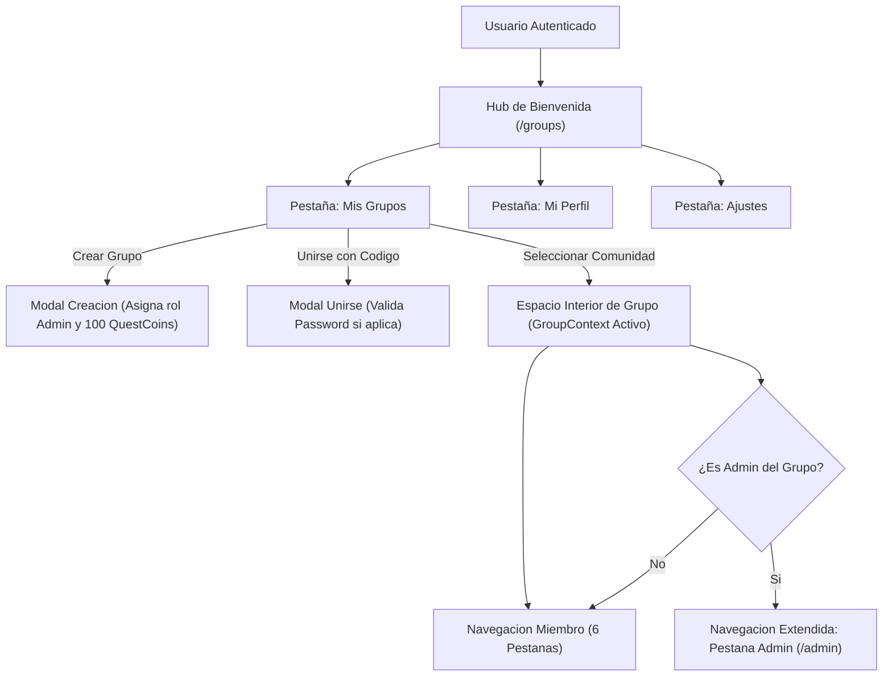

# 01.3 - Arquitectura Multi-Grupo e Aislamiento de Entidades

> Enlace de navegación: Volver al [[01.0 - Indice y Mapa de Vision General]]

---

## Explicación Técnica: Modelo Multi-Inquilino y Desacoplamiento Comunitario

La plataforma **QuestFest** adopta una arquitectura multi-inquilino lógica (Logical Multi-Tenancy) basada en esquema relacional compartido con particionamiento por clave foránea (`grupo_id`). Este modelo permite a una única instancia de servidor y base de datos gestionar simultáneamente múltiples comunidades independientes, peñas de fiestas o grupos de amigos con aislamiento estricto de sus datos y dinámicas de juego.

Bajo este paradigma, el sistema desacopla dos ámbitos de información:

1. **Ámbito Global de Identidad**:
   - Reside a nivel de plataforma y es único para cada persona.
   - Comprende las credenciales criptográficas de inicio de sesión, el nombre de usuario único, la biografía y la fotografía o avatar global.
   - Es administrado desde el **Hub de Bienvenida** (`/groups`), el cual constituye el punto de entrada primario tras autenticarse en la aplicación.

2. **Ámbito Local de Grupo**:
   - Cada entidad de juego (misiones, apuestas colectivas, duelos 1vs1, publicaciones del feed social, transacciones del libro contable y clasificaciones de ranking) pertenece obligatoriamente a una comunidad específica mediante su clave foránea `grupo_id`.
   - **Economía Aislada**: El saldo de **QuestCoins** no es global, sino que reside en la tabla intermedia `miembros_grupo` (`saldo_grupo`). Cada usuario dispone de un saldo y un historial contable independiente en cada grupo al que pertenece.
   - **Gobernanza Granular**: La administración se delega a nivel de comunidad mediante el rol de Administrador de Grupo (`admin`), otorgando permisos de gestión de configuración, resolución de tribunales y emisión de invitaciones sin requerir privilegios de superadministrador sobre el servidor.

---

## Modelo Conceptual de Analogía: El Gran Complejo Festivo y las Carpas Temáticas

Imagine un recinto ferial de gran escala donde se celebran diversas fiestas simultáneas.

A la entrada del recinto, cada asistente muestra su documento de identidad y recibe una acreditación personal intransferible (Cuenta Global de Usuario). Con dicha acreditación, el asistente puede acceder a las distintas carpas temáticas o casetas privadas (Grupos o Peñas) a las que haya sido invitado.

Cada carpa opera de manera completamente autónoma:
- Al cruzar la puerta de una carpa, el organizador le entrega un monedero con fichas de plástico (QuestCoins de Grupo). Las fichas ganadas o apostadas en la carpa de baile no tienen validez ni alteran el monedero de la carpa de juegos de mesa.
- En la pared de cada carpa cuelga una pizarra de puntuaciones propia (Ranking del Grupo), y en el tablón de anuncios solo figuran los desafíos y comentarios de quienes están dentro (Feed de Grupo).
- El anfitrión de la carpa (Administrador de Grupo) posee las llaves para admitir a nuevos miembros, dictar las reglas internas y organizar los torneos de esa carpa concreta, sin tener autoridad alguna sobre las carpas vecinas.

---

## Aplicación en el Proyecto QuestFest

### 1. Hub de Bienvenida (`/groups`)
Punto neurálgico que organiza la experiencia previa a entrar en una comunidad mediante tres pestañas:
- **Mis Grupos**: Tarjetas apiladas horizontales de ancho completo que reflejan el estado del jugador en cada comunidad (saldo local de QuestCoins, puesto en el ranking y rol). Incorpora un menú de tres puntos (`...`) con opciones de acceso rápido, abandono voluntario o gestión administrativa. Además, ofrece los botones para crear una nueva comunidad o unirse mediante código de invitación.
- **Mi Perfil**: Editor de la identidad global de la cuenta (avatar, nombre y biografía).
- **Ajustes Generales**: Configuración de notificaciones del dispositivo, comprobación del estado de la PWA y cierre seguro de sesión.

### 2. Espacio de Juego Interior y Navegación Dinámica (`BottomNav.tsx`)
Al seleccionar una comunidad, el cliente almacena el grupo activo en el `GroupContext` y redirige a la experiencia inmersiva. La barra de navegación inferior adapta sus opciones según los privilegios del usuario:
- **Miembro Estándar (6 pestañas)**: Feed social, Ranking, Apuestas, Misiones, Duelos y Estadísticas (resumen de balance local e historial contable del grupo).
- **Administrador de Grupo (7 pestañas)**: Feed social, Ranking, Apuestas, Misiones, Duelos, Estadísticas y la pestaña directa **Admin** (`/admin`), que incorpora la gestión de la comunidad, códigos de invitación con códigos QR dinámicos y tribunal de resoluciones.

### 3. Mecanismo Seguro de Invitaciones y Enlaces Profundos
- Cada comunidad cuenta con un identificador único con prefijo (`QF-XXXXX`).
- **Restricción de Seguridad**: El código de invitación, los enlaces directos (`/join/[code]`) y los códigos QR visuales son accesibles y regenerables exclusivamente por los usuarios con rol `admin` del grupo correspondiente.

---

## Conceptos Teóricos Relacionados

- [[06.26 - Patron de Diseño Multi-Tenancy y Modelado Relacional]]
- [[06.7 - Control de Acceso Basado en Roles]]
- [[06.11 - Transacciones Atomicas e Integridad Referencial]]
- [[06.13 - Gestion del Estado Global y Context API]]

---

## Ficheros Físicos del Código Fuente

- Modelo de datos relacional de grupos y membresías: [backend/app/models/grupo.py](vscode://file/c:/.d/fiestas26-project/backend/app/models/grupo.py:1) *(Línea 1: Modelos Grupo y MiembroGrupo)*
- Controladores y endpoints de la API de grupos: [backend/app/api/routers/groups.py](vscode://file/c:/.d/fiestas26-project/backend/app/api/routers/groups.py:1) *(Línea 1: Router de Comunidades)*
- Proveedor de contexto global de grupo en React: [frontend/src/context/GroupContext.tsx](vscode://file/c:/.d/fiestas26-project/frontend/src/context/GroupContext.tsx:1) *(Línea 1: GroupProvider y useGroup)*
- Hub de bienvenida y gestión multi-grupo: [frontend/src/app/groups/page.tsx](vscode://file/c:/.d/fiestas26-project/frontend/src/app/groups/page.tsx:1) *(Línea 1: WelcomeHubPage)*
- Barra de navegación adaptativa por roles: [frontend/src/components/BottomNav.tsx](vscode://file/c:/.d/fiestas26-project/frontend/src/components/BottomNav.tsx:1) *(Línea 1: BottomNav con 6 o 7 pestañas)*
- Panel de administración con pestaña de comunidad: [frontend/src/components/admin/TabGrupoSettings.tsx](vscode://file/c:/.d/fiestas26-project/frontend/src/components/admin/TabGrupoSettings.tsx:1) *(Línea 1: TabGrupoSettings)*
