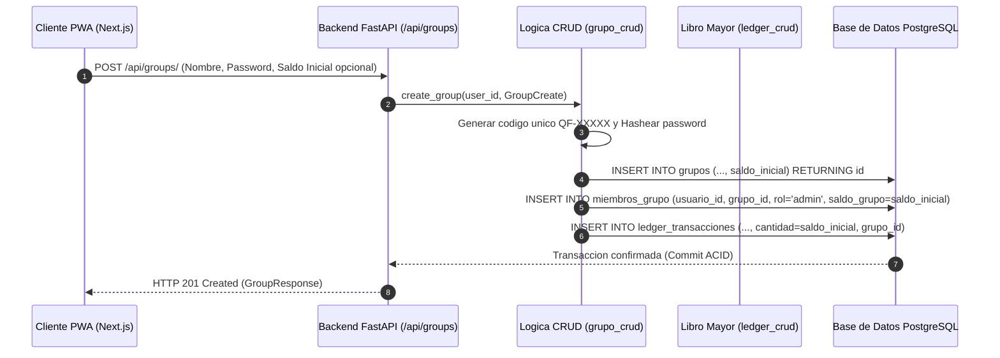

# 02.10 - Gestion de Grupos Membresias y Roles Granulares

> Enlace de navegación: Volver al [[02.0 - Indice y Mapa de El Motor Backend]]

---

## Análisis Técnico: Modelos Relacionales, Autorización y Restricciones Operativas

El backend de **QuestFest** implementa la gestión de comunidades mediante el router `/api/groups` y la capa de persistencia definida en `app/models/grupo.py` y `app/crud/grupo_crud.py`. Este módulo coordina la creación de grupos, el ingreso mediante códigos de invitación, la protección por contraseña y la asignación de permisos de administración autónomos.

### 1. Modelado de Datos Relacional (`app/models/grupo.py`)
- **Entidad `Grupo`**: Representa la comunidad o peña. Almacena el nombre, la descripción opcional, el código de invitación único alfanumérico (`codigo_unico`, indexado y con restricción `UNIQUE`), el identificador del usuario fundador (`creador_id`) y el hash criptográfico opcional de contraseña (`password_hash`).
- **Entidad `MiembroGrupo`**: Tabla de asociación muchos-a-muchos entre `Usuario` y `Grupo` con clave foránea compuesta única (`UniqueConstraint('usuario_id', 'grupo_id')`). Almacena:
  - `rol`: Nivel de privilegio del usuario en esa comunidad (`admin` o `member`).
  - `saldo_grupo`: Cantidad de **QuestCoins** del usuario en ese grupo específico, asegurando saldo no negativo mediante una restricción `CheckConstraint('saldo_grupo >= 0')`.
  - `fecha_union`: Marca temporal de ingreso al grupo.

### 2. Ciclo de Vida y Reglas de Negocio en la Capa CRUD (`app/crud/grupo_crud.py`)
1. **Creación de Grupo (`create_group`)**:
   - Genera un código de invitación aleatorio con prefijo `QF-` y 5 caracteres alfanuméricos criptográficamente seguros.
   - Si se especifica contraseña, genera un hash con algoritmo Bcrypt (`pwd_context.hash`).
   - Permite parametrizar el saldo inicial (`saldo_inicial`, validado mediante Pydantic entre 0 y 10.000 QuestCoins, con valor por defecto de 100).
   - Inserta automáticamente al creador como miembro con rol `admin` y le asigna el saldo inicial configurado.
   - Registra de forma atómica el movimiento contable inicial en el libro mayor (`LedgerTransaccion`) con el correspondiente `grupo_id` y snapshot de `saldo_resultante`.
2. **Ingreso a Grupo (`join_group`)**:
   - Valida la existencia del código de invitación.
   - Si el grupo exige clave de acceso, verifica la contraseña proporcionada contra el hash persistido. Si no coincide, retorna un error HTTP 401 Unauthorized.
   - Comprueba que el usuario no sea ya miembro del grupo (prevención de duplicados con HTTP 400 Bad Request).
   - Mitigación del exploit de abandono y reingreso: Consulta en `LedgerTransaccion` si el usuario ya percibió previamente un abono de bienvenida en esta comunidad. En caso afirmativo, se asignan 0 QuestCoins para evitar la duplicación o farmeo infinito de fondos.
   - Si es su primer ingreso, otorga el saldo inicial configurado en `grupo.saldo_inicial` y genera el correspondiente asiento contable en `LedgerTransaccion`.
3. **Restricción de Seguridad en Invitaciones (`get_group_invite_data`)**:
   - Comprueba estrictamente que el usuario solicitante pertenezca al grupo y posea el rol `admin`.
   - Si un usuario con rol `member` intenta consultar o generar el enlace de invitación o el código QR, el sistema deniega el acceso con HTTP 403 Forbidden.
4. **Protección ante Abandono del Grupo (`leave_group`)**:
   - Si un usuario con rol `admin` solicita abandonar la comunidad y es el único administrador restante pero existen otros miembros en el grupo, el sistema bloquea la salida con HTTP 400 Bad Request, exigiendo que se delegue el rol de administrador en otro participante antes de salir.
   - Admite peticiones mediante verbos HTTP DELETE y POST (`/{group_id}/leave`) para máxima compatibilidad con las invocaciones del cliente web.
5. **Soberanía del Fundador y Gestión de Roles (`update_member_role`)**:
   - **Soberanía Exclusiva del Creador**: Únicamente el usuario fundador del grupo (`creador_id`) tiene potestad para modificar los roles de los participantes (`PATCH /{group_id}/members/{user_id}/role`). Tanto el ascenso a la categoría de `admin` como la revocación hacia el rol `member` están reservados al creador original. Si un administrador secundario o delegado intenta ascender o revocar el rol de cualquier participante, el sistema rechaza la petición con HTTP 403 Forbidden.
   - **Inmutabilidad del Fundador**: El creador y administrador del grupo no puede desasignarse su propio rol de administrador ni ser degradado bajo ninguna circunstancia (HTTP 400 Bad Request), impidiendo que la comunidad quede sin liderazgo.
   - **Garantía de Administrador Activo**: Ninguna acción de degradación puede dejar a un grupo con cero administradores activos (HTTP 400 Bad Request).
6. **Consulta de Membresías y Rutas Duales (`get_user_groups`)**:
   - El router expone tanto `GET /api/groups/me` como el alias `GET /api/groups/my-groups`, garantizando la sincronización transparente del contexto global (`GroupContext`) tras el registro o inicio de sesión.
   - Devuelve la tarjeta de membresía completa (`UserGroupCardResponse`), integrando el código alfanumérico (`codigo_unico` y `codigo_invitacion`), descripción, saldo local de **QuestCoins**, posición calculada en el ranking, total de participantes, saldo inicial configurado y el identificador del fundador (`creador_id`).
7. **Listado de Miembros del Grupo (`get_group_members`)**:
   - Endpoint `GET /api/groups/{group_id}/members` exclusivo para administradores del grupo.
   - Devuelve los usuarios participantes con su identificador, nombre de usuario, avatar, rol actual (`admin` o `member`), saldo local de **QuestCoins**, fecha de ingreso y el indicador booleano `es_creador` para posibilitar la representación de insignias y candados en el cliente web.
8. **Regeneración de Código de Acceso (`regenerate_group_code`)**:
   - Endpoint `POST /api/groups/{group_id}/regenerate-code` reservado a administradores.
   - Genera un nuevo código alfanumérico único con formato `QF-XXXXX`, revocando inmediatamente el código previo para preservar la privacidad del grupo.
9. **Modificación de Configuración del Grupo (`update_group_settings`)**:
   - Endpoint `PATCH /api/groups/{group_id}` accesible únicamente por administradores.
   - Permite actualizar atómicamente el nombre, descripción, redefinir la contraseña o modificar el saldo inicial para nuevas incorporaciones (sin alterar con carácter retroactivo los balances de los miembros ya inscritos).
10. **Clasificación y Métricas Scoped por Grupo (`GET /api/ranking/?group_id=...`)**:
    - El router `ranking.py` evalúa el parámetro opcional `group_id` para aislar las estadísticas:
      - `saldo_actual`: Extraído de `MiembroGrupo.saldo_grupo` para la comunidad indicada.
      - `apuestas_acertadas`: Subconsulta sobre `TicketApuesta` unida a `Apuesta` filtrando por `TicketApuesta.grupo_id == group_id`, estado cerrada y opción ganadora acertada.
      - `misiones_completadas`: Subconsulta sobre `PruebaMision` unida con `Mision` filtrando por `Mision.grupo_id == group_id` y estado de prueba aprobada.
      - `duelos_ganados`: Subconsulta sobre `Duelo` filtrando por `Duelo.grupo_id == group_id`, vencedor igual al usuario y estado completado.
    - Garantiza que los marcadores y logros de una comunidad no interfieran con las dinámicas de otros grupos.

---

## Modelo Conceptual de Analogía: El Club Polideportivo y las Secciones Federadas

Imagine un carnet de socio para un gran club polideportivo.

El titular del carnet posee un único número de socio y una foto oficial para entrar por los tornos del club (Cuenta de Usuario Global). Una vez dentro de las instalaciones, el socio puede inscribirse en diferentes secciones federadas: la sección de Ajedrez, la de Tenis y la de Natación (Grupos).

En la sección de Ajedrez, el socio es nombrado Presidente y Fundador de Sección (Administrador de Grupo Fundador): dispone de las llaves del armario de los tableros, tiene la facultad de admitir a nuevos ajedrecistas, firmar las actas de los torneos e invitar a otros jugadores. Retiene de forma inmutable su condición de fundador y la potestad exclusiva para nombrar o destituir vocales o administradores adjuntos; ningún administrador adjunto puede arrebatarle el mando ni destituir a otros administradores.

Por el contrario, en la sección de Natación es un simple nadador de fin de semana (Miembro): no puede alterar los horarios de las calles ni repartir medallas.

Asimismo, cada sección emite sus propios vales de cafetería (QuestCoins locales). Los vales ganados en un campeonato de ajedrez no pueden utilizarse para alquilar toallas en la piscina, garantizando que el presupuesto de cada sección se mantenga estrictamente separado y ordenado.

---

## Flujo de Creación e Ingreso a Grupo

---

## Conceptos Teóricos Relacionados

- [[06.26 - Patron de Diseño Multi-Tenancy y Modelado Relacional]]
- [[06.7 - Control de Acceso Basado en Roles]]
- [[06.11 - Transacciones Atomicas e Integridad Referencial]]
- [[06.6 - Hashing de Contraseñas y Algoritmo Bcrypt]]

---

## Ficheros Físicos del Código Fuente

- Definición de tablas de grupos y miembros: [backend/app/models/grupo.py](vscode://file/c:/.d/fiestas26-project/backend/app/models/grupo.py:1) *(Línea 1: Grupo y MiembroGrupo)*
- Esquemas Pydantic DTO para grupos: [backend/app/schemas/grupo_schemas.py](vscode://file/c:/.d/fiestas26-project/backend/app/schemas/grupo_schemas.py:1) *(Línea 1: GroupCreate, GroupResponse, UserGroupCardResponse, GroupJoinRequest, GroupInviteResponse, UpdateMemberRoleRequest, GroupMemberResponse, GroupUpdateRequest)*
- Funciones de persistencia y reglas de negocio: [backend/app/crud/grupo_crud.py](vscode://file/c:/.d/fiestas26-project/backend/app/crud/grupo_crud.py:1) *(Línea 1: Operaciones CRUD de grupos y miembros)*
- Rutas y controladores HTTP de comunidades: [backend/app/api/routers/groups.py](vscode://file/c:/.d/fiestas26-project/backend/app/api/routers/groups.py:1) *(Línea 1: Endpoints /api/groups y alias /my-groups)*
- Controlador de Clasificación Scoped: [backend/app/api/routers/ranking.py](vscode://file/c:/.d/fiestas26-project/backend/app/api/routers/ranking.py:1) *(Línea 1: Endpoint /api/ranking con aislamiento por group_id)*
- Resolución de dependencias y permisos de administración: [backend/app/dependencies.py](vscode://file/c:/.d/fiestas26-project/backend/app/dependencies.py:45) *(Línea 45: get_admin_user)*
