# 02.11 - Modelo Relacional, Esquema Entidad-Relación y Lógica de Base de Datos

> Enlace de navegación: Volver al [[02.0 - Indice y Mapa de El Motor Backend]]

---

## Explicación Técnica: Lógica de Negocio y Arquitectura de la Capa de Persistencia

La capa de datos del proyecto **QuestFest** se implementa sobre un Sistema de Gestión de Bases de Datos Relacionales (RDBMS) **PostgreSQL**, abstraído mediante el ORM **SQLAlchemy 2.0** en modo asíncrono (`AsyncSession`). El diseño del modelo relacional responde a tres requisitos clave de la ingeniería de software: **arquitectura multi-tenancy (aislamiento por comunidades o eventos)**, **integridad financiera inmutable mediante auditoría ledger** y **garantía de consistencia ACID en la ejecución de juegos y apuestas**.

### 1. Arquitectura Multi-Tenancy y Aislamiento de Comunidades
- **Segmentación por Grupo**: Cada comunidad o fiesta privada constituye un dominio aislado representado por la entidad `Grupo`. La tabla `miembros_grupo` actúa como entidad asociativa (intermedia) que modela la pertenencia `N:M` entre `Usuario` y `Grupo`, asignando un saldo independiente de **QuestCoins** (`saldo_grupo >= 0`) y un rol local (`'admin'` o `'member'`) para cada entorno.
- **Relaciones Scoped**: Las entidades operativas principales (`misiones`, `apuestas`, `duelos`, `publicaciones`, `registro_ruleta`, `notificaciones_admin`, `audit_logs`, `ledger_transacciones`) incorporan la clave ajena `grupo_id`, lo que garantiza que las consultas SQL filtren los registros estrictamente dentro del contexto de la comunidad activa.

### 2. Motor Financiero Inmutable (`LedgerTransaccion`)
- **Trazabilidad de QuestCoins**: Toda modificación en el monedero digital de un usuario (ganancia en misiones, cobro de premios en apuestas, depósito/liquidación de duelos o tiradas de ruleta) se ejecuta registrando un asiento inmutable en `ledger_transacciones`.
- **Integridad Referencial y Saldo Resultante**: El campo `saldo_resultante` almacena el balance exacto tras la operación, garantizando la auditoría contable. Las restricciones `CheckConstraint("saldo_actual >= 0")` en `usuarios` y `CheckConstraint("saldo_grupo >= 0")` en `miembros_grupo` impiden a nivel de motor de datos la existencia de descubiertos o saldos negativos.

### 3. Ciclos de Vida y Máquinas de Estado
- **Misiones y Pruebas**: Una `Mision` es creada por un usuario/administrador. Los participantes envían evidencias en `pruebas_misiones` con estado inicial `'pending'`. La aprobación del administrador cambia el estado a `'approved'`, activando una transacción atómica que incrementa el saldo del usuario y genera la correspondiente entrada en el `LedgerTransaccion` y en el muro de `publicaciones`.
- **Duelos 1vs1**: Representados en la entidad `duelos`, gestionan el ciclo de estados `pending` -> `accepted` -> `validation_winner` -> `completed`. Al crearse o aceptarse un duelo, el sistema retiene los QuestCoins en concepto de depósito de garantía. La resolución acredita el bote acumulado (`tokens_en_juego * 2`) al vencedor.
- **Apuestas Colectivas y Estructuras JSONB**: La entidad `apuestas` almacena la definición de opciones y el conteo de votos de sugerencias en campos semiestructurados de tipo `JSONB`. Los usuarios adquieren participaciones registradas en `ticket_apuestas` (`cantidad > 0`), limitadas a un ticket único por apuesta mediante la restricción `UniqueConstraint("usuario_id", "apuesta_id")`.
- **Muro Social e Hilos Jerárquicos**: La entidad `publicaciones` implementa una relación recursiva de autorreferencia mediante `parent_id` (árbol de comentarios), permitiendo respuestas jerárquicas y notificaciones del sistema (`es_sistema = True`).

---

## Esquema Entidad-Relación (E/R) Académico Universitario

El siguiente diagrama Entidad-Relación modela conceptualmente el dominio de la base de datos de QuestFest bajo los estándares universitarios de modelado E/R, detallando las entidades principales, sus atributos clave y las cardinalidades de interrelación:

```mermaid
erDiagram
    USUARIOS {
        int id PK
        string username UK
        string password_hash
        string rol
        int saldo_actual
        string bio
        string avatar_url
    }

    GRUPOS {
        int id PK
        string codigo_unico UK
        string nombre
        text descripcion
        string icono_url
        boolean requiere_password
        string password_hash
        int saldo_inicial
        int creador_id FK
        datetime fecha_creacion
    }

    MIEMBROS_GRUPO {
        int id PK
        int grupo_id FK
        int usuario_id FK
        string rol
        int saldo_grupo
        datetime fecha_union
    }

    MISIONES {
        int id PK
        int grupo_id FK
        string titulo
        int creador_id FK
        text descripcion
        int recompensa
        int cupo_maximo
        string fase
        boolean es_ruleta
        string media_url
        string estado
        datetime fecha_creacion
    }

    PRUEBAS_MISIONES {
        int id PK
        int mision_id FK
        int usuario_id FK
        text prueba_texto
        string prueba_imagen_url
        string estado
        datetime fecha_creacion
    }

    VOTOS_MISIONES {
        int id PK
        int mision_id FK
        int usuario_id FK
        string tipo_voto
    }

    MISION_RULETA_ACEPTADA {
        int id PK
        int mision_id FK
        int usuario_id FK
        datetime fecha
    }

    APUESTAS {
        int id PK
        int grupo_id FK
        string titulo
        int creador_id FK
        jsonb opciones
        string fase
        string estado
        string opcion_ganadora_id
        jsonb votos_sugerencia
        datetime fecha_creacion
        datetime fecha_aprobacion
    }

    TICKET_APUESTAS {
        int id PK
        int grupo_id FK
        int usuario_id FK
        int apuesta_id FK
        string opcion_id
        int cantidad
        date fecha
    }

    DUELOS {
        int id PK
        int grupo_id FK
        int retador_id FK
        int retado_id FK
        string juego
        int tokens_en_juego
        string estado
        int ganador_id FK
        datetime fecha_creacion
        string reported_resolution
    }

    LEDGER_TRANSACCIONES {
        int id PK
        int grupo_id FK
        int usuario_id FK
        int cantidad
        string concepto
        int saldo_resultante
        datetime fecha_creacion
    }

    REGISTRO_RULETA {
        int id PK
        int grupo_id FK
        int usuario_id FK
        date fecha
    }

    PUBLICACIONES {
        int id PK
        int grupo_id FK
        string tipo
        int autor_id FK
        text contenido
        string media_url
        boolean es_sistema
        datetime fecha_creacion
        int parent_id FK
    }

    NOTIFICACIONES_ADMIN {
        int id PK
        int grupo_id FK
        string titulo
        text mensaje
        string media_url
        string estado
        datetime fecha_programada
        string destinatario_tipo
        int destinatario_id FK
        jsonb config_boletin
        datetime fecha_creacion
    }

    NOTIFICACIONES_LEIDAS {
        int id PK
        int usuario_id FK
        int notificacion_id FK
        datetime fecha_leida
    }

    PUSH_SUBSCRIPTIONS {
        int id PK
        int usuario_id FK
        text endpoint UK
        text p256dh
        text auth
        datetime fecha_creacion
    }

    AUDIT_LOGS {
        int id PK
        int grupo_id FK
        int admin_id FK
        string accion
        string entidad
        int entidad_id
        jsonb detalles
        datetime fecha_creacion
    }

    %% Interrelaciones del Modelo E/R
    USUARIOS ||--o{ GRUPOS : "CREA"
    USUARIOS ||--o{ MIEMBROS_GRUPO : "PERTENECE"
    GRUPOS ||--o{ MIEMBROS_GRUPO : "CONTIENE"
    
    USUARIOS ||--o{ MISIONES : "PUBLICA_MISION"
    GRUPOS ||--o{ MISIONES : "ALOJA_MISION"
    MISIONES ||--o{ PRUEBAS_MISIONES : "TIENE_EVIDENCIAS"
    USUARIOS ||--o{ PRUEBAS_MISIONES : "ENVIA_PRUEBA"
    MISIONES ||--o{ VOTOS_MISIONES : "RECIBE_VOTOS"
    USUARIOS ||--o{ VOTOS_MISIONES : "EMITE_VOTO"
    MISIONES ||--o{ MISION_RULETA_ACEPTADA : "ASIGNA_RULETA"
    USUARIOS ||--o{ MISION_RULETA_ACEPTADA : "ACEPTA_RULETA"

    USUARIOS ||--o{ APUESTAS : "CREA_APUESTA"
    GRUPOS ||--o{ APUESTAS : "ALOJA_APUESTA"
    APUESTAS ||--o{ TICKET_APUESTAS : "REGISTRA_TICKETS"
    USUARIOS ||--o{ TICKET_APUESTAS : "APUESTA_EN"
    GRUPOS ||--o{ TICKET_APUESTAS : "SCOPED_TICKET"

    USUARIOS ||--o{ DUELOS : "RETADOR_EN"
    USUARIOS ||--o{ DUELOS : "RETADO_EN"
    USUARIOS ||--o{ DUELOS : "GANADOR_DE"
    GRUPOS ||--o{ DUELOS : "ALOJA_DUELO"

    USUARIOS ||--o{ LEDGER_TRANSACCIONES : "AUDITA_SALDO"
    GRUPOS ||--o{ LEDGER_TRANSACCIONES : "SCOPED_LEDGER"
    
    USUARIOS ||--o{ REGISTRO_RULETA : "REGISTRA_TIRADA"
    GRUPOS ||--o{ REGISTRO_RULETA : "SCOPED_RULETA"

    USUARIOS ||--o{ PUBLICACIONES : "ESCRIBE_POST"
    GRUPOS ||--o{ PUBLICACIONES : "ALOJA_POST"
    PUBLICACIONES ||--o{ PUBLICACIONES : "RESPONDE_A"

    GRUPOS ||--o{ NOTIFICACIONES_ADMIN : "EMITE_NOTIFICACION"
    USUARIOS ||--o{ NOTIFICACIONES_ADMIN : "RECIBE_ESPECIFICA"
    NOTIFICACIONES_ADMIN ||--o{ NOTIFICACIONES_LEIDAS : "REGISTRA_LECTURA"
    USUARIOS ||--o{ NOTIFICACIONES_LEIDAS : "MARCA_LEIDA"

    USUARIOS ||--o{ PUSH_SUBSCRIPTIONS : "REGISTRA_DISPOSITIVO"
    USUARIOS ||--o{ AUDIT_LOGS : "EJECUTA_ACCION_ADMIN"
    GRUPOS ||--o{ AUDIT_LOGS : "SCOPED_AUDIT"
```

---

## Modelo Relacional Formal de Base de Datos

A continuación se presenta la especificación formal del modelo relacional. Se emplean las convenciones académicas universitarias: las **claves primarias** figuran <u>subrayadas</u> y las **claves ajenas (foráneas)** figuran en *cursiva*.

1. **`USUARIOS`** (<u>id</u>, username, password_hash, rol, saldo_actual, bio, avatar_url)
2. **`GRUPOS`** (<u>id</u>, codigo_unico, nombre, descripcion, icono_url, requiere_password, password_hash, saldo_inicial, <i>creador_id</i>, fecha_creacion)
3. **`MIEMBROS_GRUPO`** (<u>id</u>, <i>grupo_id</i>, <i>usuario_id</i>, rol, saldo_grupo, fecha_union)
4. **`MISIONES`** (<u>id</u>, <i>grupo_id</i>, titulo, <i>creador_id</i>, descripcion, recompensa, cupo_maximo, fase, es_ruleta, media_url, estado, fecha_creacion)
5. **`PRUEBAS_MISIONES`** (<u>id</u>, <i>mision_id</i>, <i>usuario_id</i>, prueba_texto, prueba_imagen_url, estado, fecha_creacion)
6. **`VOTOS_MISIONES`** (<u>id</u>, <i>mision_id</i>, <i>usuario_id</i>, tipo_voto)
7. **`MISION_RULETA_ACEPTADA`** (<u>id</u>, <i>mision_id</i>, <i>usuario_id</i>, fecha)
8. **`APUESTAS`** (<u>id</u>, <i>grupo_id</i>, titulo, <i>creador_id</i>, opciones [JSONB], fase, estado, opcion_ganadora_id, votos_sugerencia [JSONB], fecha_creacion, fecha_aprobacion)
9. **`TICKET_APUESTAS`** (<u>id</u>, <i>grupo_id</i>, <i>usuario_id</i>, <i>apuesta_id</i>, opcion_id, cantidad, fecha)
10. **`DUELOS`** (<u>id</u>, <i>grupo_id</i>, <i>retador_id</i>, <i>retado_id</i>, juego, tokens_en_juego, estado, <i>ganador_id</i>, fecha_creacion, reported_resolution)
11. **`LEDGER_TRANSACCIONES`** (<u>id</u>, <i>grupo_id</i>, <i>usuario_id</i>, cantidad, concepto, saldo_resultante, fecha_creacion)
12. **`REGISTRO_RULETA`** (<u>id</u>, <i>grupo_id</i>, <i>usuario_id</i>, fecha)
13. **`PUBLICACIONES`** (<u>id</u>, <i>grupo_id</i>, tipo, <i>autor_id</i>, contenido, media_url, es_sistema, fecha_creacion, <i>parent_id</i>)
14. **`NOTIFICACIONES_ADMIN`** (<u>id</u>, <i>grupo_id</i>, titulo, mensaje, media_url, estado, fecha_programada, destinatario_tipo, <i>destinatario_id</i>, config_boletin [JSONB], fecha_creacion)
15. **`NOTIFICACIONES_LEIDAS`** (<u>id</u>, <i>usuario_id</i>, <i>notificacion_id</i>, fecha_leida)
16. **`PUSH_SUBSCRIPTIONS`** (<u>id</u>, <i>usuario_id</i>, endpoint, p256dh, auth, fecha_creacion)
17. **`AUDIT_LOGS`** (<u>id</u>, <i>grupo_id</i>, <i>admin_id</i>, accion, entidad, entidad_id, detalles [JSONB], fecha_creacion)
18. **`CONFIGURACION_GLOBAL`** (<u>id</u>, clave, valor)

---

### Restricciones de Integridad y Reglas del Dominio SQL

| Tabla / Relación | Restricción (`Constraint`) | Descripción de la Regla de Integridad | Acción en Borrado (`ON DELETE`) |
| :--- | :--- | :--- | :--- |
| `USUARIOS` | `check_rol_valido` | `rol IN ('admin', 'player')` | - |
| `USUARIOS` | `check_saldo_positivo` | `saldo_actual >= 0` | - |
| `GRUPOS` | `creador_id FK` | Referencia a `USUARIOS(id)` | `ON DELETE SET NULL` |
| `MIEMBROS_GRUPO` | `uq_miembro_grupo` | `UNIQUE(grupo_id, usuario_id)` | `ON DELETE CASCADE` |
| `MIEMBROS_GRUPO` | `check_rol_grupo_valido` | `rol IN ('admin', 'member')` | - |
| `MIEMBROS_GRUPO` | `check_saldo_grupo_positivo` | `saldo_grupo >= 0` | - |
| `PRUEBAS_MISIONES` | `check_estado_prueba` | `estado IN ('pending', 'approved', 'rejected')` | `ON DELETE CASCADE` |
| `VOTOS_MISIONES` | `uix_voto_mision_usuario` | `UNIQUE(mision_id, usuario_id)` | `ON DELETE CASCADE` |
| `TICKET_APUESTAS` | `uq_usuario_apuesta` | `UNIQUE(usuario_id, apuesta_id)` (1 ticket por apuesta) | `ON DELETE CASCADE` |
| `TICKET_APUESTAS` | `check_ticket_cantidad_positiva` | `cantidad > 0` | - |
| `DUELOS` | `check_estado_duelo` | `estado IN ('pending', 'accepted', 'validation_winner', 'validation_rejected', 'completed', 'penalized_challenger')` | `ON DELETE CASCADE` |
| `REGISTRO_RULETA` | `uq_usuario_fecha_ruleta` | `UNIQUE(usuario_id, fecha)` (1 tirada diaria) | `ON DELETE CASCADE` |
| `PUBLICACIONES` | `parent_id FK` | Referencia recursiva a `PUBLICACIONES(id)` (Árbol de comentarios) | `ON DELETE CASCADE` |
| `NOTIFICACIONES_ADMIN` | `check_estado_notif` | `estado IN ('pending', 'sent')` | `ON DELETE CASCADE` |
| `NOTIFICACIONES_LEIDAS` | `uq_usuario_notificacion_leida` | `UNIQUE(usuario_id, notificacion_id)` | `ON DELETE CASCADE` |
| `PUSH_SUBSCRIPTIONS` | `uix_usuario_push_endpoint` | `UNIQUE(usuario_id, endpoint)` | `ON DELETE CASCADE` |

---

## Analogía de La Gran Casa de Apuestas y Libro Diario Contable

Para comprender intuitivamente la arquitectura de datos relacional de **QuestFest**, se puede analizar el sistema mediante la analogía de un recinto de ocio y un club de apuestas con contabilidad centralizada:

1. **Los Clubes o Recintos Privados (`GRUPOS` y `MIEMBROS_GRUPO`)**:
   El edificio principal contiene diversas salas o salones de eventos (`GRUPOS`). Un participante (`USUARIOS`) dispone de un carné general, pero para acceder a una sala específica debe registrarse en el mostrador local (`MIEMBROS_GRUPO`). Cada sala le otorga una ficha de fichas virtuales (**QuestCoins**) totalmente independiente de otras salas.

2. **La Caja Fuerte y el Libro Diario Auditado (`LEDGER_TRANSACCIONES`)**:
   En la administración central opera un contable inexpugnable. Cada vez que un jugador gana una misión, pierde un duelo o compra un boleto de apuesta, el contable anota la transacción en una página inalterable especificando el concepto, la variación de QuestCoins y el saldo exacto resultante.

3. **El Tablón de Retos y Evidencias (`MISIONES` y `PRUEBAS_MISIONES`)**:
   Un panel público expone las misiones abiertas. Cuando un participante realiza un reto, entrega el resguardo en recepción (`PRUEBAS_MISIONES`) en estado *"En revisión"*. Tras la validación del organizador, la mesa liquida los QuestCoins acordados.

4. **El Depósito de Garantía de Duelos (`DUELOS`)**:
   Cuando dos duelistas pactan un desafío 1vs1, la mesa retiene las fichas de ambos en una caja fuerte transparente en calidad de depósito fiduciario. Nadie puede disponer de esas fichas hasta que el árbitro u oponente ratifica el resultado.

---

## Aplicación en el Proyecto QuestFest

En el backend de **QuestFest**, todos estos modelos relacionales se declaran con anotaciones de tipo avanzadas en SQLAlchemy 2.0 (`Mapped[...]` y `mapped_column`) en el directorio `backend/app/models/`. Las migraciones del esquema relacional y las restricciones de integridad SQL se gestionan de forma automatizada mediante **Alembic**, garantizando que los saldos y el historial contable se mantengan consistentes incluso en despliegues concurrentes de alta carga en producción.

---

## Conceptos Teóricos Relacionados
- [[06.8 - Que es un ORM y como funciona SQLAlchemy]]
- [[06.10 - Tipos de Datos JSONB en PostgreSQL]]
- [[06.11 - Transacciones Atomicas e Integridad Referencial]]
- [[06.26 - Patron de Diseño Multi-Tenancy y Modelado Relacional]]
- [[06.28 - Agrupamiento de Conexiones y Resiliencia en Bases de Datos]]

---

## Ficheros Físicos del Código Fuente
- Modelo de Usuario y Libro Mayor Ledger: [backend/app/models/usuario.py](vscode://file/c:/.d/fiestas26-project/backend/app/models/usuario.py:9) *(Línea 9: Modelos Usuario y LedgerTransaccion)*
- Modelo Multi-Tenancy de Grupos y Membresías: [backend/app/models/grupo.py](vscode://file/c:/.d/fiestas26-project/backend/app/models/grupo.py:8) *(Línea 8: Modelos Grupo y MiembroGrupo)*
- Modelo de Misiones y Evidencias: [backend/app/models/misiones.py](vscode://file/c:/.d/fiestas26-project/backend/app/models/misiones.py:11) *(Línea 11: Mision, PruebaMision, VotoMision)*
- Modelo de Apuestas, Duelos y Ruleta: [backend/app/models/juegos.py](vscode://file/c:/.d/fiestas26-project/backend/app/models/juegos.py:13) *(Línea 13: RegistroRuleta, Apuesta, Duelo, TicketApuesta)*
- Modelo del Muro Social y Respuestas: [backend/app/models/publicaciones.py](vscode://file/c:/.d/fiestas26-project/backend/app/models/publicaciones.py:11) *(Línea 11: Publicacion)*
- Modelo de Notificaciones y Megafonía: [backend/app/models/notificaciones.py](vscode://file/c:/.d/fiestas26-project/backend/app/models/notificaciones.py:8) *(Línea 8: NotificacionAdmin y NotificacionLeida)*
- Modelo de Suscripciones Push VAPID: [backend/app/models/push.py](vscode://file/c:/.d/fiestas26-project/backend/app/models/push.py:6) *(Línea 6: PushSubscription)*
- Modelo de Auditoría Administrativa: [backend/app/models/audit.py](vscode://file/c:/.d/fiestas26-project/backend/app/models/audit.py:8) *(Línea 8: AuditLog)*
