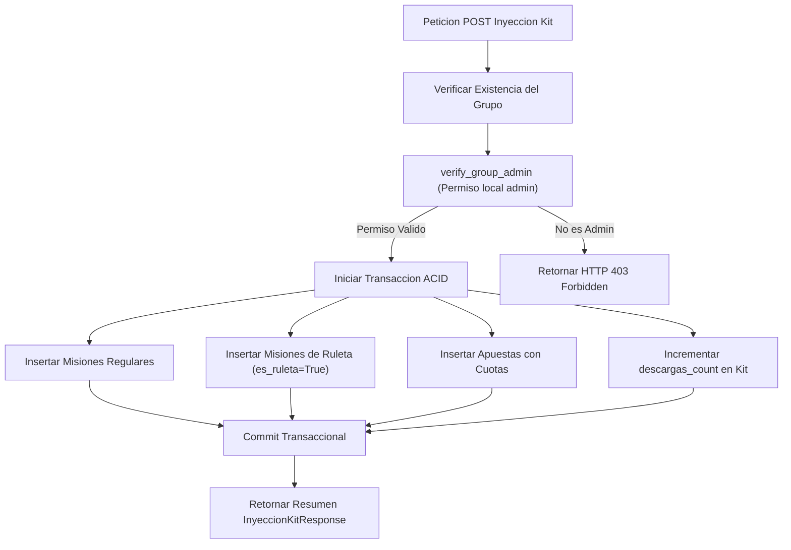

# 02.12 - Kits de Eventos Plantillas Reutilizables e Inyeccion Atomica

> Enlace de navegación: Volver al [[02.0 - Indice y Mapa de El Motor Backend]]

---

## Explicación Técnica: Persistencia JSONB, Soberanía Territorial e Inyección en Bloque

El subsistema de **Kits de Eventos** de **QuestFest** resuelve el problema de arranque en frío (*Cold Start Problem*) en comunidades recién creadas, permitiendo a los anfitriones inicializar sus grupos con lotes coherentes de misiones del tablón, misiones de ruleta diaria y mercados de apuestas con arquetipos temáticos.

### 1. Modelado Relacional y Estructura de Datos (`app/models/kits.py`)

El subsistema se compone de tres entidades relacionales:
- **`KitEvento` (`kits_eventos`)**: Representa la plantilla reusable.
  - `id`: Clave primaria entera.
  - `titulo`: Cadena descriptiva (`VARCHAR(150)`).
  - `descripcion`: Texto detallado del propósito de la plantilla (`TEXT`).
  - `categoria`: Clasificador temático indexado (`VARCHAR(50)`), como Fiesta, Viajes, Deporte o Chill.
  - `icono_url`: Enlace opcional a la imagen representativa (`VARCHAR(500)`).
  - `autor_id`: Clave foránea nullable hacia `usuarios.id` con política `ON DELETE SET NULL`, garantizando que si el autor elimina su cuenta personal el kit del catálogo comunitario no se destruya.
  - `es_oficial`: Booleano que distingue kits oficiales verificados por la plataforma de creaciones comunitarias.
  - `es_publico`: Booleano que habilita la visibilidad en el catálogo general o la reserva privada para el autor.
  - `descargas_count` y `likes_count`: Contadores acumulativos de adopción e impacto social.
  - `contenido`: Campo estructurado `JSONB` que contiene tres colecciones: `misiones`, `ruletas` y `apuestas`.
  - `fecha_creacion`: Marca temporal con zona horaria UTC.
- **`KitLike` (`kits_likes`)**: Registro de votación positiva único por usuario y kit, protegido por una restricción de unicidad compuesta `UniqueConstraint("kit_id", "usuario_id")` para conferir idempotencia estricta.
- **`KitReporte` (`kits_reportes`)**: Registro de auditoría y moderación para denuncias ciudadanas. Implementa una política anti-censura ciega: el kit permanece activo mientras el reporte queda catalogado para inspección del Tribunal.

### 2. Estructura JSONB del Campo `contenido`

El campo `contenido` serializa las definiciones de las entidades hijas:
```json
{
  "misiones": [
    {
      "titulo": "Foto grupal con 3 personas",
      "descripcion": "Evidencia fotográfica en el evento.",
      "dificultad": "facil",
      "recompensa_sugerida": 15,
      "cupo_maximo": null
    }
  ],
  "ruletas": [
    {
      "titulo": "Brindis con un desconocido",
      "descripcion": "Reto social aleatorio.",
      "dificultad": "media",
      "recompensa_sugerida": 25
    }
  ],
  "apuestas": [
    {
      "titulo": "¿Quien pedira la primera ronda?",
      "opciones": [
        { "id": "opt1", "text": "El anfitrion", "multiplier": 2.0 },
        { "id": "opt2", "text": "El conductor", "multiplier": 2.5 }
      ]
    }
  ]
}
```

### 3. Principio de Inmutabilidad de Inyecciones y Soberanía

Los kits actúan estrictamente como moldes o planos maestros:
1. Al inyectar un kit en un grupo, se crean registros independientes de `Mision` y `Apuesta` vinculados al `grupo_id` correspondiente.
2. Si el autor modifica o elimina posteriormente la plantilla en la tienda, las misiones y apuestas ya existentes en los grupos no sufren ninguna mutación, preservando la soberanía contable y operativa de cada comunidad.

### 4. Servicio Transaccional de Inyección Atómica (`inyectar_kit_en_grupo`)

El servicio ejecuta las siguientes validaciones y persistencias dentro de una única transacción ACID:
1. Comprueba la existencia del grupo destino.
2. Invoca el guardián de jurisdicción territorial `verify_group_admin(db, user, grupo_id)` para certificar que el usuario solicitante ostente el rol `admin` en dicha comunidad.
3. Inserta en bloque las misiones seleccionadas con `es_ruleta = False`.
4. Inserta en bloque las ruletas seleccionadas como entidades `Mision` con `es_ruleta = True`.
5. Inserta en bloque las apuestas transformando las opciones a un diccionario indexado por identificador único.
6. Si `publicar_inmediatamente` es verdadero, las misiones nacen en estado `activa` y las apuestas en estado `abierta`. Si es falso, nacen en estado `propuesta` para requerir activación manual progresiva.
7. Incrementa atómicamente el contador `descargas_count` del kit origen si se especificó su identificador.



---

## Analogía en el Mundo Real

Un Kit de Eventos equivale a un recetario maestro o a un juego de planos arquitectónicos prefabricados. El arquitecto dibuja el diseño una única vez y lo pone a disposición de constructores locales. Cuando un constructor decide utilizar el plano para erigir una vivienda en su parcela (inyectar el kit en su grupo), la casa pasa a ser una edificación física completamente independiente. El propietario puede pintar las paredes de otro color, cambiar los cerramientos o demoler una habitación sin que el plano original se altere, y cualquier cambio futuro que el arquitecto realice en su catálogo general jamás derribará ni modificará la casa ya construida en el terreno del cliente.

---

## Aplicación en QuestFest

- Erradicación del inicio vacío al fundar una peña o fiesta de amigos, posibilitando que el muro y el tablón comiencen poblados desde el segundo cero.
- Compatibilidad nativa con la economía de QuestCoins: las recompensas sugeridas en los kits están calibradas con respecto al fondo inicial estándar de 100 QuestCoins (15 QuestCoins para fácil, 25 para media y 50 para difícil).
- Soporte dual de entrada: inyección directa desde el catálogo general hacia un grupo administrado, o creación desde el formulario de alta del grupo.

---

## Conceptos Relacionados

- [[02.10 - Gestion de Grupos Membresias y Roles Granulares]]
- [[02.2 - Misiones y Retos]]
- [[02.3 - Juegos y Apuestas]]
- [[06.10 - JSONB y Consultas NoSQL en PostgreSQL]]
- [[06.11 - Transacciones ACID y Aislamiento en Bases de Datos]]

---

## Ficheros Físicos del Código Fuente

- Modelos relacionales de kits: [backend/app/models/kits.py](vscode://file/c:/.d/questfest-project/backend/app/models/kits.py:1)
- Esquemas Pydantic v2: [backend/app/schemas/kits_schemas.py](vscode://file/c:/.d/questfest-project/backend/app/schemas/kits_schemas.py:1)
- Lógica transaccional y CRUD: [backend/app/crud/kits_crud.py](vscode://file/c:/.d/questfest-project/backend/app/crud/kits_crud.py:1)
- Enrutador REST FastAPI: [backend/app/api/routers/kits.py](vscode://file/c:/.d/questfest-project/backend/app/api/routers/kits.py:1)
- Migración de base de datos Alembic: [backend/alembic/versions/f8a29b431c12_add_kits_de_eventos_tables.py](vscode://file/c:/.d/questfest-project/backend/alembic/versions/f8a29b431c12_add_kits_de_eventos_tables.py:1)
- Semilla de kits oficiales: [backend/app/scripts/seed_kits.py](vscode://file/c:/.d/questfest-project/backend/app/scripts/seed_kits.py:1)
- Suite de pruebas de integración: [backend/tests/test_kits.py](vscode://file/c:/.d/questfest-project/backend/tests/test_kits.py:1)
