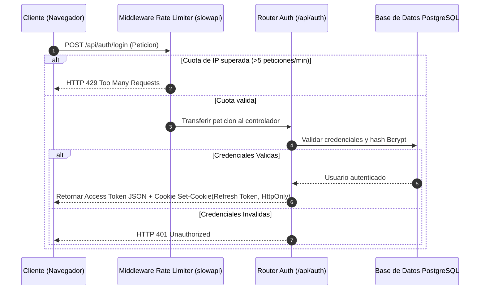

# 02.7 - Seguridad Avanzada Rate Limiting y Refresh Tokens

> Enlace de navegación: Volver al [[02.0 - Indice y Mapa de El Motor Backend]]

---

## Análisis Técnico: Módulo de Protección Anti-Abuso y Control de Sesiones

El módulo de seguridad avanzada de QuestFest implementa dos capas indispensables para la protección de la API REST contra ataques de fuerza bruta, denegación de servicio (DDoS) y secuestro de credenciales:

1. **Limitación de Tasa (Rate Limiting) con Extracción de IP Segura y Fallback Híbrido**:
   Configurado a través de `slowapi` en `app/core/rate_limiter.py`, intercepta las peticiones salientes discriminando individualmente por dirección IP de origen.
   - **Problema del Proxy Inverso**: Al operar detrás de NGINX, Docker o balanceadores de carga, la dirección física directa del socket (`request.client.host`) corresponde invariablemente a la IP de la red interna del contenedor proxy (e.g. `172.20.0.x`). Si el limitador utilizara la función genérica `get_remote_address`, todos los usuarios del mundo compartirían la misma cuota de peticiones, colapsando el servicio con bloqueos HTTP 429 masivos tras apenas 5 subidas o intentos de acceso.
   - **Resolución Anti-Spoofing en `get_real_client_ip`**: Se implementa un extractor seguro que:
     - Prioriza la cabecera `X-Real-IP`, la cual es sobrescrita de manera forzada por NGINX (`proxy_set_header X-Real-IP $remote_addr;`), garantizando que cualquier valor manipulado por un atacante sea neutralizado por el socket TCP real.
     - Analiza `X-Forwarded-For` de derecha a izquierda descartando rangos privados de red interna (RFC 1918) para recuperar la última IP pública real en arquitecturas multi-hop.
     - Aplica como último recurso la dirección del socket reportada por ASGI/Uvicorn (`request.client.host`).
   - **Almacenamiento**: Opera mediante memoria RAM local para entornos monocontenedor o se conecta a clústeres distribuidos Redis mediante la variable `REDIS_URL`.
   - **Límites Aplicados**:
     - Registro e Inicio de Sesión: Máximo 5 peticiones por minuto.
     - Tirada de Ruleta: Máximo 10 peticiones por minuto.
     - Carga de Archivos Multimedia: Máximo 5 peticiones por minuto.
     - Recuperación de Contraseña: Máximo 3 peticiones por minuto.

2. **Gestión de Sesiones Dobles (Access Token + Refresh Token)**:
   - **Access Token**: Token JWT de vida corta (24 horas) emitido en el cuerpo de la respuesta para autorizar peticiones mediante la cabecera `Authorization: Bearer <token>`.
   - **Refresh Token**: Token JWT de vida larga (7 días) inyectado de forma automatizada mediante la directiva `Set-Cookie` en una cookie de navegador marcada como `HttpOnly`, `Secure` y `SameSite=Lax`. Esta configuración previene el acceso al token mediante scripts JavaScript maliciosos (ataques XSS).

3. **Verificación de firmas MIME, Magic Bytes y Optimización de Cloudinary**:
   En el controlador `app/api/routers/upload.py`, la carga de archivos multimedia no se limita a verificar la extensión del nombre del archivo, sino que inspecciona los primeros bytes del archivo en memoria (*magic bytes*) para certificar la firma binaria real (JPEG, PNG, WebP o MP4) antes de transferir el contenido a la CDN de Cloudinary. Asimismo, restringe físicamente los tamaños máximos (10 MB para fotos y 50 MB para vídeos) y aplica compresión dinámica automatizada mediante las directivas `quality="auto"` y `fetch_format="auto"`, reduciendo el consumo de almacenamiento y ancho de banda en más de un 80% sin pérdida visual de calidad.

---

## Modelo Conceptual de Analogía: La Garita de Control y el Pasaporte Vip

Imagine un club privado donde se celebran torneos de gran concurrencia.

Para evitar que un intruso intente adivinar la combinación de la puerta probando llaves a toda velocidad (ataque de fuerza bruta), la garita de seguridad instala un torno giratorio (Rate Limiter) que se bloquea durante un minuto si alguien intenta girarlo más de 5 veces consecutivas.

Una vez que el usuario demuestra su identidad, el club le entrega una pulsera de acceso temporal para entrar a las salas de juego durante el día (Access Token). Simultáneamente, el personal de recepción guarda una tarjeta magnética codificada en un cofre de seguridad sellado que solo el chofer oficial del club puede manipular (Cookie HTTP-Only de Refresh Token). Cuando la pulsera diaria caduca, el usuario muestra su tarjeta magnética sellada para recibir una nueva pulsera sin necesidad de volver a presentar sus documentos de identidad iniciales.

---

## Aplicaciones y Middleware de Seguridad

El punto de entrada del servidor FastAPI (`app/main.py`) incorpora el middleware personalizado `SecurityHeadersMiddleware`, el cual inyecta en cada respuesta HTTP las cabeceras defensivas recomendadas por OWASP:

- `X-Frame-Options: DENY`: Impide que la interfaz de QuestFest sea embebida dentro de Marcos iFrame en sitios externos (protección contra Clickjacking).
- `X-Content-Type-Options: nosniff`: Fuerza al navegador a respetar estrictamente el tipo MIME retornado por la API.
- `Referrer-Policy: strict-origin-when-cross-origin`: Protege la privacidad de las URIs en peticiones salientes.

---

## Conceptos Teóricos Relacionados
- [[06.18 - Limitacion de Tasa de Peticiones y Algoritmo Leaky Bucket]]
- [[06.19 - Proteccion de Sesiones mediante Refresh Tokens en Cookies HTTP-Only]]
- [[06.5 - Autenticacion con Tokens JWT]]
- [[06.6 - Hashing de Contraseñas y Algoritmo Bcrypt]]

---

## Ficheros Físicos del Código Fuente
- Configuración de Límites y Extracción de IP Segura: [backend/app/core/rate_limiter.py](vscode://file/c:/.d/fiestas26-project/backend/app/core/rate_limiter.py:6) *(Función get_real_client_ip, slowapi y fallback Redis)*
- Motor de Criptografía de Tokens: [backend/app/security.py](vscode://file/c:/.d/fiestas26-project/backend/app/security.py:1) *(Generación de Refresh y Reset Tokens)*
- Rutas de Autenticación y Sesiones: [backend/app/api/routers/users.py](vscode://file/c:/.d/fiestas26-project/backend/app/api/routers/users.py:35) *(Controladores login, refresh, logout y reseteo)*
- Filtro de Carga Segura: [backend/app/api/routers/upload.py](vscode://file/c:/.d/fiestas26-project/backend/app/api/routers/upload.py:1) *(Validación de magic bytes y límites)*
- Cabeceras HTTP de Seguridad e Integración del Limitador: [backend/app/main.py](vscode://file/c:/.d/fiestas26-project/backend/app/main.py:15) *(Registro de app.state.limiter y SecurityHeadersMiddleware)*
