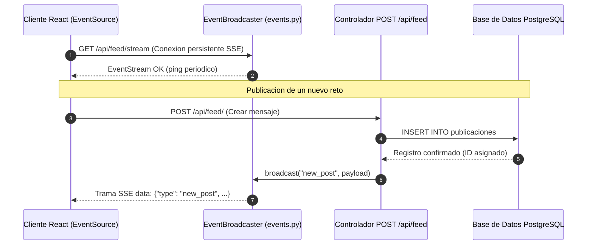

# 02.8 - Eventos Enviados por el Servidor SSE y Paginacion por Cursor

> Enlace de navegación: Volver al [[02.0 - Indice y Mapa de El Motor Backend]]

---

## Análisis Técnico: Módulo de Transmisión Real-Time y Optimización de Consultas SQL

El módulo de rendimiento de QuestFest reemplaza los esquemas tradicionales de consulta periódica (*short-polling*) por dos mecanismos de ingeniería de software de alto rendimiento:

1. **Transmisión Unidireccional en Tiempo Real mediante Server-Sent Events (SSE)**:
   Implementado en el endpoint `/api/feed/stream` de `app/api/routers/publicaciones.py`, utiliza la interfaz `StreamingResponse` de FastAPI y un publicador de eventos asíncrono basado en colas de memoria (`app/core/events.py`). Cuando un usuario publica un mensaje o el sistema genera una notificación automática, el servidor emite una trama `text/event-stream` inmediatamente a todos los clientes suscritos. Esto elimina las peticiones redundantes cada 15 segundos, reduciendo el tráfico HTTP del servidor en más de un 90%.

2. **Paginación Basada en Cursor (`cursor_id`)**:
   Implementado en `app/crud/publicaciones_crud.py` para la consulta del muro social. A diferencia de la paginación por desplazamiento (`OFFSET`), que obliga a la base de datos PostgreSQL a escanear e ignorar filas anteriores a medida que avanza la página (complejidad $O(N)$), la paginación por cursor filtra directamente por clave primaria (`WHERE id < cursor_id ORDER BY id DESC LIMIT 15`). Esto aprovecha el índice B-Tree primario alcanzando una complejidad temporal constante $O(1)$ sin importar la profundidad del historial.

3. **Sincronización Atómica de Saldo de QuestCoins**:
   El método `updateBalance(delta)` expuesto en `AuthContext.tsx` permite a cualquier componente del cliente (ruleta, duelos, apuestas) actualizar localmente el saldo de QuestCoins de la interfaz sin ejecutar una llamada completa al perfil del usuario.

---

## Modelo Conceptual de Analogía: La Megafonía de la Plaza y la Guía Telefónica

Imagine la plaza principal del festival donde se anuncian las novedades del evento.

En el esquema antiguo de polling, cada participante debía caminar hasta el puesto de información cada 15 segundos para preguntar si había alguna novedad. Esto creaba aglomeraciones masivas de gente caminando en vano y colapsaba la oficina. Con la megafonía SSE, los participantes descansan en la plaza y, solo cuando ocurre una novedad, el altavoz del recinto (Server-Sent Events) transmite la noticia al instante a todos los presentes.

Para consultar el registro histórico de retos pasados, en lugar de hojear un libro desde la página 1 contando 1.000 líneas para llegar a la página deseada (paginación por OFFSET), el participante utiliza un marcador de índice exacto con el número de página anterior (paginación por Cursor), abriendo el libro directamente en la sección solicitada sin perder tiempo.

---

## Arquitectura de Transmisión SSE

---

## Conceptos Teóricos Relacionados
- [[06.20 - Eventos Enviados por el Servidor SSE frente a WebSockets]]
- [[06.21 - Paginacion Eficiente por Cursor en Bases de Datos Relacionales]]
- [[06.13 - Gestion del Estado Global y Context API]]

---

## Ficheros Físicos del Código Fuente
- Administrador de Eventos: [backend/app/core/events.py](vscode://file/c:/.d/fiestas26-project/backend/app/core/events.py:1) *(EventBroadcaster asíncrono)*
- Controlador SSE y Feed: [backend/app/api/routers/publicaciones.py](vscode://file/c:/.d/fiestas26-project/backend/app/api/routers/publicaciones.py:65) *(Endpoint /stream y / con cursor_id)*
- Consulta SQL Paginada: [backend/app/crud/publicaciones_crud.py](vscode://file/c:/.d/fiestas26-project/backend/app/crud/publicaciones_crud.py:38) *(Filtro WHERE id < cursor_id)*
- Suscripción en Cliente: [frontend/src/app/page.tsx](vscode://file/c:/.d/fiestas26-project/frontend/src/app/page.tsx:106) *(EventSource y Scroll Infinito)*
- Sincronización de Saldo: [frontend/src/context/AuthContext.tsx](vscode://file/c:/.d/fiestas26-project/frontend/src/context/AuthContext.tsx:44) *(Método updateBalance)*
- React Error Boundary: [frontend/src/app/error.tsx](vscode://file/c:/.d/fiestas26-project/frontend/src/app/error.tsx:1) *(Captura de errores de renderizado)*
