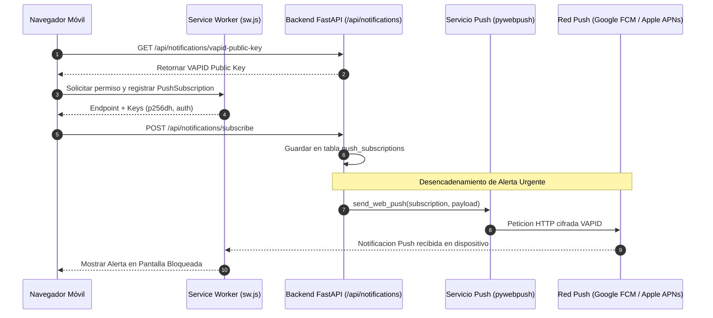

# 02.9 - Sistema de Notificaciones WebPush Nativas VAPID y Registro de Auditoria

> Enlace de navegación: Volver al [[02.0 - Indice y Mapa de El Motor Backend]]

---

## Análisis Técnico: Módulo de Alertas en Pantalla Bloqueada y Trazabilidad Administrativa

La plataforma QuestFest incorpora dos subsistemas esenciales para la operación y supervisión en tiempo real:

1. **Notificaciones Push Web Nativas (Protocolo VAPID)**:
   - **Módulo de Servicio**: Implementado en `app/services/push_service.py` mediante la librería `pywebpush`, genera notificaciones cifradas de extremo a extremo firmadas criptográficamente con una clave privada VAPID (`VAPID_PRIVATE_KEY`).
   - **Gestión de Suscripciones**: El modelo `PushSubscription` en `app/models/push.py` almacena de forma persistente los identificadores de endpoint de navegador (`endpoint`), clave pública del cliente (`p256dh`) y secreto de autenticación (`auth`).
   - **Recepción en Dispositivo**: El Service Worker (`sw.js`) escucha los eventos `push` transmitidos por los servidores de Google FCM / Apple APNs y despliega notificaciones en la barra de estado del sistema operativo incluso si el teléfono móvil está bloqueado o el navegador cerrado.

2. **Registro de Auditoría para Acciones de Moderación ("Modo Dios")**:
   - Implementado en `app/models/audit.py` y `app/crud/audit_crud.py`, el modelo `AuditLog` registra cada intervención administrativa ejecutada desde el panel `/admin`.
   - Campos de trazabilidad: Identificador del administrador (`admin_id`), nombre de la acción (`accion`), entidad afectada (`entidad`), clave primaria (`entidad_id`) y objeto semiestructurado JSONB (`detalles`) con los valores anteriores y posteriores a la modificación (por ejemplo, ajustes manuales en el saldo de QuestCoins).

---

## Modelo Conceptual de Analogía: El Carnet de Notificaciones y el Libro de Registro de la Garita

Imagine un complejo de eventos donde los participantes desean recibir avisos importantes aunque estén alejados del escenario principal.

Para el sistema de notificaciones WebPush, cada asistente entrega una tarjeta con su dirección postal única y un sello criptográfico (Suscripción VAPID). Cuando el organizador publica un comunicado urgente sobre un reto o una apuesta resuelta, el servicio de mensajería (Push Service) envía una carta sellada directamente al buzón del teléfono del participante. El teléfono hace sonar una alarma en la pantalla de bloqueo sin necesidad de que el asistente tenga la puerta de su habitación abierta.

Para el sistema de auditoría del "Modo Dios", cada vez que un juez o moderador entra a la sala de control para modificar el saldo de QuestCoins de un concursante o aprobar una prueba de misión, debe firmar un libro de registro inalterable (Audit Log). El libro anota la hora exacta, la identidad del juez, la cantidad de QuestCoins modificada y la justificación del ajuste, evitando que cualquier modificación arbitraria quede impune.

---

## Flujo de Registro y Envío WebPush

---

## Conceptos Teóricos Relacionados
- [[06.22 - Protocolo VAPID y Notificaciones Push Web Nativas]]
- [[06.23 - Registro de Auditoria y Trazabilidad en Sistemas Criticos]]
- [[06.17 - Progressive Web Apps y Service Workers]]

---

## Ficheros Físicos del Código Fuente
- Modelo de Suscripciones Push: [backend/app/models/push.py](vscode://file/c:/.d/fiestas26-project/backend/app/models/push.py:1) *(Esquema de datos push_subscriptions)*
- Modelo de Auditoría: [backend/app/models/audit.py](vscode://file/c:/.d/fiestas26-project/backend/app/models/audit.py:1) *(Esquema de datos audit_logs)*
- Servicio WebPush VAPID: [backend/app/services/push_service.py](vscode://file/c:/.d/fiestas26-project/backend/app/services/push_service.py:1) *(Integración con pywebpush)*
- Endpoints VAPID: [backend/app/api/routers/notifications.py](vscode://file/c:/.d/fiestas26-project/backend/app/api/routers/notifications.py:27) *(Controladores subscribe, unsubscribe y public-key)*
- Trazabilidad de Auditoría CRUD: [backend/app/crud/audit_crud.py](vscode://file/c:/.d/fiestas26-project/backend/app/crud/audit_crud.py:1) *(Función log_admin_action)*
- Registro en Panel Admin: [backend/app/api/routers/admin.py](vscode://file/c:/.d/fiestas26-project/backend/app/api/routers/admin.py:136) *(Invocación de auditoría en actualización de saldos)*
- Migración de Suscripciones Push: [backend/alembic/versions/d192a34b5c89_create_push_subscriptions_table.py](vscode://file/c:/.d/fiestas26-project/backend/alembic/versions/d192a34b5c89_create_push_subscriptions_table.py:1) *(Creación de tabla push_subscriptions y restricción uq_usuario_notificacion_leida)*
