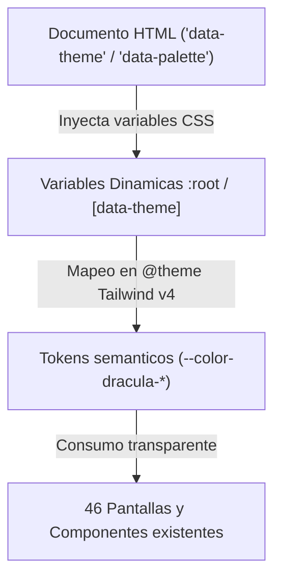

# 03.4 - Componentes Reutilizables y Estilos

> Enlace de navegación: Volver al [[03.0 - Indice y Mapa de La Interfaz Frontend]]

---

## Análisis Técnico: Sistema de Diseño Visual, Temas y Utilidades

La interfaz de QuestFest está desarrollada mediante componentes reutilizables con clases de utilidades de **Tailwind CSS v4** sobre una arquitectura dinámica de temas (Modo Oscuro, Modo Claro y Modo Sistema) y un **Modelo Híbrido de Paletas Cromáticas**.

### 1. Variables Dinámicas y Tokens de Diseño (`globals.css`)
En `src/app/globals.css`, el bloque `@theme` desacopla los tokens de diseño Dracula de valores hexadecimales fijos, vinculándolos a variables CSS dinámicas dependientes de los atributos de documento `data-theme` y `data-palette`:
- Tokens estructurales:
  - `--color-dracula-base`: `var(--theme-base)` (superficie de fondo secundario, cabeceras y barras fijas).
  - `--color-dracula-card`: `var(--theme-card)` (superficie de tarjetas y módulos interactivos).
  - `--color-dracula-light`: `var(--theme-text)` (color de texto principal).
  - `--color-dracula-gray`: `var(--theme-subtext)` (color de texto secundario y etiquetas auxiliares).
  - `--color-theme-app-bg`: `var(--theme-app-bg)` (fondo base de la aplicación, parametrizado por paleta y modo de luz).
  - `--theme-header-shadow`: Elevación semántica adaptativa para cabeceras fijas de App Shell (`0 4px 20px rgba(0, 0, 0, 0.45)` en modo oscuro; `0 1px 3px rgba(0, 0, 0, 0.05), 0 4px 12px rgba(0, 0, 0, 0.02)` en modo claro), aplicada uniformemente mediante la clase utilitaria `.app-shell-header` para eliminar manchas oscuras pesadas en modo claro.
- Tokens de acento dinámicos por panel:
  - `--color-dracula-purple`: `var(--theme-feed-accent)` (panel social y feed).
  - `--color-dracula-yellow`: `var(--theme-apuestas-accent)` (panel de apuestas y saldos de QuestCoins).
  - `--color-dracula-green`: `var(--theme-misiones-accent)` (panel de misiones y recompensas).
  - `--color-dracula-red`: `var(--theme-duelos-accent)` (panel de duelos y alertas críticas).
  - `--color-dracula-cyan`: `var(--theme-tribunal-accent)` (panel del tribunal y métricas estadísticas).

### 2. Prevención de Parpadeo Inicial (Script Anti-FOUC)
En `src/app/layout.tsx`, se incorpora en la cabecera `<head>` un script síncrono bloqueante que evalúa el almacenamiento local (`localStorage`) y la consulta de medios `window.matchMedia('(prefers-color-scheme: dark)')` antes del ciclo de hidratación y renderizado de React. Esto garantiza que el atributo `data-theme` se encuentre establecido antes de que el motor gráfico pinte la interfaz, suprimiendo cualquier parpadeo de contraste o salto visual blanco/negro.

### 3. Modelo Híbrido de Paletas Cromáticas
El sistema organiza la personalización cromática en dos familias complementarias con contraste validado bajo el estándar WCAG AA:

1. **Colección Dinámica (Multisección / Identidad por Panel y Atmósferas de Fondo)**:
   - **`default` (QuestFest Clásico)**: Mantiene la identidad original inspirada en el tema Dracula con violeta, oro, menta, rojo coral y cian, preservando el fondo negro absoluto (`#000000`) en modo oscuro y pizarra suave (`#f8fafc`) en modo claro.
   - **`cyberpunk` (Neón Futurista)**: Acabado sintético de alta saturación con fucsia neón, amarillo eléctrico, verde tóxico y carmesí láser. Asigna una atmósfera de fondo ultramar violeta profundo (`#080718` en oscuro; `#faf5ff` lavanda de alta tecnología en claro) con superficies coordinadas (`#110f29` / `#19163b`).
   - **`sunset` (Atardecer Cálido)**: Transición crepuscular con índigo, ámbar solar, salvia y naranja fuego. Implementa un fondo ciruela crepúsculo cálido (`#0f0c1b` en oscuro; `#fffbeb` marfil dorado cálido en claro) con superficies afines (`#1a152e` / `#251e3d`).
   - **`pastel` (Retro Arcade / Cozy)**: Tonalidades dulces de baja fatiga ocular con lavanda, vainilla, menta suave y fresa. Configura un fondo carbón suave aterciopelado (`#121118` en oscuro; `#fdfbf7` papel nórdico marfil cálido en claro) con superficies matizadas (`#1a1923` / `#232030`).

2. **Colección Monocromática (Minimal Accent)**:
   - Unifica todas las variables de acento (`--theme-feed-accent`, `--theme-apuestas-accent`, `--theme-misiones-accent`, `--theme-duelos-accent`, `--theme-tribunal-accent`) en un tono homogéneo para usuarios que prefieren sobriedad visual.
   - Variantes disponibles: `mono-amethyst` (Amatista Imperial), `mono-sapphire` (Zafiro Glaciar), `mono-emerald` (Esmeralda Puro), `mono-gold` (Oro Real) y `mono-crimson` (Carmesí Pasión).

### 4. Contexto Global y Selector Visual (`ThemeContext` y `ThemeSettingsCard`)
- **`ThemeContext.tsx`**: Administra el estado global de `mode` (`'dark' | 'light' | 'system'`), `palette` y `resolvedTheme`. Escucha eventos reactivos de cambio en las preferencias del sistema operativo y sincroniza en tiempo real la etiqueta `<meta name="theme-color">` leyendo dinámicamente el valor computado de `--theme-app-bg`, garantizando que la barra de estado de Safari en iOS y Chrome en Android se mimetice con la paleta activa.
- **`ThemeSettingsCard.tsx`**: Proporciona una tarjeta de control táctil accesible centralmente desde el Hub de Bienvenida (`/groups?tab=ajustes`), con redirección canónica transparente desde rutas históricas (`/settings`). Presenta una interfaz compacta y limpia con un selector segmentado de iluminación y una matriz de temas dinámicos sin subtítulos descriptivos redundantes, priorizando la legibilidad y la muestra cromática directa de los paneles.

### 5. Formateadores de Datos (`src/lib/formatters.ts`)
Proporciona utilidades para la transformación de datos:
- `formatSpanishDate`: Convierte marcas de tiempo ISO a formatos de fecha legibles en español.
- `formatCurrency`: Aplica la presentación visual estandarizada para los saldos de QuestCoins.

### 6. Componentes Auxiliares y Microinteracciones Táctiles
- **Microinteracción de Pulsación Táctil (`.btn-press`)**:
  Clase utilitaria CSS configurada con `transform: scale(0.96); opacity: 0.92;` y transición con curva Bezier cúbica `cubic-bezier(0.4, 0, 0.2, 1)`. Proporciona respuesta háptica visual inmediata al pulsar botones, tarjetas, pestañas y elementos accionables sin parpadeos de selección.
- **Barra de Navegación Flotante Liquid Glass Adaptativa (`BottomNav.tsx`)**:
  Diseño estético de píldora flotante suspendida a ras del margen inferior (estilo Liquid Glass de iOS 26/27). Emplea la clase utilitaria `.bottom-nav-glass`, la cual transiciona entre un vidrio ahumado translúcido (`rgba(40, 42, 54, 0.70)`) en modo oscuro y un cristal esmerilado blanco nieve (`rgba(255, 255, 255, 0.82)`) en modo claro. Permanece rigurosamente oculta fuera de los grupos activos (incluyendo `/groups`, `/login`, `/register`, `/join`, `/offline`, `/settings` y `/perfil`). Cada pestaña activa adopta el color semántico de su panel (o el acento unificado de la paleta monocromática) junto con una cápsula luminosa de realce y microescalado elástico `active:scale-90`.
- **`PullToRefresh.tsx` Adaptado al App Shell**:
  Componente gestor del refresco por deslizamiento táctil hacia abajo. Emplea la variable `bg-[var(--theme-app-bg)]` para evitar discordancias cromáticas en modo claro y evalúa el desplazamiento relativo `scrollTop <= 0` del elemento interno en lugar del valor global `window.scrollY`.
- **Selector de Archivos Multimedia y Subida a Cloudinary**:
  Tanto en las publicaciones del muro como en la pestaña de identidad global del Welcome Hub (`/groups?tab=perfil`), se emplean selectores nativos `<input type="file" accept="image/*">` vinculados a botones de cámara táctiles. Las imágenes se procesan mediante `FormData` y se transmiten al almacenamiento en la nube de Cloudinary (`/api/auth/me/avatar`), actualizando de forma reactiva el perfil global de la cuenta sin requerir navegación externa ni recargas de página.
- **`DailySummaryModal.tsx`**: Despliega la ventana emergente con las métricas analíticas del boletín del evento.

---

## Modelo Conceptual de Analogía: Iluminación y Escenografía del Recinto

Para comprender el sistema de diseño visual, puede analizarse mediante la analogía de la ambientación física del recinto del festival:

1. **El Conmutador de Iluminación Ambiental (Modos Oscuro, Claro y Sistema)**:
   Equivale a la iluminación de la sala principal del festival. Durante la noche, los focos principales se atenúan para proyectar una atmósfera inmersiva sin deslumbrar a los asistentes (Modo Oscuro). Durante eventos diurnos al aire libre, se abren las cortinas para permitir el ingreso de luz natural limpia con alto contraste de señalética (Modo Claro). El modo automático sincroniza la iluminación con la luz solar exterior.

2. **La Tematización Escenográfica de las Salas (Modelo Híbrido de Paletas)**:
   Actúa como la dirección artística del recinto. En el modo multisección, cada área temática cuenta con su propio color neón de señalización (el escenario musical en violeta, la zona de juegos en oro, el módulo de misiones en verde y la arena de combate en rojo). En el modo monocromático, toda la fiesta se viste bajo una temática unificada de etiqueta (por ejemplo, una noche de gala en oro real o una noche gótica en amatista).

3. **El Panel de Control de Vidrio Líquido (Liquid Glass Tab Bar)**:
   Funciona como una cápsula transparente pulida que levita sobre el suelo del recinto, reflejando el color del suelo en el que se encuentra y encendiéndose con el tono exacto de la sala en la que el usuario se sitúa.

---

## Decisiones de Arquitectura de Software

- **Compatibilidad Hacia Atrás Absoluta (Zero-Breaking)**: Se preservó la totalidad de los nombres de clase semánticos Dracula preexistentes en las 46 pantallas del proyecto, canalizándolos hacia variables CSS dinámicas mediante Tailwind v4 `@theme`.
- **Prevención de Parpadeo en el Hilo Principal (Anti-FOUC)**: La lectura síncrona en el elemento `<head>` antes de la ejecución de React suprime transiciones visuales indeseadas sin necesidad de añadir librerías externas pesadas.
- **Respeto a las Directrices de Contraste WCAG AA**: Cada color de acento cuenta con un valor específico para fondos oscuros (luminosidad alta) y para fondos claros (luminosidad y saturación calibradas para superar el ratio 4.5:1).
- **Microescalado Táctil Homogéneo**: Estandarizar la clase `.btn-press` en todos los componentes interactivos proporciona retroalimentación kinestésica uniforme.

---

## Conceptos Teóricos Relacionados
- [[06.12 - Renderizado en Servidor vs Cliente en Next.js]]
- [[06.13 - Gestion del Estado Global y Context API]]

---

## Ficheros Físicos del Código Fuente
- Estilos CSS Globales y Tokens de Tema: [frontend/src/app/globals.css](vscode://file/c:/.d/questfest-project/frontend/src/app/globals.css:1)
- Contexto de Tema y Persistencia: [frontend/src/context/ThemeContext.tsx](vscode://file/c:/.d/questfest-project/frontend/src/context/ThemeContext.tsx:1)
- Tarjeta Selectora de Tema y Paleta: [frontend/src/components/ThemeSettingsCard.tsx](vscode://file/c:/.d/questfest-project/frontend/src/components/ThemeSettingsCard.tsx:1)
- Barra Flotante Liquid Glass Adaptativa: [frontend/src/components/BottomNav.tsx](vscode://file/c:/.d/questfest-project/frontend/src/components/BottomNav.tsx:1)
- Formateadores de Datos: [frontend/src/lib/formatters.ts](vscode://file/c:/.d/questfest-project/frontend/src/lib/formatters.ts:1)
- Componente de Refresco Táctil: [frontend/src/components/PullToRefresh.tsx](vscode://file/c:/.d/questfest-project/frontend/src/components/PullToRefresh.tsx:1)
- Modal de Creación de Grupo con Galería: [frontend/src/components/groups/CreateGroupModal.tsx](vscode://file/c:/.d/questfest-project/frontend/src/components/groups/CreateGroupModal.tsx:1)
- Modal de Resumen Diario y Estadísticas: [frontend/src/components/DailySummaryModal.tsx](vscode://file/c:/.d/questfest-project/frontend/src/components/DailySummaryModal.tsx:1)
