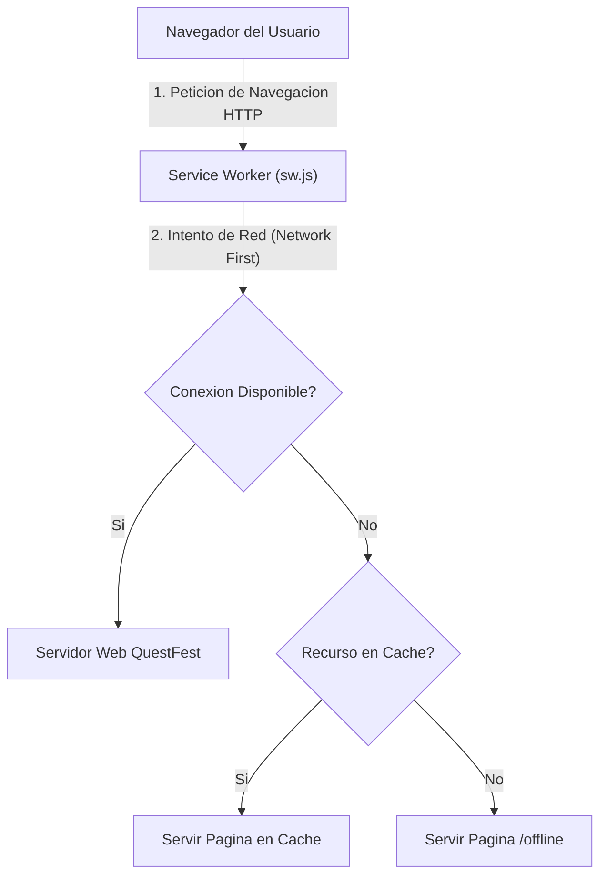

# 03.5 - Arquitectura PWA Service Worker y Modo Offline

> Enlace de navegación: Volver al [[03.0 - Indice y Mapa de La Interfaz Frontend]]

---

## Análisis Técnico: Módulo de PWA y Resiliencia Offline

La plataforma QuestFest implementa la especificación de Progressive Web Apps (PWA) para garantizar que la aplicación pueda ser instalada como un programa nativo en dispositivos móviles (Android y iOS) y continuar operativa en entornos con conectividad a red inestable o inexistente.

El componente central es el Service Worker (`sw.js`), un script independiente que se ejecuta en un hilo de navegador desacoplado de la interfaz de usuario. El Service Worker intercepta todas las peticiones HTTP emitidas por el cliente y aplica dos estrategias de almacenamiento en caché diferencial:

1. **Estrategia Stale-While-Revalidate**: Aplicada a los recursos estáticos estables (bundles JavaScript compilados de Next.js, hojas de estilo CSS, fuentes e iconos PWA). El Service Worker devuelve inmediatamente la copia almacenada en la memoria caché local mientras realiza una petición en segundo plano para actualizar el recurso en el almacenamiento si ha cambiado.
2. **Estrategia Network-First con Fallback Offline**: Aplicada a las peticiones de navegación de documentos HTML (`request.mode === 'navigate'`). El sistema intenta obtener la versión en tiempo real desde el servidor web. En caso de fallo de red por pérdida de cobertura, el Service Worker intercepta la excepción y sirve la vista de contingencia almacenada en la ruta `/offline`.

La instalabilidad está gestionada por el componente `PWAInstallPrompt`, que intercepta el evento nativo `beforeinstallprompt` en navegadores Chromium y presenta una interfaz ajustada para dispositivos iOS con las instrucciones de incorporación a la pantalla de inicio.

---

## Modelo Conceptual de Analogía: El Archivero de Emergencia de un Local de Eventos

Imagine la organización de un gran festival donde existe un centro de información principal. Para evitar que la falta de cobertura en ciertas zonas del recinto paralice la actividad de los asistentes, se contrata a un archivero personal (Service Worker) que acompaña a cada participante.

Cuando el asistente consulta un mapa o las reglas del evento (recursos estáticos), el archivero le entrega inmediatamente una copia en papel que lleva en su carpeta de mano mientras envía un mensajero a la oficina central para comprobar si hay correcciones. Si el participante intenta solicitar una acreditación nueva en tiempo real (petición de red) y no hay línea telefónica, el archivero saca una planilla impresa de emergencia (pantalla offline) para que la actividad no se detenga.

---

## Decisiones de Arquitectura de Software

En el proyecto QuestFest, la especificación PWA se ha estructurado en tres niveles de integración:

1. **Manifiesto de Aplicación Web**: Definido en `manifest.json`, establece el punto de inicio prioritario (`start_url: "/groups"` apuntando al Hub de Bienvenida), modo de presentación standalone, orientación vertical, color de tema negro (`#000000`) e iconos adaptables oficiales procesados en alta resolución (`icon-192.png`, `icon-512.png`, `apple-touch-icon.png` y `maskable-icon.png`).
2. **Registro Desacoplado y Gestión de Versiones**: Controlado por el componente de cliente `SWRegister.tsx` montado en `RootLayout`. Además de no bloquear la hidratación de Next.js, escucha el evento `onupdatefound` para mostrar una alerta interactiva mediante `react-hot-toast` que permite al usuario actualizar al instante cuando se despliega un nuevo Service Worker.
3. **Mapeo de Rutas de Respaldo y Caching Opaque**: 
   - Creación de la página dedicada `src/app/offline/page.tsx`, diseñada con los tokens visuales de la interfaz Dracula.
   - Soporte en `sw.js` para respuestas de estado `200` y de tipo `opaque` (`status === 0`), permitiendo almacenar en caché las imágenes multimedia alojadas en el CDN externo de Cloudinary.
   - Estrategia Network-First con fallback a Cache Storage para peticiones GET a la API (`/api/*`).
4. **Arquitectura de App Shell Rigido y Experiencia Nativa (iOS WebKit y Android)**:
   - **Estructuracion Inamovible del App Shell**: En `globals.css` y `layout.tsx`, los elementos `html` y `body` quedan configurados bajo `position: fixed; inset: 0; width: 100%; height: 100dvh; max-height: 100dvh; overflow: hidden; overscroll-behavior: none;`. Esta arquitectura bloquea de raiz el rebote elastico (*rubber-band bounce*) propio de los navegadores web móviles, impidiendo que la interfaz revele margenes negros fuera del lienzo visible.
   - **Supresion de Comportamientos Web**:
     - Desactivacion del resaltado gris de pulsacion mediante `-webkit-tap-highlight-color: transparent`.
     - Supresion del menu contextual emergente al mantener pulsado mediante `-webkit-touch-callout: none`.
     - Eliminacion del retardo de 300ms de doble pulsacion mediante `touch-action: manipulation`.
     - Inhabilitacion de seleccion accidental de texto en cabeceras y botones mediante `user-select: none` y `-webkit-user-select: none`, manteniendo una regla de excepcion obligatoria para campos editables (`input`, `textarea`, `[contenteditable="true"]`) y bloques informativos con la clase `.selectable-text`.
   - **Pila Tipografica del Sistema Operativo**: Se adopta la fuente del sistema Apple (`-apple-system, BlinkMacSystemFont, "SF Pro Text", "SF Pro Display", system-ui, sans-serif`) para conseguir una fidelidad visual indistinguible de una aplicacion nativa de la App Store.
   - **Canalizacion Aislada del Scroll Interno (`.app-shell-scroll`)**:
     - Las pantallas se estructuran en dos contenedores: una cabecera fija indeformable (`header.flex-shrink-0`) y un area de scroll interior aislada (`main.app-shell-scroll`).
     - La clase `.app-shell-scroll` aplica `flex: 1 1 0%; overflow-y: auto; overflow-x: hidden; overscroll-behavior-y: contain; -webkit-overflow-scrolling: touch;`. Al confinar el scroll dentro del contenedor interno, la cabecera permanece perfectamente anclada sin vibraciones ni colisiones con la barra de estado o el notch de iOS.
   - **Gestion Rigurosa de Areas Seguras (Safe Area Insets)**:
     - Cabecera: Utiliza `pt-safe-top` calculando `max(1rem, calc(env(safe-area-inset-top) + 0.75rem))`, extendiendo el fondo translucido detras de la barra de estado y el notch sin solaparse con el reloj o bateria.
     - Navegacion inferior: La barra flotante y los botones de accion flotante (FAB) calculan su separacion mediante `env(safe-area-inset-bottom)` para evitar interferencias con la barra de gestos del sistema operativo.
   - **Prevencion Definitiva del Zoom Automatico en Formularios**: Regla global CSS que impone `font-size: 16px !important` en dispositivos moviles (`max-width: 768px`) para todos los elementos `input`, `textarea` y `select` (exceptuando controles checkbox/radio), impidiendo que el motor WebKit de Safari aplique zoom al enfocar un campo.
   - **Bypass de Proxy para Recursos Estaticos PWA en `proxy.ts`**:
     - Cuando Safari en iOS solicita los iconos de pantalla de inicio (`/apple-touch-icon.png`, `/apple-touch-icon-precomposed.png`) o el manifiesto web (`/manifest.json`), lo realiza mediante peticiones no autenticadas en segundo plano.
     - El middleware/proxy de Next.js (`frontend/src/proxy.ts`) incluye una exclusion explicita para permitir el acceso directo (HTTP 200 OK) a `/icons/*`, `/apple-touch-icon*`, `/manifest.json` y `/sw.js`, evitando redirecciones 307 al formulario de login que provocaban la aparicion de un icono generico con una letra Q.
5. **Arquitectura del Subsistema de Notificaciones Push Web**:
   - Módulo cliente `frontend/src/lib/pushNotifications.ts` diseñado para auditar el soporte del navegador (`PushManager`), la existencia de un contexto seguro (`window.isSecureContext`), la plataforma del cliente (detección de iOS) y el modo de despliegue (`standalone`).
   - Proceso de suscripción VAPID (`registration.pushManager.subscribe`) transformando la clave pública en formato binario `Uint8Array` y enviando la suscripción al endpoint `/api/notifications/subscribe`.
   - Gestión de restricciones de seguridad de Apple: en iOS (WebKit 16.4+), las notificaciones Push Web exigen indefectiblemente el funcionamiento bajo HTTPS (o localhost) y la ejecución de la aplicación instalada en modo pantalla de inicio (*Standalone PWA*).

---

## Conceptos Teóricos Relacionados
- [[06.17 - Progressive Web Apps y Service Workers]]
- [[06.12 - Renderizado en Servidor vs Cliente en Next.js]]
- [[06.14 - Middleware y Proteccion de Rutas HTTP]]

---

## Ficheros Físicos del Código Fuente
- Manifiesto PWA: [frontend/public/manifest.json](vscode://file/c:/.d/fiestas26-project/frontend/public/manifest.json:1) *(Configuración de instalabilidad y metadatos)*
- Service Worker Principal: [frontend/public/sw.js](vscode://file/c:/.d/fiestas26-project/frontend/public/sw.js:1) *(Estrategias de caching y fallback offline)*
- Registro de Service Worker: [frontend/src/components/SWRegister.tsx](vscode://file/c:/.d/fiestas26-project/frontend/src/components/SWRegister.tsx:1) *(Registro asíncrono en cliente)*
- Pantalla de Contingencia Offline: [frontend/src/app/offline/page.tsx](vscode://file/c:/.d/fiestas26-project/frontend/src/app/offline/page.tsx:1) *(Interfaz para pérdida de red)*
- Componente Prompt Instalación: [frontend/src/components/PWAInstallPrompt.tsx](vscode://file/c:/.d/fiestas26-project/frontend/src/components/PWAInstallPrompt.tsx:1) *(Captura de evento de instalación)*
- Maquetación Raíz y Metadatos Viewport: [frontend/src/app/layout.tsx](vscode://file/c:/.d/fiestas26-project/frontend/src/app/layout.tsx:1) *(Integración global de metadatos, viewport, contenedor Toaster con safe area superior y safe area)*
- Estilos Globales y Reglas Anti-Zoom iOS: [frontend/src/app/globals.css](vscode://file/c:/.d/fiestas26-project/frontend/src/app/globals.css:1) *(Control de recorte con overflow-x: clip, utilidades pt-safe-top y tipografía móvil)*
- Barra Flotante Liquid Glass de Navegación: [frontend/src/components/BottomNav.tsx](vscode://file/c:/.d/fiestas26-project/frontend/src/components/BottomNav.tsx:1) *(Píldora flotante translúcida posada sobre el margen inferior bottom-3)*
- Welcome Hub de Grupos: [frontend/src/app/groups/page.tsx](vscode://file/c:/.d/fiestas26-project/frontend/src/app/groups/page.tsx:1) *(Cabecera fija Capa 2 y contenido Capa 1 deslizable)*
- Utilidad de Notificaciones Push Web: [frontend/src/lib/pushNotifications.ts](vscode://file/c:/.d/fiestas26-project/frontend/src/lib/pushNotifications.ts:1) *(Suscripción VAPID y comprobaciones de contexto seguro)*
- Iconos de Inicio para Safari: [frontend/public/apple-touch-icon.png](vscode://file/c:/.d/fiestas26-project/frontend/public/apple-touch-icon.png:1) *(Icono de alta resolución para pantalla de inicio iOS)*
