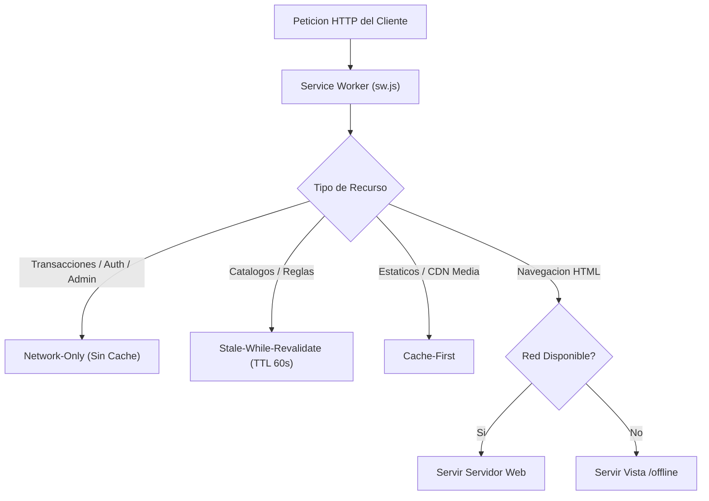

# 03.5 - Arquitectura PWA Service Worker y Modo Offline

> Enlace de navegación: Volver al [[03.0 - Indice y Mapa de La Interfaz Frontend]]

---

## Análisis Técnico: Módulo de PWA y Resiliencia Offline

La plataforma QuestFest implementa la especificación de Progressive Web Apps (PWA) para garantizar que la aplicación pueda ser instalada como un programa nativo en dispositivos móviles (Android y iOS) y continuar operativa en entornos con conectividad a red inestable o inexistente.

El componente central es el Service Worker (`public/sw.js`), un script independiente que se ejecuta en un hilo de navegador desacoplado de la interfaz de usuario. El Service Worker intercepta las peticiones HTTP emitidas por el cliente y aplica una política de almacenamiento en caché segregada según la criticidad y naturaleza de cada recurso:

1. **Estrategia Network-Only para Transacciones y Control**:
   - Aplicada estrictamente a todos los endpoints financieros, contables, administrativos y mutaciones: `/api/auth/*`, `/api/admin/*`, `/api/auth/me/transactions` y cualquier petición `POST`, `PUT`, `DELETE` o `PATCH`.
   - Estas rutas jamás se persisten en el Cache Storage del navegador. Esta segregación garantiza que los saldos de QuestCoins, los asientos inmutables del Ledger y las decisiones del Tribunal se resuelvan siempre contra la fuente única de verdad en la base de datos PostgreSQL, impidiendo discrepancias contables.
2. **Estrategia Stale-While-Revalidate con TTL Corto**:
   - Aplicada a catálogos públicos y reglas comunitarias que admiten tolerancia eventual a la latencia: `/api/settings/rules`, `/api/ranking/`.
   - El Service Worker devuelve la copia en caché de forma inmediata mientras lanza una petición en segundo plano para actualizar el registro local si el contenido ha sido modificado en el servidor.
3. **Estrategia Cache-First para Recursos Estáticos**:
   - Aplicada a bundles JavaScript compilados (`/_next/static/*`), hojas de estilo CSS, fuentes del sistema operativo, iconos PWA y recursos multimedia distribuidos por el CDN de Cloudinary.
4. **Estrategia Network-First con Fallback Offline para Navegación**:
   - Aplicada a las peticiones de navegación de documentos HTML (`request.mode === 'navigate'`). El sistema intenta obtener la versión en tiempo real desde el servidor web. En caso de corte de red, el Service Worker intercepta la excepción y sirve la vista de contingencia almacenada en la ruta `/offline`.
5. **Manejador de Purga Total (`CLEAR_APP_CACHE`)**:
   - Escuchador de eventos `message` en el Service Worker que procesa la instrucción `{ type: 'CLEAR_APP_CACHE' }`. Al cerrarse la sesión del usuario (`logout`), tanto el gestor de estado Zustand (`useAuthStore`) como el contexto de autenticación invocan esta purga y ejecutan `caches.delete('questfest-cache-v1')`, evitando la persistencia de datos privados o contables en terminales compartidos.

La instalabilidad está gestionada por el componente `PWAInstallPrompt`, que intercepta el evento nativo `beforeinstallprompt` en navegadores Chromium y presenta una interfaz ajustada para dispositivos iOS con las instrucciones de incorporación a la pantalla de inicio.

---

## Modelo Conceptual de Analogía: El Archivero de Emergencia y la Caja Fuerte

Para comprender el funcionamiento del Service Worker con políticas segregadas, se puede emplear la analogía del personal de apoyo en un gran festival:

Existen dos tipos de documentos en el recinto. Por un lado están los programas impresos, carteles y reglamentos generales (recursos estáticos y catálogos). El archivero de campo lleva copias en su carpeta de mano; cuando un asistente pregunta por las reglas de un juego, se las muestra al instante mientras manda a un mensajero a verificar si hay una versión más reciente (Stale-While-Revalidate).

Por otro lado está la caja fuerte del tesorero y el libro contable de pagos (Ledger y transacciones). El archivero tiene prohibido terminantemente anotar saldos en servilletas o guardar dinero de memoria (Network-Only). Cada movimiento de monedas exige consultar directamente al banquero central. Y cuando un tesorero entrega su turno, se limpian todos los escritorios y se destruyen las notas temporales (Purga Total de Caché) para que el siguiente encargado no encuentre anotaciones previas.

---

## Decisiones de Arquitectura de Software

En el proyecto QuestFest, la especificación PWA se ha estructurado en los siguientes niveles de integración:

1. **Manifiesto de Aplicación Web**: Definido en `manifest.json`, establece el punto de inicio prioritario (`start_url: "/groups"` apuntando al Hub de Bienvenida), modo de presentación standalone, orientación vertical, color de tema negro (`#000000`) e iconos adaptables oficiales procesados en alta resolución (`icon-192.png`, `icon-512.png`, `apple-touch-icon.png` y `maskable-icon.png`).
2. **Registro Desacoplado y Gestión de Versiones**: Controlado por el componente de cliente `SWRegister.tsx` montado en `RootLayout`. Además de no bloquear la hidratación de Next.js, escucha el evento `onupdatefound` para mostrar una alerta interactiva mediante `react-hot-toast` que permite al usuario actualizar al instante cuando se despliega un nuevo Service Worker.
3. **Mapeo de Rutas de Respaldo y Caching Opaque**:
   - Creación de la página dedicada `src/app/offline/page.tsx`, diseñada con los tokens visuales de la interfaz Dracula.
   - Soporte en `sw.js` para respuestas de estado `200` y de tipo `opaque` (`status === 0`), permitiendo almacenar en caché las imágenes multimedia alojadas en el CDN externo de Cloudinary.
   - Exclusión explícita de endpoints mutables y contables del almacenamiento en caché.
4. **Arquitectura de App Shell Rígido y Experiencia Nativa (iOS WebKit y Android)**:
   - **Estructuración Inamovible del App Shell**: En `globals.css` y `layout.tsx`, los elementos `html` y `body` quedan configurados bajo `position: fixed; inset: 0; width: 100%; height: 100dvh; max-height: 100dvh; overflow: hidden; overscroll-behavior: none;`. Esta arquitectura bloquea de raíz el rebote elástico (*rubber-band bounce*) propio de los navegadores web móviles, impidiendo que la interfaz revele márgenes negros fuera del lienzo visible.
   - **Supresión de Comportamientos Web**:
     - Desactivación del resaltado gris de pulsación mediante `-webkit-tap-highlight-color: transparent`.
     - Supresión del menú contextual emergente al mantener pulsado mediante `-webkit-touch-callout: none`.
     - Eliminación del retardo de 300ms de doble pulsación mediante `touch-action: manipulation`.
     - Inhabilitación de selección accidental de texto en cabeceras y botones mediante `user-select: none` y `-webkit-user-select: none`, manteniendo una regla de excepción obligatoria para campos editables (`input`, `textarea`, `[contenteditable="true"]`) y bloques informativos con la clase `.selectable-text`.
   - **Pila Tipográfica del Sistema Operativo**: Se adopta la fuente del sistema Apple (`-apple-system, BlinkMacSystemFont, "SF Pro Text", "SF Pro Display", system-ui, sans-serif`) para conseguir una fidelidad visual indistinguible de una aplicación nativa.
   - **Canalización Aislada del Scroll Interno (`.app-shell-scroll`)**:
     - Las pantallas se estructuran en dos contenedores: una cabecera fija indeformable (`header.flex-shrink-0`) y un área de scroll interior aislada (`main.app-shell-scroll`).
     - La clase `.app-shell-scroll` aplica `flex: 1 1 0%; overflow-y: auto; overflow-x: hidden; overscroll-behavior-y: contain; -webkit-overflow-scrolling: touch;`. Al confinar el scroll dentro del contenedor interno, la cabecera permanece perfectamente anclada sin vibraciones ni colisiones con la barra de estado o el notch de iOS.
   - **Gestión Rigurosa de Áreas Seguras (Safe Area Insets)**:
     - Cabecera: Utiliza `pt-safe-top` calculando `max(1rem, calc(env(safe-area-inset-top) + 0.75rem))`, extendiendo el fondo translúcido detrás de la barra de estado y el notch sin solaparse con el reloj o batería.
     - Navegación inferior: La barra flotante y los botones de acción flotante (FAB) calculan su separación mediante `env(safe-area-inset-bottom)` para evitar interferencias con la barra de gestos del sistema operativo.
   - **Prevención Definitiva del Zoom Automático en Formularios**: Regla global CSS que impone `font-size: 16px !important` en dispositivos móviles (`max-width: 768px`) para todos los elementos `input`, `textarea` y `select` (exceptuando controles checkbox/radio), impidiendo que el motor WebKit de Safari aplique zoom al enfocar un campo.
   - **Bypass de Proxy para Recursos Estáticos PWA en `proxy.ts`**:
     - Cuando Safari en iOS solicita los iconos de pantalla de inicio (`/apple-touch-icon.png`, `/apple-touch-icon-precomposed.png`) o el manifiesto web (`/manifest.json`), lo realiza mediante peticiones no autenticadas en segundo plano.
     - El middleware/proxy de Next.js (`frontend/src/proxy.ts`) incluye una exclusión explícita para permitir el acceso directo (HTTP 200 OK) a `/icons/*`, `/apple-touch-icon*`, `/manifest.json` y `/sw.js`, evitando redirecciones 307 al formulario de login.
5. **Arquitectura del Subsistema de Notificaciones Push Web**:
   - Módulo cliente `frontend/src/lib/pushNotifications.ts` diseñado para auditar el soporte del navegador (`PushManager`), la existencia de un contexto seguro (`window.isSecureContext`), la plataforma del cliente (detección de iOS) y el modo de despliegue (`standalone`).
   - Proceso de suscripción VAPID (`registration.pushManager.subscribe`) transformando la clave pública en formato binario `Uint8Array` y enviando la suscripción al endpoint `/api/notifications/subscribe`.

---

## Conceptos Teóricos Relacionados
- [[06.17 - Progressive Web Apps y Service Workers]]
- [[06.12 - Renderizado en Servidor vs Cliente en Next.js]]
- [[06.14 - Middleware y Proteccion de Rutas HTTP]]

---

## Ficheros Físicos del Código Fuente
- Manifiesto PWA: [frontend/public/manifest.json](vscode://file/c:/.d/questfest-project/frontend/public/manifest.json:1) *(Configuración de instalabilidad y metadatos)*
- Service Worker Principal: [frontend/public/sw.js](vscode://file/c:/.d/questfest-project/frontend/public/sw.js:1) *(Estrategias de caching segregado y purga)*
- Registro de Service Worker: [frontend/src/components/SWRegister.tsx](vscode://file/c:/.d/questfest-project/frontend/src/components/SWRegister.tsx:1) *(Registro asíncrono en cliente)*
- Pantalla de Contingencia Offline: [frontend/src/app/offline/page.tsx](vscode://file/c:/.d/questfest-project/frontend/src/app/offline/page.tsx:1) *(Interfaz para pérdida de red)*
- Componente Prompt Instalación: [frontend/src/components/PWAInstallPrompt.tsx](vscode://file/c:/.d/questfest-project/frontend/src/components/PWAInstallPrompt.tsx:1) *(Captura de evento de instalación)*
- Store de Autenticación y Purga de Caché: [frontend/src/store/useAuthStore.ts](vscode://file/c:/.d/questfest-project/frontend/src/store/useAuthStore.ts:1) *(Acción atómica de logout con purga)*
- Store de Estado de Red Reactivo: [frontend/src/store/useNetworkStore.ts](vscode://file/c:/.d/questfest-project/frontend/src/store/useNetworkStore.ts:1) *(Monitorización de conectividad online/offline)*
- Maquetación Raíz y Metadatos Viewport: [frontend/src/app/layout.tsx](vscode://file/c:/.d/questfest-project/frontend/src/app/layout.tsx:1) *(Integración global de metadatos, viewport y safe area)*
- Estilos Globales y Reglas Anti-Zoom iOS: [frontend/src/app/globals.css](vscode://file/c:/.d/questfest-project/frontend/src/app/globals.css:1) *(Control de recorte, utilidades pt-safe-top y tipografía móvil)*
- Barra Flotante Liquid Glass de Navegación: [frontend/src/components/BottomNav.tsx](vscode://file/c:/.d/questfest-project/frontend/src/components/BottomNav.tsx:1) *(Navegación adaptada a safe-area-inset)*
- Welcome Hub de Grupos: [frontend/src/app/groups/page.tsx](vscode://file/c:/.d/questfest-project/frontend/src/app/groups/page.tsx:1) *(Estructura modularizada en pestañas especializadas)*
- Utilidad de Notificaciones Push Web: [frontend/src/lib/pushNotifications.ts](vscode://file/c:/.d/questfest-project/frontend/src/lib/pushNotifications.ts:1) *(Suscripción VAPID y comprobaciones de contexto seguro)*
- Iconos de Inicio para Safari: [frontend/public/apple-touch-icon.png](vscode://file/c:/.d/questfest-project/frontend/public/apple-touch-icon.png:1) *(Icono de alta resolución para pantalla de inicio iOS)*
