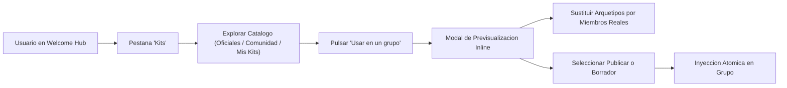

# 03.6 - Catalogo de Kits Asistente de Inyeccion y Empaquetado

> Enlace de navegación: Volver al [[03.0 - Indice y Mapa de La Interfaz Frontend]]

---

## Explicación Técnica: Pestaña en Hub, Navegación de 4 Pestañas y Componentes Modulares

La interfaz de usuario de **QuestFest** incorpora el catálogo de kits como la segunda pestaña principal en el Hub de Bienvenida (`/groups?tab=kits`), ampliando la barra de navegación superior a cuatro secciones:
1. **Mis Grupos** (`tab=grupos`)
2. **Kits** (`tab=kits`)
3. **Mi Perfil** (`tab=perfil`)
4. **Ajustes** (`tab=ajustes`)

### 1. Anatomía Visual de la Pestaña Kits (`WelcomeKitsTab.tsx`)

La vista implementa una arquitectura modular adaptada a pantallas táctiles móviles:
- **Cabecera Funcional**: Título descriptivo, insignia de categoría y botón de acción principal `+ Crear Kit` que despliega el modal de autoría.
- **Sub-pestañas de Catálogo**: Segmentación instantánea entre tres modalidades de exploración:
  - `Oficiales`: Plantillas verificadas y balanceadas por el equipo de la plataforma.
  - `Comunidad`: Kits públicos compartidos por otros usuarios.
  - `Mis Kits`: Creaciones del usuario activo, incluyendo aquellas marcadas como privadas.
- **Descubrimiento Activo**: Barra de filtrado textual en tiempo real (busca en título, descripción y categorías) combinada con un carrusel deslizable horizontal de categorías temáticas (Todos, Fiesta, Viajes, Deporte, Chill).
- **Tarjetas de Kit (`KitCard.tsx`)**: Representación visual Dracula con degradados temáticos, badge de verificación oficial, contadores de usos (`descargas_count`), botón de votación positiva con actualización optimista inmediata (`toggleKitLike`), desglose de retos (número de misiones, ruletas y apuestas) y botón táctil con área de pulsación de 48px mínimos.
- **Menú Contextual**: Tres puntos desplegables que exponen opciones de moderación ciudadana (*Reportar Kit*) o de administración de autor (*Editar Kit* y *Eliminar Kit*).

### 2. Asistente de Previsualización e Inyección Inline (`KitPreviewAndInjectModal.tsx`)

Antes de persistir las entidades en el grupo, el anfitrión dispone de un panel flotante de personalización que ofrece:
1. **Selector de Jurisdicción**: Permite elegir la comunidad destino entre aquellos grupos donde el usuario ostenta el rol de `admin`.
2. **Tres Acordeones Colapsables**:
   - *Misiones del Tablón*: Checkboxes para incluir o descartar retos, campos editables para adaptar títulos y descripciones a expresiones locales, e inputs para calibrar la recompensa en **QuestCoins**.
   - *Misiones de Ruleta Diaria*: Checkboxes y edición inline de retos para el bombo diario secreto.
   - *Mercados de Apuestas*: Personalización de pronósticos, cuotas y arquetipos.
3. **Asistente de Arquetipos para Apuestas**: Convierte opciones genéricas (como *"El anfitrión"* o *"El conductor"*) en nombres reales de miembros de la comunidad mediante un selector rápido que consulta en tiempo real el censo del grupo (`/api/groups/{group_id}/members`).
4. **Interruptor de Estado Operativo**:
   - `Publicar inmediatamente`: Las misiones se inyectan en estado `activa` y las apuestas en estado `abierta`.
   - `Guardar como borradores`: Nacen en estado `propuesta` para permitir su activación paulatina.

### 3. Empaquetado Inverso: Desde Grupo hacia Kit (`SaveGroupAsKitModal.tsx`)

Ubicado en el panel de control del grupo (`TabGrupoSettings.tsx`), permite a un anfitrión consolidar los retos más exitosos de su evento en un kit reutilizable. Carga las misiones y apuestas activas de la comunidad y permite seleccionarlas mediante casillas de verificación para generar un nuevo registro en el catálogo público o privado.

---

## Analogía en el Mundo Real

El catálogo de kits funciona de manera similar a una tienda de temas o módulos prediseñados en una plataforma de gestión de contenidos. En lugar de tener que redactar a mano cada formulario, texto y sección de una página web en blanco, el usuario selecciona una plantilla profesional y abre un asistente de previsualización donde puede marcar qué secciones quiere conservar, cambiar los textos de ejemplo por sus fotos y nombres familiares, y finalmente pulsar un botón para instalar la plantilla en su sitio web personal.

---

## Aplicación en QuestFest

- Erradicación del síndrome del lienzo en blanco cuando un anfitrión crea una peña antes de que lleguen sus invitados.
- Adaptabilidad total a fiestas locales o privadas gracias a la edición inline previa a la inyección.
- Accesibilidad móvil conforme a los estándares PWA de QuestFest, garantizando pulsaciones cómodas en pantallas táctiles y tiempos de respuesta instantáneos.

---

## Conceptos Relacionados

- [[03.1 - Pantallas y Dashboard]]
- [[03.3 - Panel de Administración]]
- [[03.4 - Componentes Reutilizables y Estilos]]
- [[02.12 - Kits de Eventos Plantillas Reutilizables e Inyeccion Atomica]]

---

## Ficheros Físicos del Código Fuente

- Hub de bienvenida y navegación de 4 pestañas: [frontend/src/app/groups/page.tsx](vscode://file/c:/.d/questfest-project/frontend/src/app/groups/page.tsx:1)
- Pestaña de catálogo de kits: [frontend/src/components/kits/WelcomeKitsTab.tsx](vscode://file/c:/.d/questfest-project/frontend/src/components/kits/WelcomeKitsTab.tsx:1)
- Tarjeta individual de kit: [frontend/src/components/kits/KitCard.tsx](vscode://file/c:/.d/questfest-project/frontend/src/components/kits/KitCard.tsx:1)
- Asistente de previsualización e inyección inline: [frontend/src/components/kits/KitPreviewAndInjectModal.tsx](vscode://file/c:/.d/questfest-project/frontend/src/components/kits/KitPreviewAndInjectModal.tsx:1)
- Modal de creación y edición de kits: [frontend/src/components/kits/CreateKitModal.tsx](vscode://file/c:/.d/questfest-project/frontend/src/components/kits/CreateKitModal.tsx:1)
- Modal de reporte de moderación: [frontend/src/components/kits/ReportKitModal.tsx](vscode://file/c:/.d/questfest-project/frontend/src/components/kits/ReportKitModal.tsx:1)
- Modal de empaquetado desde comunidad: [frontend/src/components/kits/SaveGroupAsKitModal.tsx](vscode://file/c:/.d/questfest-project/frontend/src/components/kits/SaveGroupAsKitModal.tsx:1)
- Servicio de conexión HTTP: [frontend/src/services/kitsService.ts](vscode://file/c:/.d/questfest-project/frontend/src/services/kitsService.ts:1)
