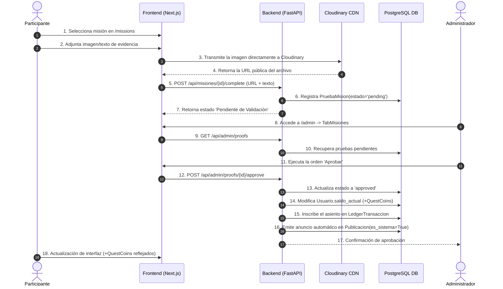

# 04.1 - Historia de Usuario: Completar una Misión

> Enlace de navegación: Volver al [[04.0 - Indice y Mapa de Flujos del Juego]]

---

## Flujo Secuencial del Proceso de Misiones

Este documento especifica la secuencia técnica de transmisión de datos entre la interfaz cliente, el servidor backend, la infraestructura de almacenamiento multimedia y la base de datos PostgreSQL durante el ciclo de vida de una misión.

---

## Análisis Técnico de la Secuencia de Ejecución

1. **Transmisión multimedia optimizada**:
   El cliente no envía la imagen directamente a la API de FastAPI. El componente React transmite el archivo a la infraestructura de [[06.16 - Redes de Distribucion de Contenido CDN y Cloudinary|Cloudinary CDN]], obteniendo una URL pública optimizada.
2. **Registro de la Evidencia (`PruebaMision`)**:
   FastAPI recibe únicamente la URL de la imagen (`prueba_imagen_url`) y el texto explicativo. La prueba se inscribe en PostgreSQL en estado `'pending'`.
3. **Transacción de Cobro Atómica (`db.commit()`)**:
   Al aprobar la prueba desde la consola de administración (`app/api/routers/admin.py`), el servidor ejecuta una [[06.11 - Transacciones Atomicas e Integridad Referencial|transacción atómica ACID]]:
   - Modifica el estado de la prueba a `'approved'`.
   - Incrementa el campo `Usuario.saldo_actual` con el importe en QuestCoins.
   - Crea un registro en la tabla `LedgerTransaccion`.
   - Genera una entrada en `Publicacion(es_sistema=True)` para su difusión en el muro social.
   - Si se produce un fallo en cualquiera de las operaciones, PostgreSQL revierte los cambios (`rollback`), impidiendo inconsistencias de saldo.

---

## Secuencia Funcional de Usuario

1. **Selección del Desafío**: El participante navega al catálogo de retos y escoge una misión disponible (por ejemplo: *"Foto con el DJ (+150 QuestCoins)"*).
2. **Registro de Evidencia**: Tras capturar la imagen, la aplicación transfiere el archivo a la nube. El botón del reto pasa al estado *"Pendiente de revisión"*.
3. **Evaluación de la Prueba**: El Administrador inspecciona la prueba desde la consola de mando y confirma su validez.
4. **Acreditación de Recompensa**: El sistema acredita la suma de 150 QuestCoins en el monedero del participante, publica el logro en el muro social y actualiza la clasificación general.

---

## Conceptos Teóricos Relacionados
- [[06.11 - Transacciones Atomicas e Integridad Referencial]]
- [[06.16 - Redes de Distribucion de Contenido CDN y Cloudinary]]

---

## Ficheros Físicos del Código Fuente
- Controlador API de Subida de Archivos: [backend/app/api/routers/upload.py](vscode://file/c:/.d/fiestas26-project/backend/app/api/routers/upload.py:1)
- Endpoint de Completar Misión: [backend/app/api/routers/misiones.py](vscode://file/c:/.d/fiestas26-project/backend/app/api/routers/misiones.py:57) *(Línea 57: complete_mission)*
- Endpoint de Aprobación en Admin: [backend/app/api/routers/admin.py](vscode://file/c:/.d/fiestas26-project/backend/app/api/routers/admin.py:1)
