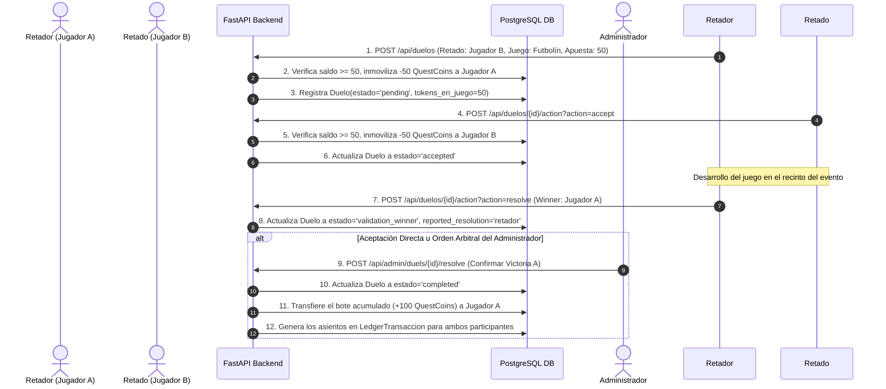

# 04.2 - Historia de Usuario: Retar a un Amigo a un Duelo 1vs1

> Enlace de navegación: Volver al [[04.0 - Indice y Mapa de Flujos del Juego]]

---

## Flujo Secuencial de Duelistas 1vs1

Este documento especifica el ciclo de vida transaccional de un desafío individual entre dos participantes, desde la emisión del reto hasta la liquidación del bote acumulado de **QuestCoins**.

---

## Análisis Técnico de Garantías Transaccionales

1. **Inmovilización del Depósito Fiduciario**:
   Al emitir y aceptar el desafío, las funciones CRUD en `app/crud/duelos_crud.py` ejecutan un descuento inmediato del saldo de ambos participantes. Esta medida impide la disposición de esos mismos QuestCoins en otros mercados concurrentes ([[06.11 - Transacciones Atomicas e Integridad Referencial|Control de Condiciones de Carrera]]).
2. **Validación de Resultados en Dos Fases (`validation_winner`)**:
   Tras la declaración del resultado por un participante, el estado cambia a `validation_winner` registrando en `reported_resolution` la identidad del reclamante. La transacción exige la confirmación del oponente o la intervención de la administración antes de la transferencia de fondos.
3. **Liquidación del Bote de QuestCoins**:
   - En caso de resolución válida, la plataforma transfiere el bote total acumulado (`tokens_en_juego * 2`) al saldo del vencedor.
   - En caso de cancelación o empate ratificado, el sistema reembolsa los QuestCoins inmovilizados a las cuentas de origen.

---

## Secuencia Funcional de Usuario

1. **Emisión del Desafío**: Un participante selecciona a un oponente en el catálogo de usuarios, especifica la disciplina de juego (por ejemplo: *"Futbolín"*) e ingresa un depósito de 50 QuestCoins. La plataforma congela esa suma en su monedero.
2. **Aceptación del Reto**: El usuario desafiado recibe la notificación y confirma la aceptación. La plataforma congela la misma cantidad de QuestCoins en su monedero, acumulando un bote total de 100 QuestCoins.
3. **Desarrollo del Juego**: Los participantes disputan la prueba en la instalación del evento.
4. **Declaración y Liquidación**: Un participante declara el resultado. Tras la verificación del sistema o de la administración, la suma acumulada de 100 QuestCoins se acredita en el saldo del vencedor y se publica el anuncio en el muro social.

---

## Conceptos Teóricos Relacionados
- [[06.11 - Transacciones Atomicas e Integridad Referencial]]

---

## Ficheros Físicos del Código Fuente
- Controlador API de Duelos: [backend/app/api/routers/duelos.py](vscode://file/c:/.d/fiestas26-project/backend/app/api/routers/duelos.py:13) *(Línea 13: launch_duel)*
- Acciones de Duelo (Aceptar, Resolver): [backend/app/api/routers/duelos.py](vscode://file/c:/.d/fiestas26-project/backend/app/api/routers/duelos.py:52) *(Línea 52: duel_action)*
- Operaciones CRUD para Duelos: [backend/app/crud/duelos_crud.py](vscode://file/c:/.d/fiestas26-project/backend/app/crud/duelos_crud.py:1)
