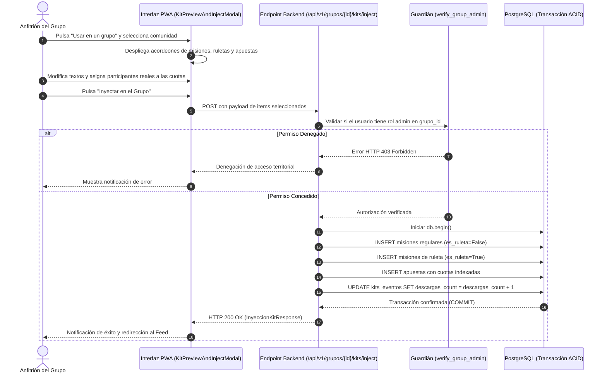
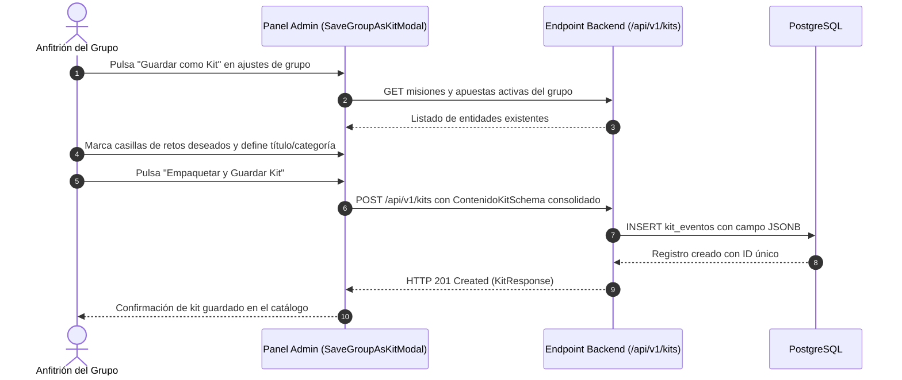

# 04.3 - Flujo de Inyeccion y Empaquetado de Kits

> Enlace de navegación: Volver al [[04.0 - Indice y Mapa de Flujos del Juego]]

---

## Explicación Técnica: Diagramas de Secuencia e Interacciones Transaccionales

El ciclo operativo de los Kits de Eventos comprende dos flujos principales: la **Inyección Atómica en una Comunidad** y el **Empaquetado de Retos desde un Grupo Activo**.

### 1. Flujo de Inyección Atómica en Comunidad

Este flujo describe la interacción entre el anfitrión, la interfaz PWA, el servicio de verificación de permisos y la base de datos PostgreSQL:

### 2. Flujo de Empaquetado Inverso (Guardar como Kit)

Este flujo permite a un anfitrión transformar los retos activos de su grupo en un nuevo kit reutilizable:

---

## Analogía en el Mundo Real

El flujo de inyección es comparable al de encargar un menú temático cerrado a una empresa de catering. El cliente abre el catálogo y elige el "Menú Degustación Barbacoa". En la comanda preliminar, el cliente especifica que quiere sustituir los entrantes picantes por ensaladas (edición inline) y anota los nombres de los comensales celíacos o vegetarianos (asistente de arquetipos). Cuando el catering confirma el pedido, la comida se prepara y se entrega en la fiesta del cliente. La cocina del catering no interfiere con el disfrute de la fiesta, ni la fiesta altera el menú original archivado en las oficinas centrales.

---

## Aplicación en QuestFest

- Garantiza que ninguna inyección deje misiones a medio crear si ocurre un fallo de red o un error imprevisto (atomicidad en PostgreSQL).
- Asegura que los administradores mantengan el control sobre el ritmo de su evento pudiendo elegir entre publicación inmediata o guardado como borradores.
- Valida matemáticamente que un participante sin rango de administrador no pueda inyectar contenido en comunidades ajenas.

---

## Conceptos Relacionados

- [[02.12 - Kits de Eventos Plantillas Reutilizables e Inyeccion Atomica]]
- [[03.6 - Catalogo de Kits Asistente de Inyeccion y Empaquetado]]
- [[04.1 - Flujo de Misión]]
- [[04.2 - Flujo de Duelo]]

---

## Ficheros Físicos del Código Fuente

- Asistente de previsualización: [frontend/src/components/kits/KitPreviewAndInjectModal.tsx](vscode://file/c:/.d/questfest-project/frontend/src/components/kits/KitPreviewAndInjectModal.tsx:1)
- Modal de empaquetado de grupo: [frontend/src/components/kits/SaveGroupAsKitModal.tsx](vscode://file/c:/.d/questfest-project/frontend/src/components/kits/SaveGroupAsKitModal.tsx:1)
- Lógica de inyección en backend: [backend/app/crud/kits_crud.py](vscode://file/c:/.d/questfest-project/backend/app/crud/kits_crud.py:1)
- Controlador de grupos e inyección: [backend/app/api/routers/groups.py](vscode://file/c:/.d/questfest-project/backend/app/api/routers/groups.py:1)
