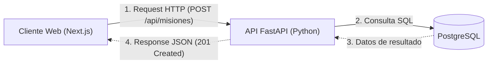

# 06.1 - ¿Qué es una API RESTful y cómo funciona?

> Enlace de navegación: Volver al [[06.0 - Indice y Mapa de Conceptos Teoricos]]

---

## Explicación Técnica

Una **API RESTful** (Interface de Programación de Aplicaciones basada en Transferencia de Estado Representacional) es un estilo arquitectónico para el diseño de aplicaciones en red. Se fundamenta en el protocolo HTTP y se rige por los siguientes principios clave:

1. **Arquitectura Cliente-Servidor Desacoplada**: El cliente (interfaz de usuario en React/Next.js) y el servidor (procesador de reglas en FastAPI) son completamente independientes. La comunicación ocurre exclusivamente a través de peticiones y respuestas HTTP.
2. **Sin Estado (Statelessness)**: Cada petición enviada por el cliente al servidor debe contener toda la información necesaria para ser comprendida y procesada (por ejemplo, el token de autenticación JWT). El servidor no guarda memoria del contexto del cliente entre peticiones consecutivas.
3. **Recursos e Identificadores (URIs)**: Cada entidad del dominio de la aplicación (usuarios, misiones, apuestas) se expone como un recurso accesible a través de una dirección URL única (ejemplo: `/api/misiones` o `/api/users/me`).
4. **Verbos HTTP Estandarizados**:
   - `GET`: Recuperar la representación de un recurso sin modificar el estado del servidor.
   - `POST`: Crear un nuevo recurso en el servidor.
   - `PUT` / `PATCH`: Actualizar un recurso existente de forma completa o parcial.
   - `DELETE`: Eliminar un recurso del servidor.
5. **Representación de Datos en JSON**: La información intercambiada entre cliente y servidor se codifica en formato sintáctico ligero JSON (JavaScript Object Notation).

---

## Analogía del Restaurante

Para facilitar la comprensión intuitiva del funcionamiento de una API RESTful, se puede analizar el modelo mediante la analogía del servicio en un restaurante:

- **El Cliente (Next.js)**: Representa al comensal sentado a la mesa. El comensal no accede directamente a la cocina ni manipula los alimentos o los fogones.
- **La API RESTful (FastAPI)**: Representa al **camarero**. El comensal consulta el menú (la documentación de endpoints) y formula un pedido al camarero mediante un encargo estandarizado (_"Traer la sopa"_, equivalente a una petición `GET /api/misiones`).
- **El Servidor y la Base de Datos (PostgreSQL)**: Representan la **cocina y la despensa**. El camarero traslada la orden a la cocina, los cocineros preparan el plato (ejecutan la regla de negocio) y el camarero entrega el plato servido en una bandeja (respuesta codificada en formato JSON).
- **Modelo Sin Estado (Stateless)**: El camarero no requiere recordar los pedidos anteriores del comensal; en cada nuevo pedido, la orden debe incluir la identificación de la mesa (token JWT) para certificar la autorización.

---

## Aplicación en el Proyecto QuestFest

En **QuestFest**, la API RESTful desarrollada con FastAPI expone los puntos de entrada centralizados que permiten a los usuarios transmitir sus evidencias de misiones, apostar **QuestCoins** en duelos y consultar la tabla de clasificación sin provocar recargas completas en la interfaz del navegador.

---

## Ficheros Físicos del Código Fuente

- Router Principal de Rutas API: [backend/app/main.py](vscode://file/c:/.d/fiestas26-project/backend/app/main.py:21) _(Línea 21: include_router)_
- Controlador REST de Misiones: [backend/app/api/routers/misiones.py](vscode://file/c:/.d/fiestas26-project/backend/app/api/routers/misiones.py:13)
- Cliente HTTP Axios en Frontend: [frontend/src/lib/axios.ts](vscode://file/c:/.d/fiestas26-project/frontend/src/lib/axios.ts:3)
