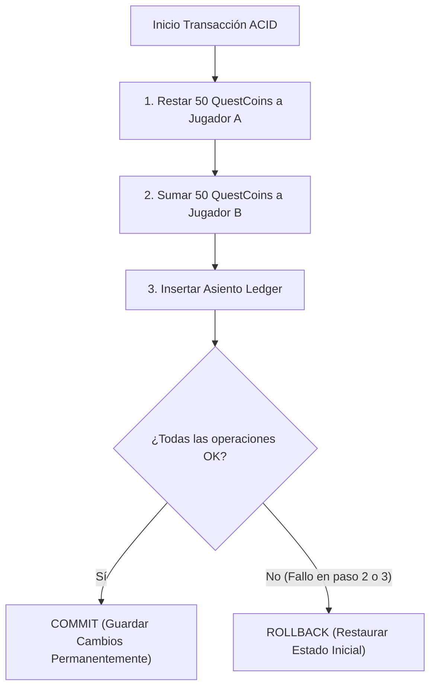

# 06.11 - Transacciones Atómicas e Integridad Referencial (ACID)

> Enlace de navegación: Volver al [[06.0 - Indice y Mapa de Conceptos Teoricos]]

---

## Explicación Técnica

Las **propiedades ACID** (Atomicidad, Consistencia, Aislamiento y Durabilidad) son los cuatro pilares fundamentales que garantizan la fiabilidad de las operaciones en un sistema de gestión de bases de datos relacionales (RDBMS).

1. **Atomicidad (All or Nothing)**: Una transacción atómica es una unidad de trabajo indivisible. Si una transacción consta de 4 operaciones SQL (ejemplo: restar saldo al usuario A, sumar saldo al usuario B, registrar la transacción en el libro contable y cerrar el duelo), se confirman todas con éxito (`commit`) o, si falla una sola de ellas, la base de datos revierte todas las operaciones (`rollback`) dejando el estado exactamente como estaba antes de empezar.
2. **Integridad Referencial y Restricciones (`CheckConstraint`)**: Consiste en garantizar que las relaciones entre tablas sean válidas y que los datos cumplan reglas estrictas de dominio. Por ejemplo, una restricción `CheckConstraint("saldo_actual >= 0")` aborta cualquier transacción que provocase un saldo negativo.
3. **Condiciones de Carrera (Race Conditions)**: Prevención de que dos transacciones simultáneas que leen el mismo saldo modifiquen la cuenta al mismo tiempo generando duplicación o pérdida de dinero virtual.

---

## Analogía del Cajero Automático

Para comprender el concepto de atomicidad en transacciones, se puede analizar mediante la analogía de la retirada de efectivo en un cajero automático:

- **La Transacción se compone de 3 pasos encadenados**:
  1. El sistema valida la tarjeta y debita el importe de la cuenta bancaria.
  2. El dispensador físico dispensa el billete correspondiente.
  3. El terminal imprime el comprobante y concluye la sesión.
- **Procesamiento sin Atomicidad (Inseguro)**: Si el sistema efectuase el débito en la cuenta (Paso 1) y sufriese una interrupción eléctrica antes de dispensar el efectivo (Paso 2), se produciría una pérdida de saldo sin entrega del producto.
- **Procesamiento con Atomicidad ACID**: Si ocurre un fallo en cualquier fase del proceso, el sistema ejecuta una **reversión automática (rollback)**, anulando el débito y restaurando la cuenta a su estado original sin inconsistencias.

---

## Aplicación en el Proyecto QuestFest

En **QuestFest**, el motor financiero gestiona miles de **QuestCoins**. Cada victoria en un duelo 1vs1, cancelación de apuestas con reembolso o cobro de misiones se ejecuta dentro de un bloque transaccional atómico `await db.commit()`. Además, las restricciones SQL a nivel de base de datos impiden que ningún jugador quede en números negativos aunque intente realizar dos apuestas simultáneas.

---

## Ficheros Físicos del Código Fuente

- Restricciones SQL de Saldo Positivo: [backend/app/models/usuario.py](vscode://file/c:/.d/fiestas26-project/backend/app/models/usuario.py:21) _(Línea 21: check_saldo_positivo)_
- Transacción Atómica en Duelos: [backend/app/crud/duelos_crud.py](vscode://file/c:/.d/fiestas26-project/backend/app/crud/duelos_crud.py:1)
- Asiento Auditado en Libro Mayor (Ledger): [backend/app/models/usuario.py](vscode://file/c:/.d/fiestas26-project/backend/app/models/usuario.py:39) _(Línea 39: LedgerTransaccion)_
