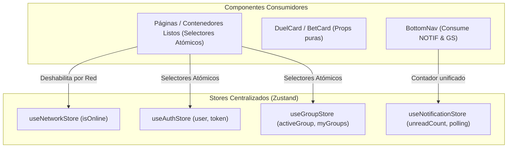

# 06.13 - Gestión del Estado Global y Arquitectura Reactiva con Zustand

> Enlace de navegación: Volver al [[06.0 - Indice y Mapa de Conceptos Teoricos]]

---

## Explicación Técnica

La gestión del estado global en aplicaciones basadas en **Next.js 16 y React 19** requiere desacoplar el estado transversal de la jerarquía visual de componentes para evitar renderizados en cascada y asegurar reactividad determinista.

En QuestFest, la arquitectura de estado combina dos niveles complementarios:

1. **Context API como Contenedor de Inicialización**:
   - Se mantiene para la distribución de dependencias de nivel superior que requieren configuración contextual, como `ThemeContext` y envolturas de hidratación.
2. **Almacenes Centralizados y Atómicos con Zustand (`frontend/src/store/`)**:
   - **Suscripciones Atómicas por Selector**: A diferencia del Context API nativo, donde cualquier mutación en el objeto de contexto provoca el re-renderizado de todos los componentes consumidores, Zustand permite a cada componente suscribirse estrictamente al fragmento de estado que utiliza mediante selectores puros:
     ```typescript
     // Solo re-renderiza si cambia el balance local del grupo
     const activeGroup = useGroupStore((state) => state.activeGroup);
     ```
   - **Aislamiento por Dominios de Responsabilidad**:
     - `useNetworkStore`: Monitoriza eventos nativos `online` y `offline` del navegador, exponiendo el estado reactivo `isOnline` para deshabilitar controles de juego en modo sin conexión de forma accesible.
     - `useAuthStore`: Centraliza usuario autenticado, token JWT y estado de sesión, sincronizando cookies seguras y orquestando la purga atómica de caché en `logout()`.
     - `useGroupStore`: Gestiona la comunidad activa (`activeGroup`), la lista de peñas del jugador y las transiciones territoriales libres de condiciones de carrera.
     - `useNotificationStore`: Centraliza el contador de avisos no leídos y actúa como **Orquestador Único de Polling**, sustituyendo múltiples temporizadores paralelos dispersos por un único ciclo periódico de 20 segundos condicionado a que el documento esté visible (`document.visibilityState === 'visible'`) y el terminal disponga de conectividad.



---

## Modelo Conceptual de Analogía: El Tablón de Avisos por Departamentos

Para comprender la diferencia entre Context API y la gestión atómica con Zustand, se puede comparar con la organización interna de un festival:

- **Context API como Megafonía General**: Cada vez que se produce cualquier novedad (sea un cambio de turno, una venta de entrada o un aviso menor), el mensaje se difunde por la megafonía principal del recinto. Todos los trabajadores deben detener lo que están haciendo para escuchar el anuncio, aunque no guarde relación con su tarea, generando distracciones continuas (renderizados innecesarios).
- **Zustand como Tablones Departamentales Especializados**: En lugar de una sola megafonía, cada área dispone de su propio tablón independiente con campanilla selectiva:
  - El personal de seguridad solo vigila el panel de accesos y red (`useNetworkStore`).
  - El equipo de admisiones solo atiende a las acreditaciones (`useAuthStore`).
  - Los delegados de peñas solo consultan el tablero de su grupo (`useGroupStore`).
  - Los avisos periódicos los centraliza un único mensajero coordinado (`useNotificationStore`), evitando que varios encargados salgan al mismo tiempo a comprobar novedades repetidas.

---

## Aplicación en el Proyecto QuestFest

En **QuestFest**, la separación de componentes en contenedores listos (*smart*) y componentes presentacionales puros (*dumb*) se apoya en los almacenes Zustand:

1. **Componentes Tontos Desacoplados**: Componentes como `DuelCard.tsx` y `FeedCard.tsx` no consumen librerías de red ni almacenes globales; reciben datos y callbacks mediante *props*, facilitando su reutilización y verificación.
2. **Contenedores Modulares**: Las vistas complejas (`bets/page.tsx`, `duels/page.tsx`, `groups/page.tsx`) extraen modales y formularios en piezas autónomas (`CreateBetModal.tsx`, `PlaceBetModal.tsx`, `CreateDuelModal.tsx`), leyendo el estado necesario mediante selectores directos de Zustand.

---

## Ficheros Físicos del Código Fuente

- Almacén de Estado de Red: [frontend/src/store/useNetworkStore.ts](vscode://file/c:/.d/questfest-project/frontend/src/store/useNetworkStore.ts:1) *(Gestión de conectividad reactiva isOnline)*
- Almacén de Autenticación y Sesión: [frontend/src/store/useAuthStore.ts](vscode://file/c:/.d/questfest-project/frontend/src/store/useAuthStore.ts:1) *(Estado de usuario, tokens y purga de caché)*
- Almacén de Comunidades y Multi-Tenancy: [frontend/src/store/useGroupStore.ts](vscode://file/c:/.d/questfest-project/frontend/src/store/useGroupStore.ts:1) *(Grupo activo y colecciones de comunidades)*
- Almacén y Orquestador de Notificaciones: [frontend/src/store/useNotificationStore.ts](vscode://file/c:/.d/questfest-project/frontend/src/store/useNotificationStore.ts:1) *(Unificación de sondeo de red y contadores)*
- Contexto Complementario de Autenticación: [frontend/src/context/AuthContext.tsx](vscode://file/c:/.d/questfest-project/frontend/src/context/AuthContext.tsx:1) *(Integración y compatibilidad hacia atrás)*
- Contexto de Tema Visual: [frontend/src/context/ThemeContext.tsx](vscode://file/c:/.d/questfest-project/frontend/src/context/ThemeContext.tsx:1) *(Tokens visuales de interfaz y paletas)*
