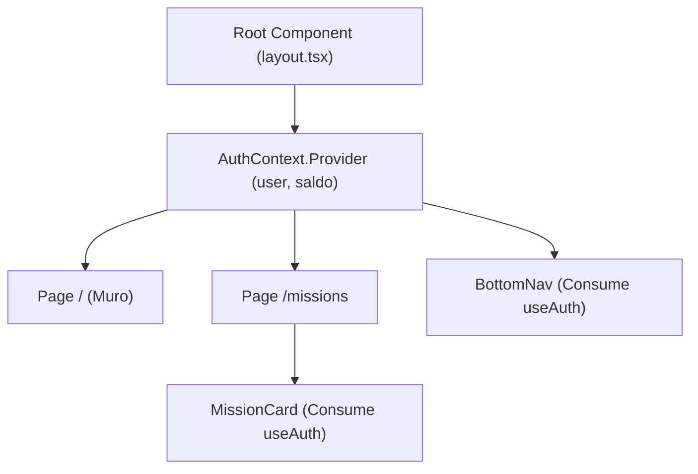

# 06.13 - Gestión del Estado Global y Context API en React

> Enlace de navegación: Volver al [[06.0 - Indice y Mapa de Conceptos Teoricos]]

---

## Explicación Técnica

La **Context API de React** es un mecanismo nativo para la gestión y distribución del estado global en una aplicación construida con componentes interconectados.

1. **El Problema del Prop Drilling**: En aplicaciones React jerárquicas, pasar datos (como el perfil del usuario autenticado o su saldo) desde la raíz hasta componentes profundamente anidados requiere transmitir las propiedades (_props_) manualmente por cada componente intermedio de la cadena, generando código frágil y difícil de mantener.
2. **Proveedores de Contexto (`Context.Provider`)**: Un proveedor es un componente contenedor que envuelve a la jerarquía de la aplicación y pone a disposición de cualquier componente secundario un estado centralizado y un conjunto de funciones de actualización.
3. **Consumo Mediante Hooks (`useContext`)**: Los componentes secundarios pueden suscribirse al contexto usando un hook personalizado (ejemplo: `useAuth()`). Cuando el estado del contexto cambia (por ejemplo, el usuario inicia sesión o cobra un premio), solo los componentes suscritos se vuelven a renderizar automáticamente.

---

## Analogía del Canal de Emisora General

Para comprender la utilidad de Context API, se puede analizar mediante la analogía de un canal de emisión interna:

- **Problema de la Transmisión Cascada (Prop Drilling)**: Equivale a enviar un mensaje desde la dirección del evento hasta un operador situado en un sector alejado, obligando a transmitir la nota de forma mano en mano por cada departamento intermedio. Si un intermediario no traslada la nota, la información se interrumpe.
- **Canal de Emisión Centralizado (`AuthContext`)**: Equivale a disponer de una **emisora general de información**.
  - La dirección emite las actualizaciones a través de la frecuencia del evento (_el Provider_).
  - Cualquier receptor que disponga del equipo sintonizado en dicha frecuencia (_el hook `useAuth()`_) capta las actualizaciones de saldo o estado en tiempo real sin importar su ubicación exacta en la estructura.

---

## Aplicación en el Proyecto QuestFest

En **QuestFest**, el componente `AuthProvider` en `frontend/src/context/AuthContext.tsx` actúa como la emisora central. Almacena los datos del jugador (su nombre, rol y saldo de **QuestCoins**). Componentes situados en cualquier lugar de la interfaz —como la barra superior de saldo, las tarjetas de apuestas o la barra de navegación inferior (`BottomNav`)— consumen el contexto mediante `useAuth()` para actualizar sus pantallas en cuanto el saldo cambia.

---

## Ficheros Físicos del Código Fuente

- Declaración del Contexto de Autenticación: [frontend/src/context/AuthContext.tsx](vscode://file/c:/.d/fiestas26-project/frontend/src/context/AuthContext.tsx:24) _(Línea 24: createContext)_
- Componente Proveedor AuthProvider: [frontend/src/context/AuthContext.tsx](vscode://file/c:/.d/fiestas26-project/frontend/src/context/AuthContext.tsx:26) _(Línea 26: AuthProvider)_
- Hook Personalizado useAuth: [frontend/src/context/AuthContext.tsx](vscode://file/c:/.d/fiestas26-project/frontend/src/context/AuthContext.tsx:97) _(Línea 97: useAuth)_
