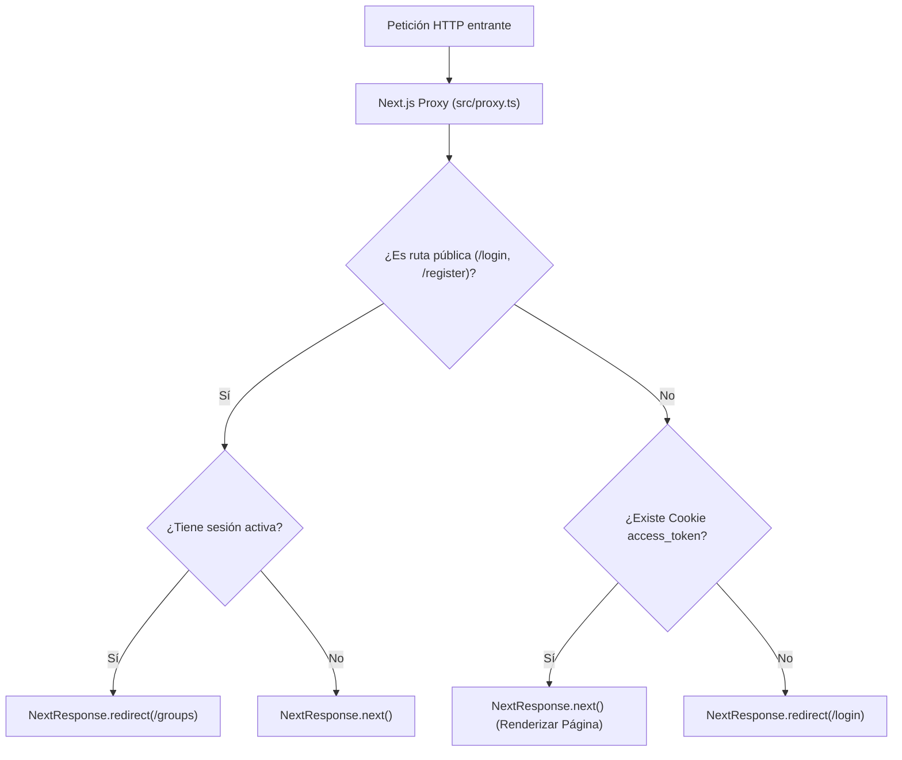

# 06.14 - Middleware y Protección de Rutas HTTP en Next.js

> Enlace de navegación: Volver al [[06.0 - Indice y Mapa de Conceptos Teoricos]]

---

## Explicación Técnica: Interceptación Perimetral y Evolución a Proxy en Next.js 16

La interceptación perimetral de peticiones HTTP en Next.js es un mecanismo de control de red que se ejecuta antes de que cualquier solicitud entrante sea procesada por el enrutador o renderizada por el motor de React.

1. **Intercepción y Evaluación de Cabeceras**: Permite inspeccionar la URL solicitada, el protocolo, las cabeceras HTTP y las cookies de sesión antes de que el servidor dedique recursos a construir la respuesta o enviar código HTML al cliente.
2. **Protección de Rutas Privadas**: Previene el parpadeo de contenido desprotegido (_unauthenticated flash_). Si un usuario sin credenciales válidas intenta navegar a una ruta protegida (como `/groups`, `/admin` o `/stats`), la capa perimetral comprueba la presencia de la cookie `access_token` y responde de forma atómica con una redirección HTTP 307/302 hacia `/login`.
3. **Evolución Arquitectónica de Next.js 16 (`middleware.ts` a `proxy.ts`)**:
   - En versiones precedentes, este componente utilizaba la convención `middleware.ts`. En Next.js 16 y posteriores, dicha convención ha sido declarada obsoleta y sustituida formalmente por **`proxy.ts`** (exportando la función homónima `proxy`).
   - El objetivo de este cambio es clarificar su responsabilidad arquitectónica: no se trata de una capa de middlewares secuenciales como en Express.js, sino de un **proxy de red perimetral** en el punto de entrada (_ingress boundary_).
   - Asimismo, mientras que el modelo anterior forzaba el Edge Runtime con limitaciones de librerías, `proxy.ts` opera de manera predeterminada sobre el entorno de ejecución estándar de Node.js.
4. **Configuración del Matcher**: Mediante expresiones regulares en el objeto `config.matcher`, se define a qué rutas aplica la intercepción, excluyendo intencionadamente archivos estáticos (`_next/static`), imágenes optimizadas (`_next/image`) y recursos públicos (`favicon.ico`) para garantizar la máxima velocidad de respuesta.

---

## Analogía del Torno Electrónico de Accesos

Para comprender la función del Proxy perimetral, se puede analizar mediante la analogía del control de acceso en el vestíbulo de una instalación:

- **Funcionamiento sin Proxy**: Un usuario accede al edificio, toma el ascensor a una planta restringida, ingresa en la sala de conferencias y únicamente al sentarse es abordado por el personal de seguridad para requerir su credencial. Si carece de autorización, se le obliga a abandonar el lugar. Esta dinámica genera demoras e incrementa la exposición de zonas privadas.
- **Funcionamiento con Proxy (Next.js)**: En la entrada del vestíbulo existe un **torno electrónico de lectura rápida**.
  - Si una persona intenta dirigirse a los niveles superiores sin presentar la acreditación (Cookie `access_token`), el torno deniega el paso de forma instantánea y reconduce al usuario hacia la taquilla de registro (`/login`).
  - La sala de la planta superior jamás llega a exponerse a usuarios no acreditados.

---

## Aplicación en el Proyecto QuestFest

En **QuestFest**, el archivo `frontend/src/proxy.ts` intercepta todas las peticiones de navegación bajo la convención moderna de Next.js 16. Si un visitante intenta consultar los grupos, el feed, el ranking o jugar con sus **QuestCoins** sin haber iniciado sesión, el proxy intercepta la petición en el perímetro y lo reconduce de inmediato a la pantalla de login. A la inversa, si un usuario con sesión iniciada visita `/login` o `/register`, es redirigido automáticamente al Hub de Bienvenida (`/groups`).

Asimismo, el proxy implementa filtros de bypass para recursos estáticos y metadatos PWA (`manifest.json`, `sw.js`, `apple-touch-icon.png`, rutas bajo `/icons/` y archivos con extensiones binarias como `.png` o `.svg`). Dado que los motores de los navegadores (como WebKit en Safari) solicitan los iconos de la pantalla de inicio en peticiones desacopladas sin cabeceras de autenticación, la exclusión perimetral previene redirecciones accidentales HTTP 307 al login, asegurando que el sistema operativo reciba el icono oficial en formato binario.

---

## Ficheros Físicos del Código Fuente

- Proxy Perimetral de Seguridad: [frontend/src/proxy.ts](vscode://file/c:/.d/fiestas26-project/frontend/src/proxy.ts:11) _(Línea 11: función proxy)_
- Configuración del Matcher de Rutas: [frontend/src/proxy.ts](vscode://file/c:/.d/fiestas26-project/frontend/src/proxy.ts:39) _(Línea 39: export const config)_
