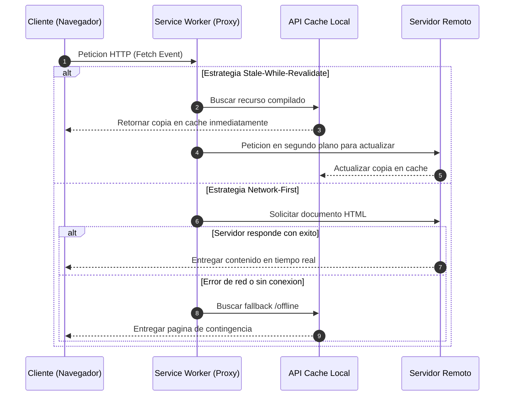

# 06.17 - Progressive Web Apps y Service Workers

> Enlace de navegación: Volver al [[06.0 - Indice y Mapa de Conceptos Teoricos]]

---

## Explicación Técnica

Las Aplicaciones Web Progresivas (Progressive Web Apps o PWA) son un conjunto de tecnologías y patrones de diseño de software que permiten a una aplicación basada en tecnologías web estándares (HTML, CSS y JavaScript) ofrecer una experiencia de usuario equiparable a la de una aplicación nativa instalada en el sistema operativo.

El pilar fundamental de una PWA es el Service Worker. Un Service Worker es un script que el navegador ejecuta en segundo plano, en un contexto de hilo separado (*Web Worker*), sin acceso directo al DOM de la página. El Service Worker actúa como un proxy de red programable situado entre la aplicación cliente, la red de internet y la memoria caché del navegador.

Ciclo de vida del Service Worker:
1. **Registro**: La aplicación web solicita al navegador registrar el script del Service Worker desde una ubicación HTTP/HTTPS segura.
2. **Instalación**: El navegador descarga y parsea el archivo. Durante este evento, la aplicación suele precargar los archivos esenciales (*App Shell*) en la API de Cache.
3. **Activación**: El Service Worker toma el control de los clientes bajo su alcance (*scope*) y elimina versiones antiguas de carpetas de caché descartadas.
4. **Intercepción de Eventos (Fetch y Push)**: Una vez activo, escucha y procesa las peticiones de red mediante el evento `fetch` o la recepción de mensajes push con el evento `push`.

Las estrategias de almacenamiento en caché más utilizadas son:
- **Cache-First**: Busca el recurso en la memoria caché local. Si existe, lo entrega de inmediato; de lo contrario, realiza la petición a la red.
- **Network-First**: Intenta obtener la versión más reciente a través de la red de internet. Si la conexión falla, recurre a la copia almacenada en la memoria local.
- **Stale-While-Revalidate**: Entrega la copia almacenada en caché de forma instantánea para priorizar la velocidad de respuesta y, en segundo plano, realiza la petición a la red para actualizar el archivo almacenado.

---

## Modelo Conceptual de Analogía: El Almacenista de la Estación de Tren

Considere una gran estación de tren donde los viajeros solicitan constantemente mapas y horarios para sus recorridos.

En un modelo tradicional sin Service Worker, cada viajero debe hacer una cola en la ventanilla central (servidor remoto) cada vez que necesita consultar una información. Si la ventanilla cierra por huelga o corte de luz (pérdida de conexión a la red), ningún viajero puede obtener datos y la estación queda paralizada.

En el modelo de Aplicación Web Progresiva, se instala un almacenista auxiliar (Service Worker) en el vestíbulo de la estación. El almacenista guarda fotocopias de los mapas más utilizados en su mostrador (memoria caché). Cuando un viajero solicita un mapa, el almacenista se lo entrega al instante mientras revisa si hay una edición actualizada en la oficina central. Si la oficina central está inalcanzable, el almacenista despliega un cartel de aviso con las instrucciones básicas de emergencia para que los viajeros continúen su trayecto sin interrupciones.

---

## Aplicación en el Proyecto QuestFest

En la plataforma QuestFest, la tecnología PWA garantiza que la experiencia del usuario no sufra degradación durante la celebración de eventos masivos donde las redes de telefonía móvil suelen saturarse o perder cobertura.

1. **Gestión de Recursos Multimedia y Estáticos**: Los archivos compilados de Next.js se distribuyen mediante el patrón Stale-While-Revalidate para lograr tiempos de carga inferiores a 200 milisegundos en aperturas sucesivas.
2. **Resiliencia Operativa**: La navegación entre vistas clave del sistema está protegida por la estrategia Network-First con fallback a la pantalla de contingencia `/offline`.
3. **Punto de Entrada Móvil**: La inclusión del archivo `manifest.json` y la configuración de metadatos permite que los participantes agreguen QuestFest a la pantalla de inicio de su dispositivo móvil como una aplicación autónoma sin marcos de navegador.

---

## Conceptos Teóricos Relacionados
- [[06.12 - Renderizado en Servidor vs Cliente en Next.js]]
- [[06.14 - Middleware y Proteccion de Rutas HTTP]]
- [[06.16 - Redes de Distribucion de Contenido CDN y Cloudinary]]

---

## Ficheros Físicos del Código Fuente
- Service Worker del Cliente: [frontend/public/sw.js](vscode://file/c:/.d/fiestas26-project/frontend/public/sw.js:1) *(Script proxy de intercepción)*
- Manifiesto de la Aplicación: [frontend/public/manifest.json](vscode://file/c:/.d/fiestas26-project/frontend/public/manifest.json:1) *(Metadatos de presentación PWA)*
- Registro en Cliente: [frontend/src/components/SWRegister.tsx](vscode://file/c:/.d/fiestas26-project/frontend/src/components/SWRegister.tsx:1) *(Script de instalación de Service Worker)*
- Componente Prompt PWA: [frontend/src/components/PWAInstallPrompt.tsx](vscode://file/c:/.d/fiestas26-project/frontend/src/components/PWAInstallPrompt.tsx:1) *(Control del evento de instalación nativo)*
