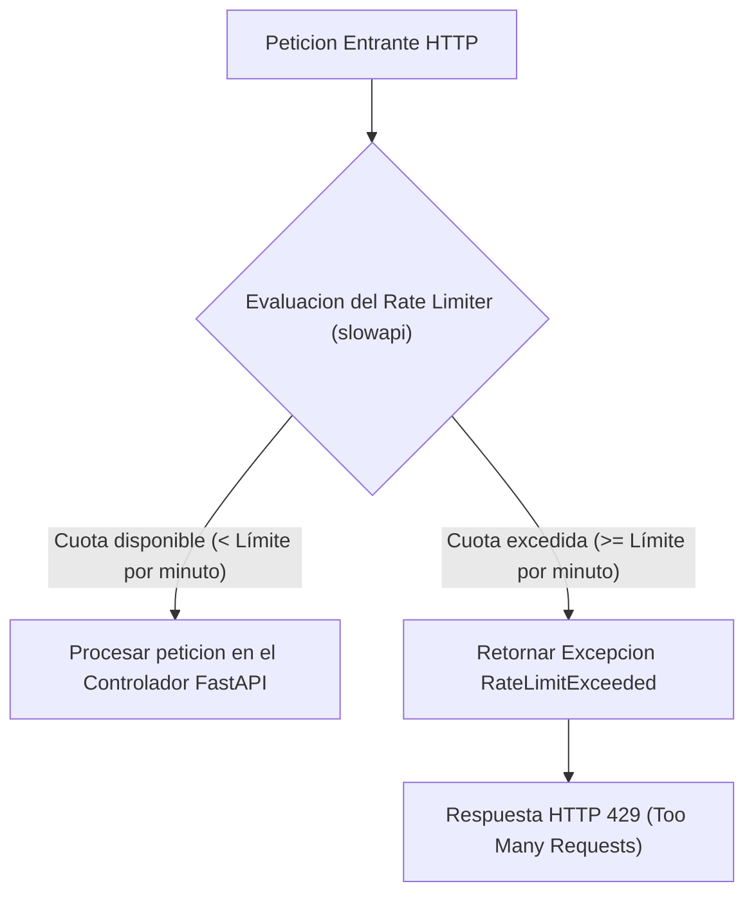

# 06.18 - Limitacion de Tasa de Peticiones y Algoritmo Leaky Bucket

> Enlace de navegación: Volver al [[06.0 - Indice y Mapa de Conceptos Teoricos]]

---

## Explicación Técnica

La limitación de tasa de peticiones (Rate Limiting) es un patrón de diseño y mecanismo de seguridad en APIs web que restringe el número de peticiones que un cliente (identificado por su dirección IP, cuenta de usuario o token de acceso) puede realizar a un servidor durante un intervalo de tiempo determinado.

El objetivo fundamental del Rate Limiting es:
1. **Prevenir Ataques de Denegación de Servicio (DDoS)**: Evitar que peticiones automatizadas maliciosas saturen los recursos de procesamiento (CPU, memoria) o el pool de conexiones de la base de datos.
2. **Mitigar Ataques de Fuerza Bruta**: Dificultar el intento masivo de combinaciones en endpoints sensibles como inicios de sesión o reseteo de claves.
3. **Garantizar la Equidad de Recursos (Fair Use)**: Asegurar que un cliente hiperactivo no degrade la velocidad de respuesta para el resto de los usuarios.

Existen varios algoritmos clásicos para implementar Rate Limiting:
- **Leaky Bucket (Cubo Goteador)**: Considera las peticiones salientes como agua que entra a un cubo con un pequeño orificio en el fondo. El agua gotea a un ritmo constante (tasa de procesamiento). Si el volumen de agua entrante supera la capacidad total del cubo, el exceso de agua se desborda inmediatamente (la API rechaza las peticiones con código de estado HTTP 429 Too Many Requests).
- **Token Bucket (Cubo de Fichas)**: Acumula tokens a un ritmo constante hasta un máximo. Cada petición consume una ficha. Si no hay fichas disponibles, se rechaza la petición.
- **Fixed Window / Sliding Window Counter**: Utiliza contadores temporales por bloques o ventanas deslizantes de tiempo para evaluar la cuota.

---

## Modelo Conceptual de Analogía: El Torniquete de Entrada a un Parque de Atracciones

Imagine un parque de atracciones donde cientos de visitantes desean acceder a la atracción principal.

Si todos los visitantes intentaran cruzar la puerta al mismo tiempo de forma descontrolada, se produciría un tapón humano, la estructura se colapsaría y nadie podría disfrutar del recinto.

Para evitar este caos, la administración instala un torniquete regulado (Rate Limiter). El torniquete solo permite el paso de 5 personas por minuto. Si un grupo de 20 personas intenta empujar la puerta en el mismo segundo, las primeras 5 personas cruzan con éxito, mientras que a las 15 personas restantes un guardia les indica que deben esperar en la zona de descanso (HTTP 429) hasta que el temporizador libere el siguiente turno de acceso.

---

## Aplicación en el Proyecto QuestFest

En la plataforma QuestFest, la limitación de tasa garantiza la disponibilidad continua del sistema durante eventos donde el uso simultáneo por parte de múltiples participantes es elevado.

Se utiliza la librería `slowapi` integrada en el ciclo de vida de FastAPI, definiendo políticas diferenciales según el nivel de riesgo de cada endpoint:

1. **Rutas Críticas de Autenticación (`/api/auth/login`, `/api/auth/register`)**: Límite estricto de 5 peticiones por minuto por IP para neutralizar scripts de fuerza bruta sobre contraseñas.
2. **Módulos de Gamificación (`/api/ruleta/spin`)**: Límite de 10 peticiones por minuto por usuario para evitar peticiones duplicadas accidentales al presionar repetidamente el botón de giro.
3. **Servicio de Carga de Archivos (`/api/upload/image`)**: Límite de 5 subidas por minuto para optimizar el consumo de ancho de banda y cuota de almacenamiento en la CDN de Cloudinary.
4. **Resolución Segura de IP tras Proxy Inverso**: La clave de discriminación no lee ingenuamente la IP local del socket (`request.client.host`), sino que emplea la función `get_real_client_ip` que prioriza `X-Real-IP` (sobrescrita por NGINX) y analiza `X-Forwarded-For` descartando saltos privados para evitar que toda la plataforma quede bloqueada con errores HTTP 429 compartidos.

---

## Conceptos Teóricos Relacionados
- [[06.1 - Que es una API RESTful y como funciona]]
- [[06.3 - Politicas CORS y Seguridad en Navegadores]]
- [[06.14 - Middleware y Proteccion de Rutas HTTP]]
- [[02.7 - Seguridad Avanzada Rate Limiting y Refresh Tokens]]

---

## Ficheros Físicos del Código Fuente
- Configuración del Limitador y Extractor de IP: [backend/app/core/rate_limiter.py](vscode://file/c:/.d/fiestas26-project/backend/app/core/rate_limiter.py:6) *(Función get_real_client_ip e instancia de slowapi)*
- Integración en Servidor: [backend/app/main.py](vscode://file/c:/.d/fiestas26-project/backend/app/main.py:15) *(Handler de excepciones RateLimitExceeded y registro del limitador)*
- Aplicación en Controlador de Usuarios: [backend/app/api/routers/users.py](vscode://file/c:/.d/fiestas26-project/backend/app/api/routers/users.py:22) *(Decoradores limit en rutas sensibles)*
