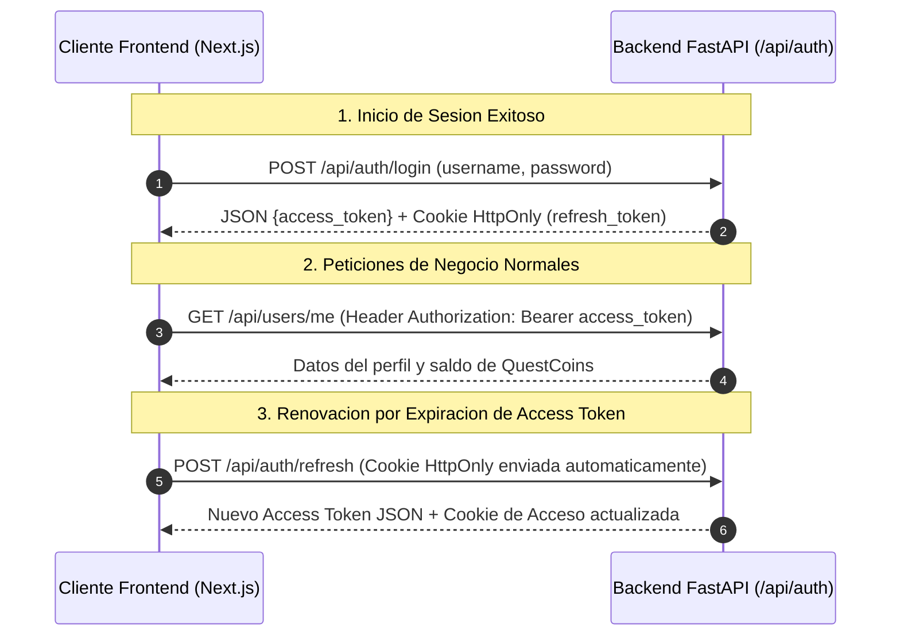

# 06.19 - Proteccion de Sesiones mediante Refresh Tokens en Cookies HTTP-Only

> Enlace de navegación: Volver al [[06.0 - Indice y Mapa de Conceptos Teoricos]]

---

## Explicación Técnica

El mantenimiento seguro de la sesión de un usuario en aplicaciones web desvinculadas (desacopladas) plantea un dilema de seguridad fundamental:
- Si el token de autenticación se almacena en el almacenamiento local del navegador (`localStorage`), cualquier vulnerabilidad de Inyección de Scripts entre Sitios (XSS) permite a un script malicioso leer el token y secuestrar la cuenta.
- Si la sesión depende únicamente de cookies de sesión tradicionales, la aplicación se vuelve vulnerable a ataques de Falsificación de Peticiones en Sitios Cruzados (CSRF).

La solución estándar de la industria consiste en la arquitectura de **Doble Token con Cookie HttpOnly**:

1. **Access Token (Token de Acceso)**: Token JWT firmado digitalmente con un tiempo de expiración corto (minutos u horas). Transmite las credenciales del usuario y se envía en el encabezado HTTP `Authorization: Bearer <token>`.
2. **Refresh Token (Token de Refresco)**: Token JWT firmado con una caducidad extendida (días o semanas). No otorga acceso directo a los recursos de negocio, sino que sirve únicamente para solicitar la emisión de un nuevo Access Token en la ruta `/refresh`.
3. **Protección HttpOnly**: El Refresh Token se transmite exclusivamente mediante la cabecera HTTP `Set-Cookie` con los atributos:
   - `HttpOnly`: Impide de forma absoluta que el script JavaScript del cliente (incluyendo código malicioso inyectado) pueda leer o manipular el valor de la cookie mediante `document.cookie`.
   - `Secure`: Garantiza que la cookie solo se envíe sobre conexiones cifradas HTTPS.
   - `SameSite=Lax` / `SameSite=Strict`: Previene que la cookie sea adjuntada automáticamente en peticiones originadas desde dominios de terceros (mitigando CSRF).

---

## Modelo Conceptual de Analogía: La Llave de Habitación y el Pasaporte en la Caja Fuerte

Considere un huésped que se aloja en un hotel de alta seguridad.

Si el huésped llevara su pasaporte original (Refresh Token) en la mano a todas partes mientras camina por la piscina o el restaurante, correría el riesgo de que un carterista (ataque XSS) se lo robe y suplante su identidad de por vida.

Para evitar este riesgo, la recepción del hotel guarda el pasaporte original dentro de una caja fuerte sellada en la recepción que solo los empleados autorizados pueden manipular (Cookie HttpOnly). En su lugar, la recepción le entrega al huésped una tarjeta magnética temporal para abrir la puerta de su habitación durante 24 horas (Access Token). Si la tarjeta magnética se pierde o vence, el huésped vuelve a la recepción para verificar su caja fuerte sellada y recibir una nueva tarjeta temporal sin haber expuesto jamás su pasaporte original.

---

## Aplicación en el Proyecto QuestFest

En la plataforma QuestFest, la combinación de Access Token y Refresh Token en cookies de navegador garantiza que la experiencia del participante sea fluida durante todo el evento sin comprometer la seguridad de su saldo de QuestCoins.

1. **Emisión en Autenticación**: Al iniciar sesión en `/api/auth/login`, el backend devuelve el Access Token en el cuerpo JSON y establece la cookie `refresh_token` con el atributo `HttpOnly=True`.
2. **Renovación Transparente**: Cuando el token de acceso caduca, la aplicación ejecuta una llamada silenciosa al endpoint `/api/auth/refresh`. El navegador adjunta automáticamente la cookie segura `refresh_token` y el servidor emite una nueva credencial sin cerrar la sesión del usuario.
3. **Cierre de Sesión Seguro**: El endpoint `/api/auth/logout` emite la instrucción de eliminación de la cookie (`response.delete_cookie`), revocando inmediatamente la capacidad de regenerar tokens.

---

## Conceptos Teóricos Relacionados
- [[06.5 - Autenticacion con Tokens JWT]]
- [[06.14 - Middleware y Proteccion de Rutas HTTP]]
- [[06.3 - Politicas CORS y Seguridad en Navegadores]]

---

## Ficheros Físicos del Código Fuente
- Lógica de Generación de Tokens: [backend/app/security.py](vscode://file/c:/.d/fiestas26-project/backend/app/security.py:27) *(create_refresh_token y decode_token)*
- Controlador de Login y Refresh: [backend/app/api/routers/users.py](vscode://file/c:/.d/fiestas26-project/backend/app/api/routers/users.py:35) *(Inyección de cookies HTTP-Only y borrado en logout)*
