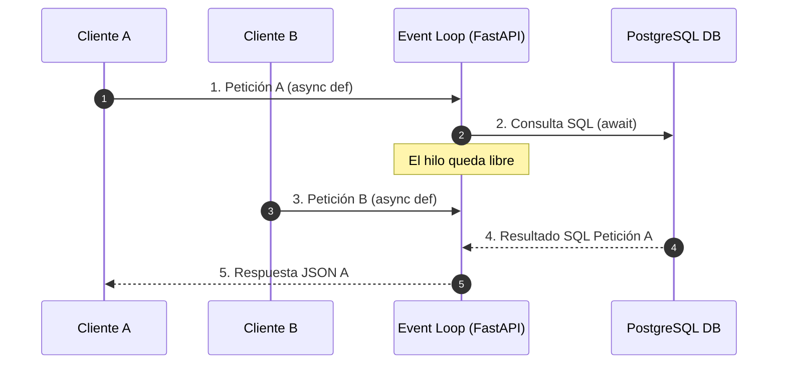

# 06.2 - La Asincronía en Python y FastAPI (async / await)

> Enlace de navegación: Volver al [[06.0 - Indice y Mapa de Conceptos Teoricos]]

---

## Explicación Técnica

La **programación asíncrona** es un paradigma que permite a una aplicación realizar operaciones de entrada/salida (I/O) de forma no bloqueante sobre un único hilo de ejecución.

1. **El Bucle de Eventos (Event Loop)**: FastAPI se ejecuta sobre un servidor ASGI (como Uvicorn) que mantiene un bucle continuo. Cuando una petición solicita una operación lenta de lectura/escritura (como consultar a PostgreSQL o subir una foto a Cloudinary), el hilo de ejecución no se queda paralizado esperando la respuesta.
2. **Las Palabras Clave `async` y `await`**:
   - `async def`: Declara una función como corrutina capaz de pausarse y reanudarse.
   - `await`: Indica el punto exacto donde la ejecución de esa corrutina se cede temporalmente al bucle de eventos mientras se resuelve la tarea externa de entrada/salida.
3. **Concurrencia vs Multithreading**: A diferencia del multithreading tradicional que consume memoria creando hilos del sistema operativo para cada usuario, la asincronía gestiona miles de conexiones concurrentes en un único hilo con un gasto mínimo de memoria RAM.

---

## Analogía de la Cafetería

Para comprender la diferencia entre procesamiento síncrono y asíncrono, se puede analizar mediante la analogía de la atención en una cafetería:

- **Modelo Síncrono (Bloqueante)**: El empleado toma el pedido de un café especial. Se desplaza a la máquina y permanece inmóvil durante 2 minutos observando la extracción del café sin realizar ninguna otra tarea. Una vez entregado el producto, procede a atender al siguiente cliente de la fila. Bajo una afluencia elevada de público, el establecimiento sufre una paralización inmediata.
- **Modelo Asíncrono (`async / await`)**: El empleado toma el pedido, activa el mecanismo de la máquina de café (`await`) e inmediatamente **atiende a los clientes posteriores de la fila** para tomar sus solicitudes. Cuando la máquina emite la señal de finalización, el empleado recupera la bebida, la entrega al cliente correspondiente y continúa el procesamiento sin tiempos muertos.

---

## Aplicación en el Proyecto QuestFest

Durante picos de tráfico en **QuestFest**, múltiples usuarios envían evidencias de misiones y realizan apuestas de **QuestCoins** simultáneamente. Al emplear funciones asíncronas en las operaciones de base de datos (`AsyncSession`), el backend de FastAPI procesa cientos de peticiones concurrentes por segundo sin bloquear la ejecución ni degradar los tiempos de respuesta.

---

## Ficheros Físicos del Código Fuente
- Configuración de Sesión Asíncrona SQLAlchemy: [backend/app/core/database.py](vscode://file/c:/.d/fiestas26-project/backend/app/core/database.py:1)
- Ejemplo de Endpoint Asíncrono: [backend/app/api/routers/misiones.py](vscode://file/c:/.d/fiestas26-project/backend/app/api/routers/misiones.py:14) *(Línea 14: async def suggest_mission)*
- Consultas Asíncronas CRUD: [backend/app/crud/misiones_crud.py](vscode://file/c:/.d/fiestas26-project/backend/app/crud/misiones_crud.py:1)
