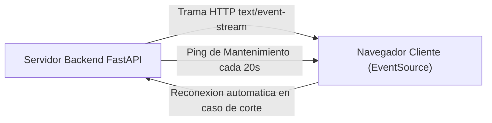

# 06.20 - Eventos Enviados por el Servidor SSE frente a WebSockets

> Enlace de navegación: Volver al [[06.0 - Indice y Mapa de Conceptos Teoricos]]

---

## Explicación Técnica

La comunicación en tiempo real entre un cliente web y un servidor de aplicaciones puede abordarse mediante distintas tecnologías según la direccionalidad del flujo de datos y la complejidad de la infraestructura:

1. **Server-Sent Events (SSE - EventSource)**:
   - Es un estándar W3C basado en el protocolo HTTP/1.1 y HTTP/2 que establece una conexión de transmisión unidireccional persistente desde el servidor hacia el cliente (`text/event-stream`).
   - El cliente inicia la conexión enviando una petición HTTP normal. El servidor mantiene la conexión abierta indefinidamente y envía tramas de texto estructuradas con formato `data: {...}\n\n`.
   - **Ventajas**: Reconexión automática nativa integrada en el navegador, simplicidad de protocolo (funciona sobre HTTP estándar sin necesidad de Handshake especial), excelente compatibilidad con proxies e infraestructura HTTP existente y menor sobrecarga de memoria.

2. **WebSockets (WS / WSS)**:
   - Es un protocolo independiente basado en TCP que inicia con una petición HTTP Upgrade de apretón de manos (*handshake*) para conmutar la conexión a un canal bidireccional dúplex (*full-duplex*).
   - Permite tanto al cliente como al servidor enviarse mensajes binarios o de texto de forma simultánea con bajísima latencia.
   - **Desventajas comparativas para notificaciones**: Requiere gestionar reconexiones manuales complejas, cortafuegos y proxies pueden bloquear conexiones no HTTP, y mayor complejidad en balanceadores de carga.

---

## Modelo Conceptual de Analogía: La Emisora de Radio frente al Teléfono Walkie-Talkie

Considere la transmisión de información en una gran ciudad.

La tecnología Server-Sent Events (SSE) funciona como una emisora de radio FM local. El centro de control del festival enciende el transmisor y todos los asistentes que sintonizan la frecuencia (EventSource) escuchan las canciones y los avisos en directo instantáneamente. Los oyentes no necesitan hablarle a la radio para recibir las noticias; la música fluye de forma constante e ininterrumpida hacia sus receptores.

La tecnología WebSockets funciona como un sistema de telefonía Walkie-Talkie bidireccional. Ambos interlocutores mantienen el canal abierto y pueden hablar y escuchar al mismo tiempo. Aunque es indispensable para llamadas de voz o juegos de acción multijugador en tiempo real, resulta innecesariamente costoso si el único objetivo es que el centro de control anuncie quién ha ganado la rifa diaria.

---

## Aplicación en el Proyecto QuestFest

En la plataforma QuestFest, la arquitectura de notificaciones y actualización del muro social utiliza Server-Sent Events por su idoneidad para flujos unidireccionales de servidor a cliente.

1. **Eliminación de Polling redundantemente**: Reemplaza las peticiones periódicas HTTP evitando miles de consultas SQL innecesarias sobre la base de datos PostgreSQL.
2. **Reconexión Automática Transparente**: Si un participante entra a una zona de baja cobertura dentro del evento y pierde la conexión a internet por unos segundos, el API nativa `EventSource` del navegador intenta reconectarse automáticamente de forma silenciosa sin interrumpir la navegación.
3. **Emisión de Eventos del Sistema**: Cuando un usuario publica un comentario o un administrador aprueba una misión con recompensa de QuestCoins, el servidor emite una trama SSE que actualiza la interfaz de todos los usuarios activos al instante.

---

## Conceptos Teóricos Relacionados
- [[06.1 - Que es una API RESTful y como funciona]]
- [[06.2 - La Asincronia en Python y FastAPI]]
- [[06.12 - Renderizado en Servidor vs Cliente en Next.js]]

---

## Ficheros Físicos del Código Fuente
- Administrador de Suscripciones SSE: [backend/app/core/events.py](vscode://file/c:/.d/fiestas26-project/backend/app/core/events.py:1) *(EventBroadcaster con colas asyncio.Queue)*
- Endpoint de Transmisión SSE: [backend/app/api/routers/publicaciones.py](vscode://file/c:/.d/fiestas26-project/backend/app/api/routers/publicaciones.py:65) *(StreamingResponse text/event-stream)*
- Cliente de Escucha EventSource: [frontend/src/app/page.tsx](vscode://file/c:/.d/fiestas26-project/frontend/src/app/page.tsx:106) *(Suscripción a /api/feed/stream)*
