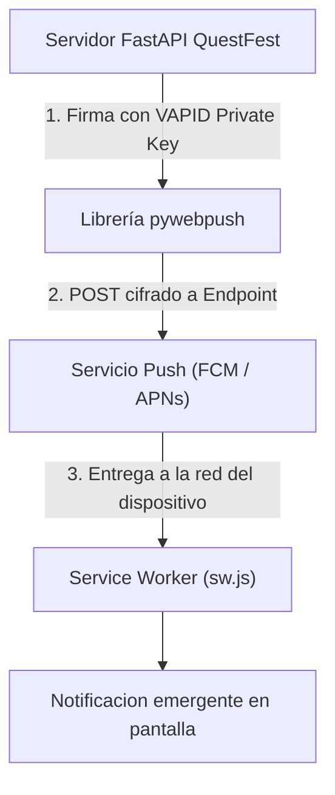

# 06.22 - Protocolo VAPID y Notificaciones Push Web Nativas

> Enlace de navegación: Volver al [[06.0 - Indice y Mapa de Conceptos Teoricos]]

---

## Explicación Técnica

El protocolo VAPID (Voluntary Application Server Identification para Web Push, definido en el RFC 8292) es un estándar abierto de seguridad que permite a un servidor de aplicaciones identificarse de forma voluntaria ante los servicios de notificaciones push de los navegadores (como Google FCM para Chrome/Android o Apple APNs para Safari/iOS) sin depender de credenciales propietarias o de pago.

Mecanismo de funcionamiento de VAPID:
1. **Generación de Par de Claves Asimétricas**: El servidor de aplicaciones genera un par de claves públicas y privadas basadas en curvas elípticas (ECDSA sobre P-256).
2. **Suscripción del Cliente**: La aplicación cliente solicita al navegador una suscripción push enviando la clave pública VAPID del servidor. El servicio push del navegador genera un `endpoint` único y claves de cifrado de mensajes (`p256dh` y `auth`).
3. **Firma Criptográfica**: Cuando el servidor desea enviar una notificación, crea una llamada HTTP POST dirigida al `endpoint` del navegador. La petición se firma con la clave privada VAPID y el contenido útil (*payload*) se cifra con la clave pública `p256dh` del cliente.
4. **Desencriptación Segura**: El servicio push del sistema operativo recibe la trama cifrada, verifica la firma del servidor y la transmite al Service Worker (`sw.js`), el cual descifra el contenido y muestra la notificación emergente.

---

## Modelo Conceptual de Analogía: La Firma con Sello de Cera Real

Considere la correspondencia oficial entre la dirección de un evento y los teléfonos móviles de los asistentes.

En el sistema tradicional sin VAPID, la dirección del evento tendría que pagar una cuota mensual a una agencia privada de mensajería para que entregue los comunicados a domicilio.

Con el protocolo VAPID, la dirección del evento graba un sello de cera único con su clave privada y entrega un molde de verificación de la marca (clave pública) a los guardias de la ciudad (los servicios push del sistema operativo). Cada vez que la dirección envía una carta urgente cifrada con el sello de cera, los guardias comprueban la marca en la puerta del castillo y entregan el sobre directamente en la habitación del asistente. Ningún impostor puede falsificar la carta porque nadie más posee el sello de cera privado.

---

## Aplicación en el Proyecto QuestFest

En la plataforma QuestFest, el protocolo VAPID garantiza que los avisos críticos de la comunidad lleguen al dispositivo del participante de forma inmediata.

1. **Desacoplamiento de Licencias**: No requiere pagar suscripciones a plataformas propietarias de notificaciones push, operando de forma 100% autónoma desde el servidor FastAPI.
2. **Notificaciones en Pantalla Bloqueada**: Alertas enviadas cuando un oponente acepta un duelo 1vs1, cuando el administrador aprueba una misión recompensada con QuestCoins o cuando finaliza una apuesta pari-mutuel.
3. **Persistencia de Dispositivos**: Las suscripciones push se mantienen en la tabla relacional `push_subscriptions`, permitiendo emitir comunicados segmentados a un usuario específico o broadcasts masivos a todos los asistentes.

---

## Conceptos Teóricos Relacionados
- [[06.17 - Progressive Web Apps y Service Workers]]
- [[06.5 - Autenticacion con Tokens JWT]]
- [[06.14 - Middleware y Proteccion de Rutas HTTP]]

---

## Ficheros Físicos del Código Fuente
- Integración de la Librería: [backend/app/services/push_service.py](vscode://file/c:/.d/fiestas26-project/backend/app/services/push_service.py:1) *(Uso de pywebpush con VAPID)*
- Endpoints de Suscripción: [backend/app/api/routers/notifications.py](vscode://file/c:/.d/fiestas26-project/backend/app/api/routers/notifications.py:27) *(Obtención de VAPID Public Key y guardado de endpoint)*
- Manejador en Service Worker: [frontend/public/sw.js](vscode://file/c:/.d/fiestas26-project/frontend/public/sw.js:80) *(Evento push y notificationclick)*
