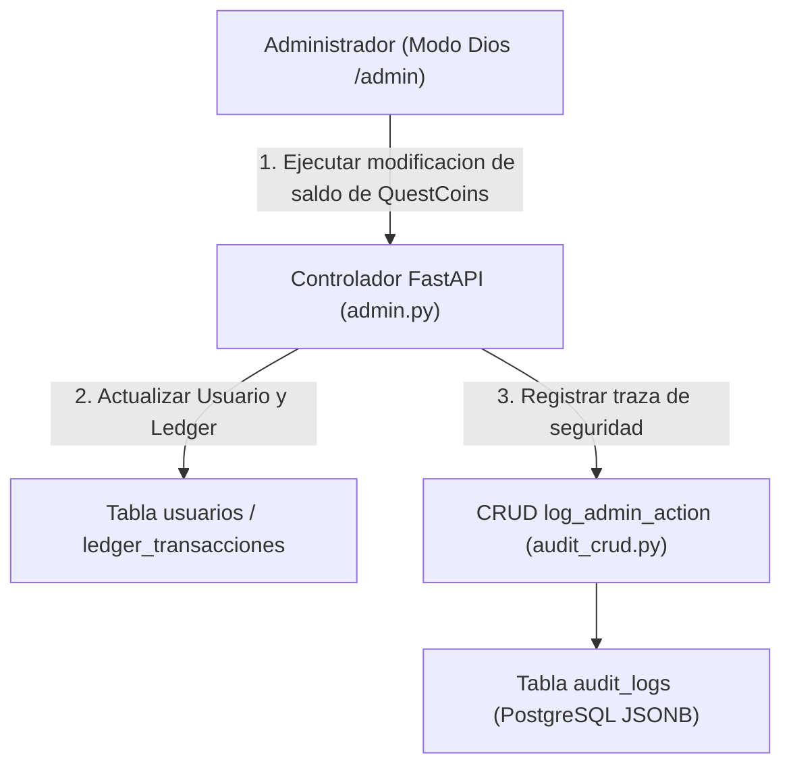

# 06.23 - Registro de Auditoria y Trazabilidad en Sistemas Criticos

> Enlace de navegación: Volver al [[06.0 - Indice y Mapa de Conceptos Teoricos]]

---

## Explicación Técnica

Un Registro de Auditoría (Audit Log o Audit Trail) es una secuencia cronológica inmutable de registros de eventos que documenta las acciones, operaciones de modificación de datos y eventos de seguridad ejecutados en un sistema de información por parte de los usuarios o procesos del sistema.

Principios fundamentales de un sistema de auditoría:
1. **No Repudio**: Garantizar que un usuario no pueda negar la autoría de una modificación realizada bajo sus credenciales autenticadas.
2. **Inmutabilidad y Trazabilidad**: Registrar quién realizó la acción (identificador de usuario o administrador), qué acción ejecutó, qué entidad o tabla fue alterada, la marca temporal de precisión (`timestamp`) y el estado anterior y posterior del registro en formato estructurado (por ejemplo, documentos JSONB).
3. **Desacoplamiento Operativo**: El registro de auditoría no debe interferir con la lógica de negocio ni permitir la alteración o borrado de entradas pasadas desde las interfaces convencionales de usuario.

---

## Modelo Conceptual de Analogía: La Bitácora del Notario en la Sala de Juego

Considere la supervisión de un casino o un torneo de alto nivel donde los árbitros toman decisiones sobre las apuestas y premios de los concursantes.

Para prevenir favorecimientos o sospechas de alteración de saldos de QuestCoins por parte de los jueces, se contrata a un notario independiente que permanece sentado en una esquina de la sala con una libreta encuadernada de páginas numeradas e inalterables (Audit Log).

Cada vez que un árbitro modifica el marcador de un concursante o aprueba un premio, el notario anota de inmediato la fecha y hora exacta, la firma del árbitro, el nombre del jugador afectado y el cambio exacto de saldo realizado. Ningún árbitro puede arrancar una hoja del cuaderno ni borrar una entrada del notario, garantizando la transparencia total frente a cualquier reclamación de la comunidad.

---

## Aplicación en el Proyecto QuestFest

En la plataforma QuestFest, el módulo de auditoría es indispensable para supervisar todas las intervenciones ejecutadas desde el panel administrativo "Modo Dios" (`/admin`).

1. **Monitoreo de Alteraciones Financieras**: Cuando un administrador ajusta manualmente el saldo de QuestCoins de un participante a través de `/api/admin/users/{id}/balance`, la función `log_admin_action` guarda una entrada en la tabla `audit_logs` detallando el `admin_id`, la cantidad otorgada/retirada y el motivo explícito.
2. **Arbitraje de Conflictos**: Permite auditar en caso de disputa quién resolvió un duelo 1vs1 o cuál fue la justificación de rechazar una prueba multimedia de misión subida por un usuario.
3. **Estructura Semi-Estructurada JSONB**: La columna `detalles` almacena objetos flexibles que se adaptan a la complejidad de cada acción sin requerir cambios en el esquema de base de datos.

---

## Conceptos Teóricos Relacionados
- [[06.11 - Transacciones Atomicas e Integridad Referencial]]
- [[06.7 - Control de Acceso Basado en Roles]]
- [[06.10 - Tipos de Datos JSONB en PostgreSQL]]

---

## Ficheros Físicos del Código Fuente
- Modelo de Datos: [backend/app/models/audit.py](vscode://file/c:/.d/fiestas26-project/backend/app/models/audit.py:1) *(Esquema de la tabla audit_logs)*
- Controlador CRUD de Auditoría: [backend/app/crud/audit_crud.py](vscode://file/c:/.d/fiestas26-project/backend/app/crud/audit_crud.py:1) *(Función log_admin_action)*
- Invocación en Operación de Saldo: [backend/app/api/routers/admin.py](vscode://file/c:/.d/fiestas26-project/backend/app/api/routers/admin.py:136) *(Integración en update_user_balance)*
