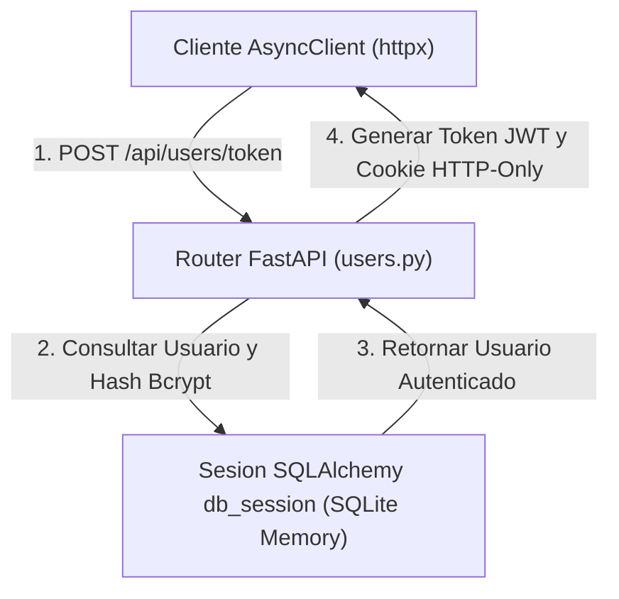

# 06.24 - Pruebas de Integracion y Cobertura de Codigo

> Enlace de navegación: Volver al [[06.0 - Indice y Mapa de Conceptos Teoricos]]

---

## Explicación Técnica

Las Pruebas de Integración (Integration Testing) son un nivel del proceso de verificación de software en el que los módulos individuales, controladores API y componentes de persistencia se combinan y evalúan como un conjunto unificado. A diferencia de las pruebas unitarias simples, las pruebas de integración validan que la comunicación entre la capa de endpoints HTTP, las reglas de negocio en servicios/CRUD y la base de datos relacional funcione de forma coherente y sin efectos secundarios indeseados.

Principios de las pruebas de integración efectivas:
1. **Aislamiento del Entorno de Prueba**: Ejecutar las pruebas sobre una base de datos de prueba (en memoria o contenedor efímero) para asegurar resultados estables y repetibles sin alterar datos reales.
2. **Simulación de Clientes HTTP**: Utilizar clientes asíncronos en memoria (`AsyncClient`) para enviar peticiones HTTP reales a los routers sin necesidad de levantar un puerto de red físico.
3. **Métricas de Cobertura de Código (Code Coverage)**: Evaluar el porcentaje del código fuente (líneas, ramas condicionales e instrucciones) ejecutado durante la suite de pruebas para detectar esquinas no probadas o fallos potenciales.

---

## Modelo Conceptual de Analogía: El Ensayador de Balanzas en la Caja Central

Considere el sistema de control de calidad de un banco central o de la caja fuerte de un parque temático.

Probar cada componente de forma aislada (prueba unitaria) equivale a verificar que las monedas de QuestCoins tengan el peso correcto o que una balanza funcione encendida en una mesa de trabajo. 

Sin embargo, una prueba de integración evalúa el flujo completo: un participante llega a la ventanilla, deposita 50 QuestCoins, el cajero acciona la palanca de transferencia, la balanza ajusta la cuenta y la caja fuerte registra el movimiento en el libro mayor. Si la transferencia se rechaza por falta de saldo, la prueba comprueba que ni la balanza se mueva ni la caja fuerte entregue dinero. Las pruebas de integración aseguran que la interacción completa entre el cliente, el cajero y la caja fuerte sea impecable.

---

## Aplicación en el Proyecto QuestFest

En **QuestFest**, la integridad financiera de las QuestCoins exige que las transacciones y autenticaciones estén respaldadas por pruebas de integración robustas.

1. **Pruebas del Ledger (`test_ledger.py`)**: Valida que al invocar la función `move_tokens`, los saldos de ambos participantes se actualicen atómicamente y que un intento de transferencia con saldo insuficiente sea rechazado mediante una excepción `HTTP 400 InsufficientFundsError`, impidiendo saldos negativos.
2. **Pruebas de Autenticación (`test_auth.py`)**: Comprueba el flujo completo de registro de usuario (`/api/users/register`), verificación de hash de contraseña bcrypt y posterior inicio de sesión (`/api/users/token`) con emisión de tokens de acceso y refresh tokens en cookies HTTP-Only.
3. **Fixtures Asíncronos (`conftest.py`)**: Utiliza `sqlite+aiosqlite:///:memory:` para ejecutar la suite completa en poco más de 1 segundo sin requerir un servidor PostgreSQL activo.

---

## Conceptos Teóricos Relacionados
- [[06.11 - Transacciones Atomicas e Integridad Referencial]]
- [[06.5 - Autenticacion con Tokens JWT]]
- [[06.6 - Hashing de Contraseñas y Algoritmo Bcrypt]]

---

## Ficheros Físicos del Código Fuente
- Configuración de Pruebas: [backend/tests/conftest.py](vscode://file/c:/.d/fiestas26-project/backend/tests/conftest.py:1) *(Fixtures de base de datos SQLite y client ASGI)*
- Suite de Pruebas Ledger: [backend/tests/test_ledger.py](vscode://file/c:/.d/fiestas26-project/backend/tests/test_ledger.py:1) *(Verificación de transferencias e inmutabilidad)*
- Suite de Pruebas Autenticación: [backend/tests/test_auth.py](vscode://file/c:/.d/fiestas26-project/backend/tests/test_auth.py:1) *(Verificación de registro e inicio de sesión)*
