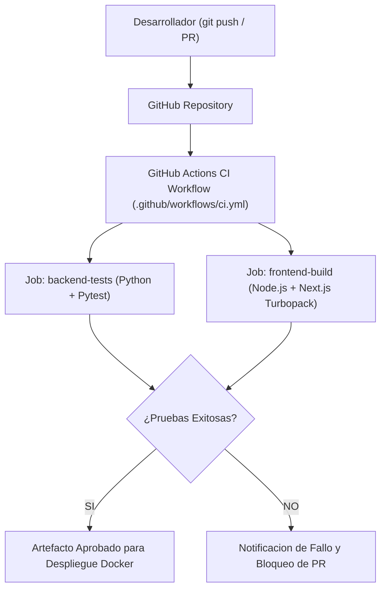

# 06.25 - Integracion y Despliegue Continuo CI/CD

> Enlace de navegación: Volver al [[06.0 - Indice y Mapa de Conceptos Teoricos]]

---

## Explicación Técnica

La Integración Continua (Continuous Integration, CI) y el Despliegue Continuo (Continuous Deployment / Delivery, CD) representan una práctica de ingeniería de software automatizada diseñada para compilar, probar y desplegar cambios de código de forma constante y fiable.

Fases del ciclo CI/CD:
1. **Integración Continua (CI)**: Cada modificación subida al repositorio de control de versiones desencadena la ejecución automática de pipelines en servidores aislados (runners). Estos pipelines compilan el proyecto y ejecutan la suite de pruebas unitarias y de integración. Si alguna prueba falla o existe un error de sintaxis/tipado, el pipeline rechaza la integración.
2. **Entrega/Despliegue Continuo (CD)**: Una vez que el código supera todas las comprobaciones de CI, los artefactos de producción (imágenes Docker, paquetes compilados de Next.js) se construyen de forma automatizada y se despliegan en los servidores de producción sin intervención manual.

---

## Modelo Conceptual de Analogía: La Línea de Inspección y Ensamblaje Automatizada de un Parque

Imagine la cadena de montaje y control de calidad de las carrocerías de una atracción de parque temático.

En lugar de construir una atracción entera y probarla por primera vez el día de la inauguración (lo que acarrearía riesgos enormes de fallos graves), cada pieza fabricada por un ingeniero pasa por una cinta transportadora automatizada (CI Pipeline). 

Sensores automáticos miden las dimensiones de la pieza, prueban su resistencia a la presión y verifican que encaje perfectamente con los pernos existentes. Si la pieza pasa todas las pruebas de calidad de la cinta, un brazo robótico la traslada inmediatamente al circuito de la atracción en funcionamiento (CD Pipeline). Si la pieza presenta el menor defecto, la cinta se detiene y notifica al ingeniero exactamente qué cota no cumplió el estándar.

---

## Aplicación en el Proyecto QuestFest

En la plataforma **QuestFest**, el flujo CI/CD garantiza que ninguna actualización rompa la estabilidad del evento ni impida la participación de los usuarios.

1. **Pipeline de GitHub Actions (`ci.yml`)**: Organizado en dos trabajos paralelos (`backend-tests` y `frontend-build`) que se ejecutan automáticamente ante peticiones de cambio (`pull_requests`) o actualizaciones en la rama principal.
2. **Validación Backend**: Descarga las dependencias de Python y ejecuta `pytest` sobre SQLite en memoria para verificar la lógica del ledger, la autenticación y las reglas de seguridad.
3. **Validación Frontend**: Descarga las dependencias de Node.js y ejecuta `npm run build` para asegurar la compilación limpia de la PWA Next.js Turbopack.
4. **Orquestación en Producción (`docker-compose.prod.yml` / `nginx.conf`)**: Facilita el despliegue directo de contenedores con proxy inverso NGINX, terminación SSL y cabeceras de desinhibición de buffer para SSE.

---

## Conceptos Teóricos Relacionados
- [[06.15 - Contenedores y Virtualizacion con Docker]]
- [[06.24 - Pruebas de Integracion y Cobertura de Codigo]]
- [[05.3 - Despliegue en Produccion y Pipeline CI-CD]]

---

## Ficheros Físicos del Código Fuente
- Workflow de GitHub Actions: [.github/workflows/ci.yml](vscode://file/c:/.d/fiestas26-project/.github/workflows/ci.yml:1)
- Orquestación Docker de Producción: [docker-compose.prod.yml](vscode://file/c:/.d/fiestas26-project/docker-compose.prod.yml:1)
- Configuración NGINX Proxy: [nginx.conf](vscode://file/c:/.d/fiestas26-project/nginx.conf:1)
