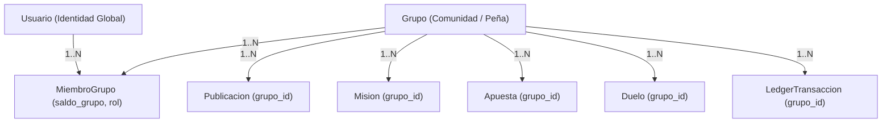

# 06.26 - Patron de Diseño Multi-Tenancy y Modelado Relacional

> Enlace de navegación: Volver al [[06.0 - Indice y Mapa de Conceptos Teoricos]]

---

## Explicación Técnica

El patrón arquitectónico de **Multi-Inquilinato (Multi-Tenancy)** describe un modelo de diseño de software en el que una única instancia de una aplicación sirve a múltiples clientes u organizaciones independientes (denominados inquilinos o *tenants*), garantizando que los datos y la operativa de cada inquilino permanezcan estrictamente aislados e inaccesibles para el resto.

En la ingeniería de bases de datos relacionales existen tres estrategias fundamentales de aislamiento multi-inquilino:

1. **Base de Datos Separada por Inquilino (Database-per-tenant)**:
   - Cada inquilino dispone de su propio motor o base de datos independiente.
   - Máximo aislamiento físico, pero elevado coste operativo, complejidad en el mantenimiento de conexiones y dificultad extrema para aplicar migraciones sobre cientos de bases de datos.
2. **Esquema Separado en Base de Datos Compartida (Schema-per-tenant)**:
   - Una única base de datos alberga esquemas lógicos independientes (por ejemplo, esquemas de PostgreSQL `tenant_1`, `tenant_2`).
   - Buen equilibrio de aislamiento lógico, pero incrementa la complejidad del catálogo interno del motor de base de datos cuando el número de inquilinos escala.
3. **Esquema Compartido con Columna Discriminadora (Shared Schema with Discriminator Column)**:
   - Todos los inquilinos comparten las mismas tablas físicas.
   - Cada fila de datos almacena una clave foránea identificadora del inquilino (en QuestFest, `grupo_id`).
   - El aislamiento se implementa a nivel de consulta y lógica de negocio (filtrado obligatorio por `WHERE entidad.grupo_id == :active_group_id`).

### Ventajas de la Estrategia Elegida en QuestFest
La plataforma **QuestFest** implementa la tercera estrategia (esquema compartido particionado por `grupo_id`), la cual ofrece ventajas determinantes para entornos sociales y de eventos:
- **Mapeo Natural de Usuarios Poli-Comunitarios**: Un mismo usuario físico puede pertenecer a varios grupos simultáneamente mediante la tabla intermedia `miembros_grupo`. En modelos de bases de datos separadas, la identidad del usuario requeriría duplicarse o resolverse mediante un servicio federado externo.
- **Eficiencia en Recursos y Conexiones**: El pool de conexiones asíncronas de SQLAlchemy atiende peticiones de cualquier grupo sin sobrecarga de memoria.
- **Evolución Homogénea mediante Migraciones**: Cualquier actualización de esquema ejecutada mediante **Alembic** se aplica de manera instantánea y atómica a todas las comunidades de la plataforma.
- **Rendimiento O(1) con Índices Compuestos**: Al indexar `grupo_id` junto con las claves temporales o de estado (por ejemplo, `Index('ix_posts_grupo_id', 'grupo_id')`), el motor relacional localiza los registros de una comunidad concreta con coste logarítmico mínimo sin degradación ante el crecimiento de otros grupos.

---

## Modelo Conceptual de Analogía: El Edificio Residencial y los Apartamentos Privados

Imagine la construcción de un complejo de viviendas para alojar a múltiples familias.

En lugar de edificar una pequeña casa aislada en un terreno propio para cada familia (Base de Datos Separada), lo cual multiplicaría el coste de las tuberías generales, los cables de luz y el servicio de basuras, se construye un moderno edificio de apartamentos con estructura compartida (Esquema Compartido).

El edificio cuenta con un portal común y un interfono donde cada inquilino se identifica con su llave personal (Autenticación Global). Sin embargo, cada puerta tiene su propio número de vivienda (Clave Discriminadora `grupo_id`) y una cerradura de seguridad exclusiva.

El vecino del apartamento 3B no puede abrir la puerta del 2A ni consultar la correspondencia que llega al buzón de su vecino. Si un inquilino decide alquilar un trastero en el sótano y una plaza de garaje en el mismo edificio (Pertenencia a Múltiples Grupos), su llavero personal reúne las llaves de ambos recintos sin que sus pertenencias se mezclen.

---

## Aplicación en el Proyecto QuestFest

En **QuestFest**, el identificador `grupo_id` actúa como discriminador de aislamiento en todas las entidades del dominio de juego:

1. **Entidades Aisladas**:
   - `Publicacion`: El feed social y los comentarios están vinculados al grupo.
   - `Mision`: Los retos propuestos y completados pertenecen a la comunidad local.
   - `Apuesta`: Las apuestas colectivas se financian con las QuestCoins de ese grupo.
   - `Duelo`: Los desafíos 1vs1 se disputan exclusivamente entre miembros del mismo grupo.
   - `LedgerTransaccion`: Cada movimiento contable registra el `grupo_id` de la transacción.
   - `AuditLog` y `NotificacionAdmin`: Registro de auditoría y megafonías segmentadas por grupo.

2. **Modelo Entidad-Relación Multi-Tenancy**:

---

## Conceptos Teóricos Relacionados

- [[06.8 - Que es un ORM y como funciona SQLAlchemy]]
- [[06.11 - Transacciones Atomicas e Integridad Referencial]]
- [[06.7 - Control de Acceso Basado en Roles]]
- [[06.9 - Migraciones de Base de Datos con Alembic]]

---

## Ficheros Físicos del Código Fuente

- Modelo relacional de grupos y membresías: [backend/app/models/grupo.py](vscode://file/c:/.d/fiestas26-project/backend/app/models/grupo.py:1) *(Línea 1: Modelos Grupo y MiembroGrupo)*
- Migración estructural multi-grupo en Alembic: [backend/alembic/versions/e7f12a34b567_create_multi_group_tables.py](vscode://file/c:/.d/fiestas26-project/backend/alembic/versions/e7f12a34b567_create_multi_group_tables.py:1) *(Línea 1: Script de migración relacional)*
- Lógica de aislamiento y consultas particionadas: [backend/app/crud/grupo_crud.py](vscode://file/c:/.d/fiestas26-project/backend/app/crud/grupo_crud.py:1) *(Línea 1: CRUD de grupos y miembros)*
- Control de transacciones aisladas en el libro mayor: [backend/app/crud/ledger_crud.py](vscode://file/c:/.d/fiestas26-project/backend/app/crud/ledger_crud.py:1) *(Línea 1: move_tokens con group_id)*
