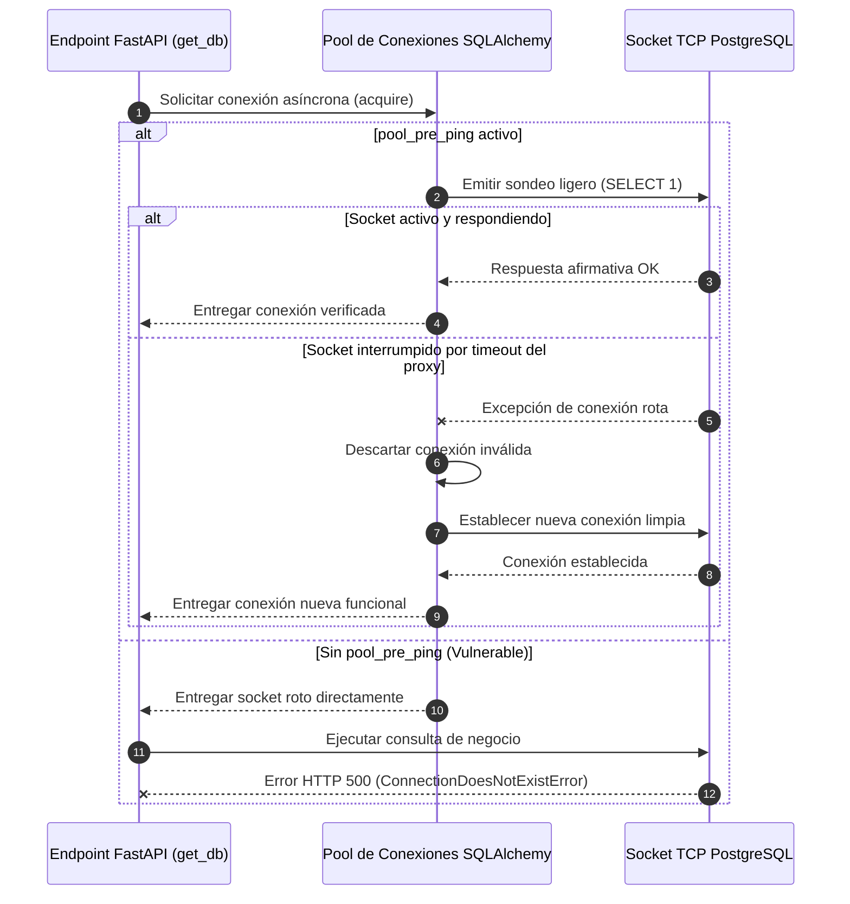

# 06.28 - Agrupamiento de Conexiones y Resiliencia en Bases de Datos

> Enlace de navegación: Volver al [[06.0 - Indice y Mapa de Conceptos Teoricos]]

---

## Explicación Técnica

El **agrupamiento de conexiones** (*Connection Pooling*) es un patrón de optimización y resiliencia de infraestructura de software mediante el cual una aplicación mantiene una colección de conexiones de red activas hacia un motor de base de datos relacional (como PostgreSQL), reutilizándolas entre múltiples peticiones entrantes concurrentes en lugar de abrir y destruir un nuevo socket TCP por cada transacción.

### 1. Coste Computacional de la Apertura de Conexiones
Establecer una conexión directa hacia un servidor de base de datos relacional conlleva un alto coste de latencia y recursos de cómputo:
1. **Negociación de Red (TCP Three-Way Handshake)**: Envío de paquetes SYN, SYN-ACK y ACK a través de la interfaz de red física o virtual.
2. **Negociación Criptográfica TLS/SSL**: Intercambio de certificados y derivación de claves simétricas de sesión.
3. **Autenticación y Autorización**: Verificación de credenciales criptográficas de usuario y permisos en el motor de base de datos.
4. **Reserva de Memoria en el Servidor**: En motores como PostgreSQL, cada conexión cliente genera un proceso dedicado (*backend process* o proceso hijo) que consume memoria de trabajo fija (`work_mem`).

Al implementar un pool de conexiones, el coste de inicialización se amortiza en el arranque del servicio. Las operaciones posteriores adquieren una conexión precalentada del pool en fracciones de milisegundo (complejidad temporal O(1)).

### 2. El Problema de las Desconexiones Silenciosas (Silent Socket Drops)
En arquitecturas distribuidas y entornos de contenedores donde la aplicación opera detrás de proxies de red, puertas de enlace NAT o cortafuegos de filtrado con estado (*stateful firewalls*), las conexiones inactivas que no transmiten paquetes durante un intervalo de tiempo sufren una desvinculación unilateral. El intermediario elimina la entrada de su tabla de traducción de direcciones sin emitir los paquetes de cierre ordenado TCP (FIN o RST).

Cuando la aplicación cliente solicita una conexión del pool e intenta enviar una consulta SQL a través de un socket muerto, el intento falla abruptamente, levantando excepciones como `ConnectionDoesNotExistError`, errores de socket roto (*Broken Pipe*) y códigos de estado HTTP 500 no interceptados.

### 3. Mecanismos de Resiliencia en SQLAlchemy y asyncpg
Para contrarrestar estas desconexiones silenciosas en entornos de alta concurrencia, se implementan tres directivas fundamentales:

1. **Validación Pesimista de Salud (`pool_pre_ping=True`)**:
   Antes de entregar una conexión existente del pool a una sesión de trabajo, el motor ejecuta una instrucción de prueba ultraligera (pesimistic ping, típicamente `SELECT 1`). Si el socket TCP no responde o se encuentra interrumpido, SQLAlchemy captura la excepción de forma transparente, descarta la conexión dañada y genera una conexión limpia y funcional antes de transferirla a la lógica de negocio.
2. **Reciclaje Preventivo Programado (`pool_recycle=1800`)**:
   Configura un límite de vida máxima para las conexiones del pool (por ejemplo, 1800 segundos o 30 minutos). Al alcanzar esta antigüedad, la conexión se cierra ordenadamente y se reemplaza por una nueva, evitando que las conexiones alcancen el umbral de desconexión por inactividad impuesto por balanceadores de red o proxies perimetrales.
3. **Dimensionamiento de Capacidad (`pool_size` y `max_overflow`)**:
   - `pool_size`: Número fijo de conexiones activas permanentes que el pool preserva en todo momento.
   - `max_overflow`: Conexiones adicionales que el pool puede abrir transitoriamente para atender picos extremos de tráfico concurrente, las cuales se cierran de forma automática una vez normalizado el volumen de peticiones.
4. **Normalización Dinámica de Protocolos Asíncronos**:
   Muchos entornos en la nube inyectan URLs de conexión bajo esquemas genéricos (`postgres://` o `postgresql://`). En arquitecturas asíncronas con SQLAlchemy 2.0, estas URLs deben reescribirse automáticamente hacia el protocolo del driver no bloqueante (`postgresql+asyncpg://`) para prevenir fallos de inicialización en tiempo de arranque.

---

## Analogía de la Flota de Taxis y la Inspección Previa al Viaje

Imagine una empresa de transporte que atiende pasajeros en una gran estación de ferrocarril.

Si por cada cliente que llega a la estación la empresa tuviera que comprar un automóvil nuevo en el concesionario, matricularlo, contratar el seguro y encender el motor desde cero, las colas de espera serían intolerables y la empresa quebraría por costes operativos. En su lugar, la empresa mantiene una flota de 10 vehículos aparcados en la parada con el motor en ralentí (el Pool de Conexiones). Cada cliente sube de inmediato a un taxi disponible y, al finalizar su viaje, el coche regresa a la parada para el siguiente usuario.

Sin embargo, si un vehículo ha permanecido apagado en un rincón durante una noche fría, la batería podría haberse descargado sin que nadie lo note a simple vista (desconexión silenciosa). Para garantizar que el cliente no se quede tirado a mitad del camino:
- El taxista gira la llave y comprueba que el motor arranca antes de permitir que el pasajero suba al vehículo (**pool_pre_ping**). Si el coche no arranca, el conductor lo aparta de inmediato al taller y asigna al pasajero otro coche en perfecto estado.
- Tras un turno continuo de varias horas de servicio, cada taxi se envía a una revisión preventiva programada para cambiar filtros y aceite antes de que pueda sufrir una avería grave por desgaste (**pool_recycle**).

---

## Aplicación en el Proyecto QuestFest

En la plataforma **QuestFest**, el motor asíncrono se configura en `backend/app/core/database.py`. Al operar en producción dentro de un clúster de Docker Compose orquestado con NGINX y PostgreSQL, la infraestructura aplica los siguientes estándares de resiliencia:

### Configuración Establecida en el Código Fuente
- **Normalización**: La función `normalize_database_url` transforma cualquier variable `DATABASE_URL` con esquemas `postgres://` o `postgresql://` en `postgresql+asyncpg://`.
- **Pre-ping**: `pool_pre_ping=True` activado para eliminar las excepciones `ConnectionDoesNotExistError`.
- **Reciclaje**: `pool_recycle=1800` para renovar sockets cada 30 minutos de forma transparente.
- **Concurrencia**: `pool_size=10` y `max_overflow=20` ajustados para equilibrar la memoria de PostgreSQL y el caudal de peticiones concurrentes de QuestFest.

---

## Conceptos Teóricos Relacionados

- [[06.8 - Que es un ORM y como funciona SQLAlchemy]]
- [[06.2 - La Asincronia en Python y FastAPI]]
- [[06.11 - Transacciones Atomicas e Integridad Referencial]]
- [[07.1 - Patrones Creacionales en QuestFest]]

---

## Ficheros Físicos del Código Fuente

- Configuración del Pool y Motor Asíncrono: [backend/app/core/database.py](vscode://file/c:/.d/fiestas26-project/backend/app/core/database.py:38) *(Línea 38: Inicialización del motor create_async_engine con pool_pre_ping y pool_recycle)*
- Función de Normalización de URL: [backend/app/core/database.py](vscode://file/c:/.d/fiestas26-project/backend/app/core/database.py:5) *(Línea 5: Función normalize_database_url para driver asyncpg)*
- Inyección de Sesión Asíncrona: [backend/app/core/database.py](vscode://file/c:/.d/fiestas26-project/backend/app/core/database.py:65) *(Línea 65: Generador asíncrono get_db)*
