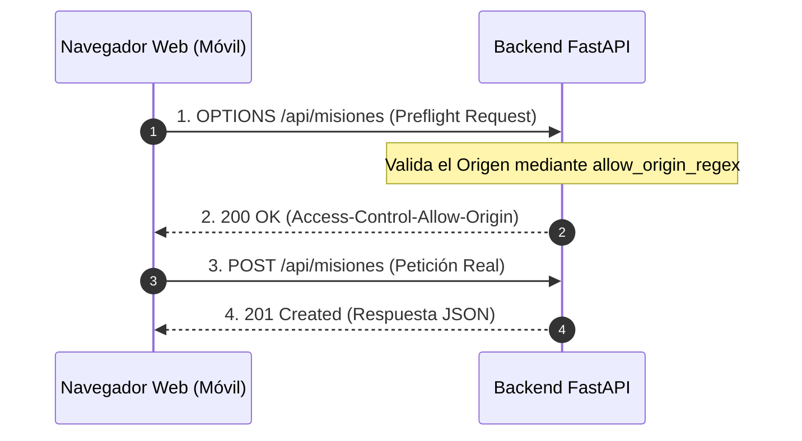

# 06.3 - Políticas CORS y Seguridad en Navegadores

> Enlace de navegación: Volver al [[06.0 - Indice y Mapa de Conceptos Teoricos]]

---

## Explicación Técnica

**CORS** (_Cross-Origin Resource Sharing_ o Intercambio de Recursos de Origen Cruzado) es un mecanismo de seguridad implementado por todos los navegadores web modernos para prevenir ataques maliciosos del tipo Cross-Site Request Forgery (CSRF).

1. **El Principio de Mismo Origen (Same-Origin Policy)**: Por defecto, un navegador web prohíbe que una página cargada desde un dominio (ejemplo: `http://localhost:3000`) realice peticiones HTTP asíncronas (fetch/axios) a un servidor situado en una IP o puerto distinto (ejemplo: `http://localhost:8000`), a menos que el servidor receptor declare explícitamente que autoriza esa conexión.
2. **Peticiones Pre-vuelo (Preflight Requests)**: Ante peticiones que modifican datos (`POST`, `DELETE`, o peticiones con cabecera `Authorization`), el navegador envía automáticamente una petición preliminar con el método `OPTIONS` para preguntar al backend qué origenes, métodos y cabeceras están permitidos.
3. **Expresiones Regulares en CORS**: Para redes locales Wi-Fi con direcciones IP dinámicas asignadas por DHCP (`192.168.x.x`), la configuración CORS del backend debe ser lo suficientemente flexible para validar las subredes mediante expresiones regulares sin abrir la API indeseadamente a todo Internet.

---

## Analogía del Control de Aduanas

Para facilitar la comprensión de las políticas CORS, se puede analizar el mecanismo mediante la analogía de un control aduanero en un puerto:

- **El Navegador Web**: Representa al agente de aduanas que vigila la seguridad del terminal móvil del usuario.
- **La Petición de la App (Next.js)**: Representa a un transporte de mercancías que solicita ingresar en el territorio de destino.
- **La Petición Pre-vuelo (`OPTIONS`)**: Antes de autorizar el desembarco del transporte con su carga, el agente de aduanas realiza una consulta preliminar al puerto receptor (Backend FastAPI) preguntando si la procedencia de la nave (la IP local de la Wi-Fi `192.168.1.45:3000`) figura en el registro oficial de orígenes permitidos.
- **La Respuesta de Autorización**: Si el puerto confirma que el origen está autorizado por las reglas del recinto, el agente autoriza el paso de la mercancía. En caso contrario, deniega la entrada emitiendo un bloqueo de seguridad en la consola del navegador.

---

## Aplicación en el Proyecto QuestFest

En **QuestFest**, los asistentes al evento acceden a la aplicación desde los navegadores de sus smartphones conectados a la red Wi-Fi local. La regla `allow_origin_regex` configurada en `backend/app/main.py` habilita el acceso desde subredes privadas `192.168.x.x` o `10.x.x.x` sin comprometer la seguridad frente a dominios externos no autorizados.

---

## Ficheros Físicos del Código Fuente

- Configuración Middleware CORS: [backend/app/main.py](vscode://file/c:/.d/fiestas26-project/backend/app/main.py:13) _(Línea 13: CORSMiddleware)_
