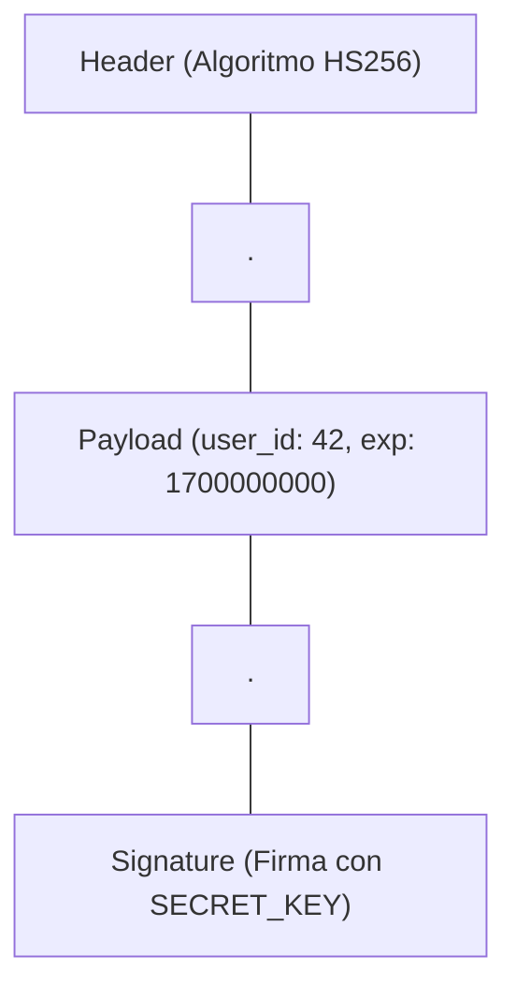

# 06.5 - Autenticación con Tokens JWT (JSON Web Tokens)

> Enlace de navegación: Volver al [[06.0 - Indice y Mapa de Conceptos Teoricos]]

---

## Explicación Técnica

Un **JSON Web Token (JWT)** es un estándar abierto de la industria (RFC 7519) que define un método compacto y autosuficiente para transmitir información estructurada entre partes de forma segura como un objeto JSON.

1. **Estructura Compuesta de 3 Partes**: El token es un texto codificado en Base64 formado por tres secciones separadas por puntos (`Header.Payload.Signature`):
   - **Header (Encabezado)**: Especifica el algoritmo de firma (ejemplo: `HS256`).
   - **Payload (Carga Útil)**: Contiene los datos o _claims_ del usuario (ejemplo: `user_id`, fecha de expiración `exp`).
   - **Signature (Firma Criptográfica)**: Se calcula mediante una clave secreta (`SECRET_KEY`) guardada únicamente en el servidor. Garantiza que el token no ha sido alterado ni falsificado por el cliente.
2. **Naturaleza Sin Estado (Stateless)**: El servidor no necesita almacenar los tokens en la base de datos para verificar la sesión. Basta con descifrar la firma del token recibido en la cabecera `Authorization: Bearer <token>` para confiar en los datos contenidos en el _Payload_.

---

## Analogía del Pase de Acceso Firmado

Para comprender la utilidad de los tokens JWT, se puede analizar mediante la analogía de un pase de acreditación con sello de seguridad:

- **Fase de Autenticación**: El usuario presenta su documento de identidad y sus credenciales en la taquilla de registro.
- **Emisión de la Acreditación (Token JWT)**: La taquilla no requiere retener la documentación del usuario. En su lugar, emite una **acreditación transparente estampada con un sello holográfico exclusivo** (la firma criptográfica `SECRET_KEY`). El reverso del pase contiene impreso el número de registro y la fecha límite de validez (el _Payload_).
- **Validación en Puntos de Acceso**: Al solicitar un servicio o ingresar a un área restringida, el personal de seguridad examina la acreditación. Tras verificar la autenticidad del sello holográfico y comprobar que la fecha está vigente, autoriza el acceso de forma inmediata sin consultar al registro central.

---

## Aplicación en el Proyecto QuestFest

En **QuestFest**, al autenticarse un participante en `/login`, la API de FastAPI le devuelve un Token JWT firmado. El cliente guarda el token en `localStorage` (para peticiones de datos) y en una `Cookie` (para que el Middleware de Next.js le deje pasar a las pantallas privadas). Así, el jugador puede realizar apuestas de **QuestCoins** o enviar fotos de retos sin tener que reintroducir su contraseña en cada acción.

---

## Ficheros Físicos del Código Fuente

- Generación de Token JWT con `python-jose`: [backend/app/security.py](vscode://file/c:/.d/fiestas26-project/backend/app/security.py:20) _(Línea 20: create_access_token)_
- Verificación de Token Bearer: [backend/app/dependencies.py](vscode://file/c:/.d/fiestas26-project/backend/app/dependencies.py:14) _(Línea 14: get_current_user)_
- Almacenamiento Dual en Frontend: [frontend/src/context/AuthContext.tsx](vscode://file/c:/.d/fiestas26-project/frontend/src/context/AuthContext.tsx:68) _(Línea 68: localStorage y Cookie)_
