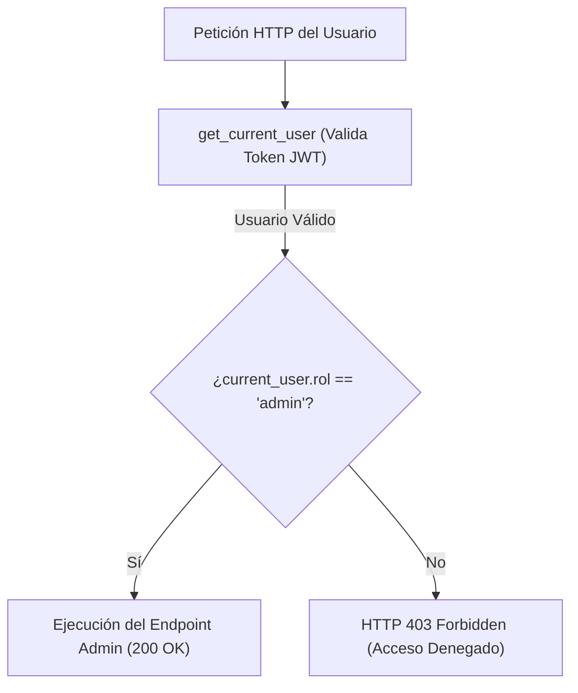

# 06.7 - Control de Acceso Basado en Roles (RBAC)

> Enlace de navegación: Volver al [[06.0 - Indice y Mapa de Conceptos Teoricos]]

---

## Explicación Técnica

El **Control de Acceso Basado en Roles** (RBAC por sus siglas en inglés, _Role-Based Access Control_) es un enfoque de seguridad en la ingeniería de sistemas donde las autorizaciones para realizar operaciones específicas están vinculadas a roles definidos en lugar de a usuarios individuales.

1. **Diferencia entre Autenticación y Autorización**:
   - **Autenticación (Who are you?)**: Verificación de la identidad del usuario (ejemplo: comprobar usuario/contraseña y validar el JWT).
   - **Autorización (What can you do?)**: Verificación de si el usuario autenticado posee los privilegios necesarios para acceder a un recurso o ejecutar una acción en el servidor.
2. **Jerarquía de Roles e Inyección de Dependencias**: En un backend FastAPI, el control de acceso se implementa de forma elegante mediante dependencias encadenadas (`Depends`). Una dependencia raíz como `get_current_user` valida la autenticación, mientras que una dependencia derivada como `get_admin_user` inspecciona la propiedad `user.rol` exigiendo el rol estricto `'admin'`.

---

## Analogía del Control de Llaves Maestras

Para comprender la distinción entre autenticación y autorización por roles, se puede analizar mediante la analogía de la seguridad en un recinto deportivo:

- **Proceso de Autenticación**: En el control de entrada general, el participante presenta su documento de identidad. El personal de seguridad verifica que la identificación corresponde a la persona y le autoriza el acceso al recinto. El usuario se encuentra autenticado.
- **Autorización y Roles (RBAC)**: En el interior del recinto existen sectores de acceso restringido provistos de controles específicos:
  - **Categoría Jugador (`player`)**: La credencial permite el acceso a las zonas comunes de juego, consultar marcadores y participar en competiciones generales.
  - **Categoría Administrador (`admin`)**: Incorpora una **llave maestra de supervisión**. Al solicitar acceso al centro de control técnico (`/admin`), el dispositivo lector (`get_admin_user`) verifica la presencia de la credencial de administrador. Si se cuenta con ella, el acceso se concede; si se presenta una credencial ordinaria de jugador, el sistema bloquea el paso emitiendo una denegación de acceso (error 403 Forbidden).

---

## Aplicación en el Proyecto QuestFest

En **QuestFest**, la base de datos contempla dos roles principales: `'player'` y `'admin'`. Mientras que cualquier jugador puede consultar el ranking o retar a un amigo apostando **QuestCoins**, únicamente los usuarios con rol `'admin'` pueden acceder al panel "Modo Dios" para aprobar o rechazar fotos de misiones enviadas al tribunal o ajustar los marcadores globales.

---

## Ficheros Físicos del Código Fuente

- Restricción SQL de Rol en Modelo: [backend/app/models/usuario.py](vscode://file/c:/.d/fiestas26-project/backend/app/models/usuario.py:20) _(Línea 20: check_rol_valido)_
- Dependencia de Autorización Admin: [backend/app/dependencies.py](vscode://file/c:/.d/fiestas26-project/backend/app/dependencies.py:39) _(Línea 39: get_admin_user)_
- Protección de Rutas Admin en API: [backend/app/api/routers/admin.py](vscode://file/c:/.d/fiestas26-project/backend/app/api/routers/admin.py:1)
