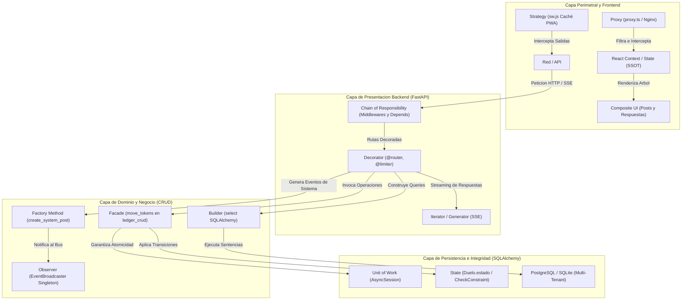

# 07.0 - Indice y Mapa de Patrones Software

> Enlace de navegación: Volver al [[00 - Índice General]]

---

## Explicación Técnica

Este capítulo constituye el inventario y mapa de relaciones de los patrones de ingeniería de software implementados en el código de **QuestFest**. El sistema combina patrones de diseño orientados a objetos (catálogo canónico GoF), patrones de arquitectura empresarial, patrones de robustez y concurrencia, e idioms de lenguaje.

Cada patrón catalogado en esta sección cumple tres criterios de inclusión estrictos:
1. **Presencia Explícita**: Se evidencia en estructuras de datos, firmas de métodos, interfaces o jerarquías de clases concretas del repositorio.
2. **Criticidad de Negocio**: Sustenta operaciones esenciales del sistema (motor económico de QuestCoins, streaming en tiempo real, seguridad de sesiones, modelado social jerárquico o soporte offline).
3. **Comprobabilidad y Testeo**: Interviene en flujos cubiertos o verificables mediante la suite de pruebas unitarias e integración con Pytest.

### Matriz de Patrones Identificados en QuestFest

| Categoría | Patrón de Software | Nivel | Componente / Subsistema de Aplicación | Fichero Principal de Referencia |
| :--- | :--- | :--- | :--- | :--- |
| **Creacional** | **Singleton** | GoF | Bus de eventos SSE y Rate Limiter en memoria | `backend/app/core/events.py` |
| **Creacional** | **Factory Method** | GoF | Generación de publicaciones de sistema y sesiones DB | `backend/app/crud/publicaciones_crud.py` |
| **Creacional** | **Builder** | GoF | Construcción dinámica de consultas SQLAlchemy | `backend/app/crud/publicaciones_crud.py` |
| **Estructural** | **Composite** | GoF | Jerarquía recursiva de publicaciones y respuestas | `backend/app/models/publicaciones.py` |
| **Estructural** | **Facade** | GoF | Fachada transaccional económica ACID (`move_tokens`) | `backend/app/crud/ledger_crud.py` |
| **Estructural** | **Decorator** | GoF | Enrutamiento, cuotas de peticiones e interceptor JWT | `backend/app/api/routers/ruleta.py` |
| **Estructural** | **Proxy** | GoF | Edge routing perimetral y Reverse Proxy Nginx | `frontend/src/proxy.ts` |
| **Comportamiento** | **Observer** | GoF | Publicador/Suscriptor de eventos en tiempo real SSE | `backend/app/core/events.py` |
| **Comportamiento** | **Strategy** | GoF | Políticas de caché en Service Worker y filtros admin | `frontend/public/sw.js` |
| **Comportamiento** | **State** | GoF | Máquina de estados finitos en duelos y misiones | `backend/app/models/juegos.py` |
| **Comportamiento** | **Chain of Responsibility** | GoF | Cadena de middlewares HTTP e inyección de dependencias | `backend/app/dependencies.py` |
| **Comportamiento** | **Iterator / Generator** | GoF | Streaming de eventos SSE y generadores de sesión DB | `backend/app/api/routers/publicaciones.py` |
| **Arquitectónico** | **Clean Layered Architecture** | Arquitectura | Separación desacoplada: Routers -> CRUD -> Models -> DTOs | `backend/app/` |
| **Arquitectónico** | **Unit of Work & Ledger** | Robustez | Libro mayor inmutable con partida simple balanceada | `backend/app/crud/ledger_crud.py` |
| **Arquitectónico** | **Multi-Tenancy Lógico** | Arquitectura | Aislamiento comunitario por `grupo_id` en esquema compartido | `backend/app/models/grupo.py` |
| **Arquitectónico** | **Event-Driven Streaming** | Concurrencia | Emisión unidireccional desacoplada productor-consumidor | `backend/app/api/routers/publicaciones.py` |
| **Cliente / UI** | **Single Source of Truth** | UI State | Estado global distribuido mediante React Context API | `frontend/src/context/` |
| **Cliente / UI** | **Optimistic UI Updates** | UI Pattern | Mutación visual inmediata de saldos y feed sin latencia | `frontend/src/hooks/useFeedStream.ts` |

---

## Modelo Conceptual de Analogía: El Plano Urbanístico del Festival

Imagine la organización y logística de un gran festival temático medieval.

Para que la ciudadela funcione con fluidez y sin incidentes, los organizadores no improvisan la gestión de multitudes ni las transacciones en los puestos de comida. Disponen de un plano urbanístico general (Matriz de Patrones) donde cada necesidad tiene asignada una solución contrastada:

1. El heraldo en la torre central que anuncia los sucesos a toda la plaza con un único megáfono (Singleton y Observer).
2. La casa de la moneda donde se verifican las bolsas de oro y nadie puede retirar más de lo que posee (Facade, Unit of Work y Ledger).
3. Los tablones de anuncios donde los avisos principales admiten notas de respuesta clavadas debajo (Composite).
4. El reglamento del torneo que estipula si dos caballeros están en fase de reto, combate o arbitraje final (State).
5. Las murallas y portones exteriores que exigen mostrar la pulsera oficial antes de cruzar a la zona VIP (Proxy y Chain of Responsibility).

Cada estructura colabora de manera integrada con el resto, permitiendo que miles de participantes disfruten de las actividades sin que el sistema colapse.

---

## Aplicación en el Proyecto QuestFest

En **QuestFest**, los patrones cooperan de forma cruzada a través de las distintas capas de la arquitectura:

### Navegación del Capítulo 07

- [[07.1 - Patrones Creacionales en QuestFest]]: Singleton, Factory Method y Builder en la instanciación de recursos críticos.
- [[07.2 - Patrones Estructurales en QuestFest]]: Composite, Facade, Decorator y Proxy en la composición modular del sistema.
- [[07.3 - Patrones de Comportamiento en QuestFest]]: Observer, Strategy, State, Chain of Responsibility e Iterator en la interacción de objetos.
- [[07.4 - Patrones Arquitectonicos y Motor Transaccional Ledger]]: Arquitectura en capas, Unit of Work y contabilidad de partida inmutable.
- [[07.5 - Conexion e Inversion de Control en Frameworks del Proyecto]]: Cómo FastAPI, SQLAlchemy, Next.js y la API Service Worker articulan estos patrones.

---

## Conceptos Teóricos Relacionados

- [[06.8 - Que es un ORM y como funciona SQLAlchemy]]
- [[06.11 - Transacciones Atomicas e Integridad Referencial]]
- [[06.13 - Gestion del Estado Global y Context API]]
- [[06.14 - Middleware y Proteccion de Rutas HTTP]]
- [[06.17 - Progressive Web Apps y Service Workers]]
- [[06.20 - Eventos Enviados por el Servidor SSE frente a WebSockets]]
- [[06.26 - Patron de Diseño Multi-Tenancy y Modelado Relacional]]
- [[06.27 - Patrones de Diseño Software y Catalogo GoF]]

---

## Ficheros Físicos del Código Fuente

- Punto de entrada y middlewares: [backend/app/main.py](vscode://file/c:/.d/fiestas26-project/backend/app/main.py:1) *(Línea 1: Configuración de la aplicación y decoradores)*
- Dependencias de seguridad: [backend/app/dependencies.py](vscode://file/c:/.d/fiestas26-project/backend/app/dependencies.py:14) *(Línea 14: Cadena de responsabilidad)*
- Fachada económica y transacciones: [backend/app/crud/ledger_crud.py](vscode://file/c:/.d/fiestas26-project/backend/app/crud/ledger_crud.py:11) *(Línea 11: Función move_tokens)*
- Bus de eventos en memoria: [backend/app/core/events.py](vscode://file/c:/.d/fiestas26-project/backend/app/core/events.py:5) *(Línea 5: Broadcaster Observer y Singleton)*
- Proxy perimetral de rutas: [frontend/src/proxy.ts](vscode://file/c:/.d/fiestas26-project/frontend/src/proxy.ts:11) *(Línea 11: Función proxy de Next.js)*
- Service Worker y políticas de caché: [frontend/public/sw.js](vscode://file/c:/.d/fiestas26-project/frontend/public/sw.js:1) *(Línea 1: Estrategias de red y caché)*

---

> Nota de uso en Obsidian: Esta nota actúa como nodo central y punto de partida para estudiar la arquitectura de software de QuestFest desde el grafo interactivo.
