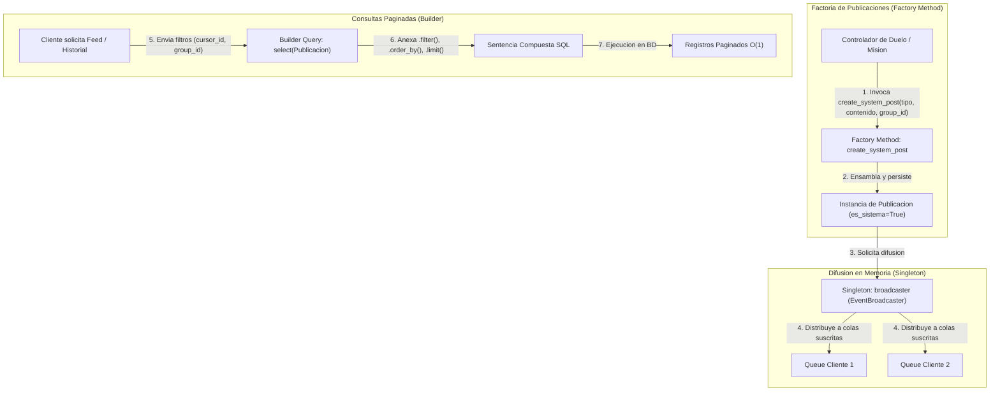

# 07.1 - Patrones Creacionales en QuestFest

> Enlace de navegación: Volver al [[07.0 - Indice y Mapa de Patrones Software]]

---

## Explicación Técnica

Los **patrones creacionales** resuelven la problemática vinculada a la instanciación de objetos. Su objetivo primario es aislar el código cliente del proceso concreto de creación, inicialización y ensamblado de clases y entidades, proporcionando flexibilidad respecto a qué objetos se crean, quién los crea, cómo se componen y cuándo se instancian.

En el código fuente de **QuestFest** se manifiestan de forma explícita tres patrones creacionales canónicos del catálogo GoF:

### 1. Singleton (Instancia Única)
- **Definición Formal**: Garantiza que una clase posea una única instancia a lo largo del ciclo de vida del proceso de ejecución y proporciona un punto de acceso global y uniforme a dicha instancia.
- **Implementación en el Proyecto**:
  - En `backend/app/core/events.py`, la clase `EventBroadcaster` gestiona el registro en memoria de oyentes asíncronos (`asyncio.Queue`). Al final del módulo se instancia `broadcaster = EventBroadcaster()`. Los routers importan directamente este objeto singleton, asegurando que todos los hilos del Event Loop compartan exactamente el mismo conjunto de suscriptores para la emisión de eventos en tiempo real.
  - En `backend/app/core/rate_limiter.py`, el limitador de tasa `limiter = Limiter(key_func=get_remote_address)` se crea como singleton de módulo y se vincula a `app.state.limiter` en `main.py`.
  - En `frontend/src/lib/axios.ts`, la configuración del cliente Axios (`baseURL`, `withCredentials`, interceptores de cabeceras) se exporta como una instancia única compartida en todo el árbol de componentes de React.

### 2. Factory Method (Método Fábrica)
- **Definición Formal**: Define una interfaz o método para crear un objeto, permitiendo a las subclases o a funciones auxiliares parametrizadas encapsular la lógica de instanciación y decidir qué tipo de objeto concreto o con qué valores de configuración inicializarlo.
- **Implementación en el Proyecto**:
  - En `backend/app/crud/publicaciones_crud.py`, se distinguen dos métodos factoría: `create_post` (creación manual por un usuario autenticado) y `create_system_post`. El método `create_system_post` recibe el tipo de evento de juego (`duelo`, `ruleta`, `mision`, `apuesta`), establece forzosamente `autor_id=None` y `es_sistema=True`, asociándolo opcionalmente al grupo activo. Este desacoplamiento permite que los controladores de duelos o misiones generen publicaciones en el feed sin conocer los detalles internos de construcción del modelo relacional.
  - En `backend/app/core/database.py`, `AsyncSessionLocal = async_sessionmaker(bind=engine, class_=AsyncSession, expire_on_commit=False)` actúa como una factoría tipada para generar instancias de sesión asíncrona ORM.

### 3. Builder (Constructor Progresivo)
- **Definición Formal**: Separa la construcción de un objeto complejo de su representación final, permitiendo que el mismo proceso de construcción paso a paso produzca diferentes configuraciones o representaciones según los parámetros de entrada.
- **Implementación en el Proyecto**:
  - En `backend/app/crud/publicaciones_crud.py` (función `get_feed`), la sentencia de consulta relacional no se escribe como una cadena estática SQL, sino que se construye mediante llamadas encadenadas sobre el builder de SQLAlchemy 2.0:
    ```python
    query = select(Publicacion).options(joinedload(Publicacion.autor), ...).filter(Publicacion.parent_id == None)
    if group_id is not None:
        query = query.filter(Publicacion.grupo_id == group_id)
    if cursor_id is not None and cursor_id > 0:
        query = query.filter(Publicacion.id < cursor_id)
    query = query.order_by(desc(Publicacion.id)).limit(limit)
    ```
  - En `backend/app/api/routers/admin.py` (función `preview_audience`), el builder compone la consulta de destinatarios evaluando el parámetro `destinatario_tipo` (`all`, `bankrupt`, `specific`, `no_bet`).

---

## Modelo Conceptual de Analogía: El Taller del Maestro Artesano

Imagine un taller artesanal en la plaza central de una villa medieval.

1. **La Imprenta Real (Singleton)**:
   En toda la comarca existe una única imprenta oficial con el sello del reino. Si cualquier guardia, mercader o heraldo necesita colgar un decreto público, debe acudir a la misma imprenta única. Si cada uno tuviera una máquina distinta en su casa, las convocatorias oficiales y los avisos se imprimirían en prensas diferentes y nadie sabría cuál es el canal fidedigno.

2. **El Horno de Sellos Oficiales (Factory Method)**:
   Cuando el alguacil ordena emitir una citación judicial, no funde el plomo ni talla la cera manualmente. Solicita al horno un "sello de sanción", y el horno se encarga de aplicar los grabados oficiales, fijar la cera roja y firmar como auto oficial del juzgado, garantizando que el documento cumpla el formato legal sin que el alguacil sea un perito en forja.

3. **El Escaparate a Medida del Sastre (Builder)**:
   Cuando un caballero encarga una armadura, no compra un conjunto rígido prefijado. El sastre comienza con una cota de malla base; si el torneo es a caballo, añade guardabrazos reforzados; si hay lluvia, agrega capa impermeable; y si el caballero pertenece a una orden concreta, borda su escudo en el pecho. El proceso de ensamble paso a paso construye la vestimenta exacta según la necesidad del torneo.

---

## Aplicación en el Proyecto QuestFest

El siguiente diagrama detalla cómo colaboran los tres patrones creacionales al momento de generarse un evento en el juego:



### Ventajas Técnicas en QuestFest:
- **Prevención de Fugas de Estado**: El patrón Singleton en `broadcaster` asegura que no existan múltiples colecciones de suscriptores dispersas entre procesos asíncronos en el worker de Uvicorn.
- **Encapsulación de Reglas de Negocio**: `create_system_post` garantiza la invariante de que las publicaciones automáticas carecen de autor humano y no pueden ser suplantadas por un cliente externo.
- **Protección contra Inyección SQL y Flexibilidad de Filtros**: El patrón Builder de SQLAlchemy 2.0 compila parámetros tipados y ensambla la paginación por cursor de manera óptima sin riesgo de interpolación de cadenas inseguras.

---

## Conceptos Teóricos Relacionados

- [[06.2 - La Asincronia en Python y FastAPI]]
- [[06.8 - Que es un ORM y como funciona SQLAlchemy]]
- [[06.20 - Eventos Enviados por el Servidor SSE frente a WebSockets]]
- [[06.21 - Paginacion Eficiente por Cursor en Bases de Datos Relacionales]]
- [[06.27 - Patrones de Diseño Software y Catalogo GoF]]
- [[07.0 - Indice y Mapa de Patrones Software]]

---

## Ficheros Físicos del Código Fuente

- Singleton EventBroadcaster: [backend/app/core/events.py](vscode://file/c:/.d/fiestas26-project/backend/app/core/events.py:27) *(Línea 27: broadcaster = EventBroadcaster())*
- Singleton Rate Limiter: [backend/app/core/rate_limiter.py](vscode://file/c:/.d/fiestas26-project/backend/app/core/rate_limiter.py:10) *(Línea 10: limiter = Limiter(...))*
- Singleton Cliente Axios: [frontend/src/lib/axios.ts](vscode://file/c:/.d/fiestas26-project/frontend/src/lib/axios.ts:3) *(Línea 3: export default api)*
- Factory Method Publicaciones: [backend/app/crud/publicaciones_crud.py](vscode://file/c:/.d/fiestas26-project/backend/app/crud/publicaciones_crud.py:27) *(Línea 27: Función create_system_post)*
- Factory Method Sesiones DB: [backend/app/core/database.py](vscode://file/c:/.d/fiestas26-project/backend/app/core/database.py:21) *(Línea 21: AsyncSessionLocal = async_sessionmaker(...))*
- Builder de Consultas Paginadas: [backend/app/crud/publicaciones_crud.py](vscode://file/c:/.d/fiestas26-project/backend/app/crud/publicaciones_crud.py:57) *(Líneas 57 a 78: Construcción encadenada de query en get_feed)*
- Builder de Audiencias Administrativas: [backend/app/api/routers/admin.py](vscode://file/c:/.d/fiestas26-project/backend/app/api/routers/admin.py:73) *(Líneas 73 a 90: Construcción dinámica en preview_audience)*

---

> Nota de uso en Obsidian: Consulte la nota siguiente [[07.2 - Patrones Estructurales en QuestFest]] para continuar el recorrido del catálogo de patrones de software.
