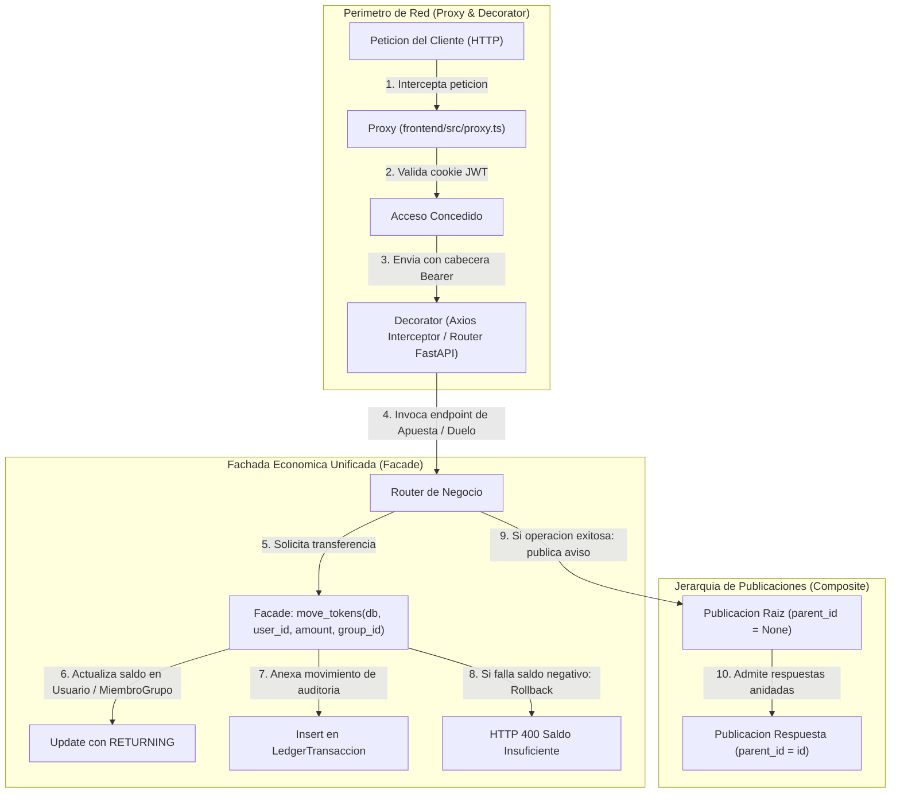

# 07.2 - Patrones Estructurales en QuestFest

> Enlace de navegación: Volver al [[07.0 - Indice y Mapa de Patrones Software]]

---

## Explicación Técnica

Los **patrones estructurales** se ocupan de cómo se componen y organizan las clases y objetos para constituir subsistemas y estructuras de mayor escala, manteniendo la modularidad, la cohesión interna y la flexibilidad del diseño. Estos patrones facilitan la integración de módulos heterogéneos y definen límites arquitectónicos claros entre las diferentes capas del software.

En el código fuente de **QuestFest** destacan cuatro patrones estructurales canónicos del catálogo GoF:

### 1. Composite (Objeto Compuesto / Estructura en Árbol)
- **Definición Formal**: Compone objetos en estructuras jerárquicas de árbol para representar relaciones parte-todo, permitiendo a los clientes tratar a los objetos individuales y a las composiciones de objetos de manera uniforme a través de una misma interfaz o esquema de datos.
- **Implementación en el Proyecto**:
  - En `backend/app/models/publicaciones.py`, el modelo `Publicacion` implementa una relación autorreferencial recursiva:
    ```python
    parent_id: Mapped[Optional[int]] = mapped_column(ForeignKey("publicaciones.id", ondelete="CASCADE"), nullable=True)
    parent: Mapped[Optional["Publicacion"]] = relationship("Publicacion", back_populates="respuestas", remote_side=[id])
    respuestas: Mapped[list["Publicacion"]] = relationship("Publicacion", back_populates="parent", cascade="all, delete-orphan")
    ```
  - Tanto un post raíz (`parent_id == None`) como un comentario o réplica anidada (`parent_id != None`) son instancias de la misma entidad `Publicacion`. Los algoritmos de carga en base de datos (`joinedload(Publicacion.respuestas)`) y el tratamiento en frontend (`useFeedStream.ts`) procesan las publicaciones y sus árboles de respuestas polimórficamente sin requerir dos esquemas relacionales divergentes.

### 2. Facade (Fachada)
- **Definición Formal**: Proporciona una interfaz unificada y simplificada para acceder a un conjunto complejo de interfaces, subsistemas o librerías de bajo nivel, reduciendo el acoplamiento y ocultando la complejidad operativa interna.
- **Implementación en el Proyecto**:
  - En `backend/app/crud/ledger_crud.py`, la función `move_tokens` actúa como la fachada unificada del motor económico ACID de QuestFest:
    ```python
    async def move_tokens(db: AsyncSession, user_id: int, amount: int, concept: str, auto_commit: bool = True, group_id: Optional[int] = None) -> None:
    ```
    Oculta la complejidad de: determinar el ámbito de saldo (saldo local en `MiembroGrupo` si hay `group_id`, o saldo global en `Usuario`), ejecutar sentencias atómicas `UPDATE ... RETURNING`, instanciar y anexar la fila de auditoría en `LedgerTransaccion`, interceptar la violación de `CheckConstraint("saldo_actual >= 0")` y abortar con `rollback` HTTP 400.
    Cualquier subsistema (apuestas, duelos, ruleta, misiones o tribunal administrativo) interactúa con la economía a través de esta única función sin duplicar la lógica de consistencia contable.
  - En `backend/app/services/push_service.py`, `send_web_push` simplifica la criptografía asimétrica VAPID, la codificación de claims y el tratamiento de errores de red del estándar Web Push.

### 3. Decorator (Decorador)
- **Definición Formal**: Añade responsabilidades y comportamientos adicionales a un objeto o función de forma dinámica y transparente, envolviéndolo sin alterar su implementación original ni requerir herencia rígida.
- **Implementación en el Proyecto**:
  - En `backend/app/api/routers/ruleta.py` y el resto de controladores FastAPI, los decoradores de endpoint (`@router.post(...)`, `@router.get(...)`) instrumentan las funciones asíncronas con validación de esquemas Pydantic, serialización OpenAPI y registro de rutas en Starlette.
  - El decorador `@limiter.limit("10/minute")` envuelve la ejecución del handler evaluando la cuota de peticiones por dirección IP antes de invocar la lógica interna.
  - En `frontend/src/lib/axios.ts`, `api.interceptors.request.use(...)` decora cada petición saliente agregando la cabecera `Authorization: Bearer <token>` extraída de `localStorage`.

### 4. Proxy (Sustituto / Intermediario)
- **Definición Formal**: Proporciona un sustituto o intermediario que controla el acceso a otro objeto o recurso, permitiendo realizar operaciones de intercepción, filtrado, autenticación o diferimiento antes de ceder el paso al recurso real.
- **Implementación en el Proyecto**:
  - En `frontend/src/proxy.ts`, la función `proxy` actúa como el Edge Routing Proxy de Next.js 16. Se sitúa en el perímetro antes de la resolución de componentes de React. Intercepta peticiones HTTP, descodifica la cookie de sesión `access_token`, valida si la ruta solicitada es privada y redirige forzosamente hacia `/login` o hacia `/groups`, impidiendo que peticiones no autorizadas lleguen a renderizar páginas o consultar APIs.
  - En `nginx.conf`, el servidor Nginx actúa como Reverse Proxy perimetral gestionando certificados SSL, cabeceras seguras y redirigiendo el tráfico hacia `/api` o hacia los contenedores de Next.js.

---

## Modelo Conceptual de Analogía: La Anatomía de la Ciudadela

Imagine la infraestructura física de una ciudadela en fiestas.

1. **El Tablón Comunitario de Notas (Composite)**:
   En el muro de la plaza hay un pergamino oficial. Debajo de él, los ciudadanos clavan notas de respuesta o aclaraciones. Las notas de respuesta son de papel idéntico al pergamino grande; admiten las mismas firmas y se leen de la misma manera. El conjunto forma un árbol visible donde un aviso y sus réplicas comparten la misma naturaleza.

2. **La Ventanilla Única de la Tesorería (Facade)**:
   Para comprar fichas de torneo, apostar en el palenque o cobrar premios de misiones, los ciudadanos no bajan a la bóveda subterránea ni manipulan los libros de contabilidad. Solo se acercan a la ventanilla única. El funcionario de la ventanilla descuenta el dinero, anota la partida en el libro mayor y sella el recibo.

3. **La Pulsera Sellada para Entrar al Palenque (Decorator)**:
   Los asistentes son las mismas personas, pero al colocarse la pulsera identificativa adquieren temporalmente derechos especiales: cruzar el puente levadizo, participar en torneos y recibir alertas de los heraldos. La persona sigue siendo la misma, pero ha sido "decorada" con facultades adicionales.

4. **El Puesto de Guardia en el Puente Levadizo (Proxy)**:
   Nadie puede pisar la fortaleza sin pasar frente a los centinelas del puente. Los guardias verifican si el viajero tiene pase de día o salvoconducto. Si no lo tiene, lo envían al albergue exterior sin dejarle cruzar la puerta ni consumir espacio dentro del recinto.

---

## Aplicación en el Proyecto QuestFest

El siguiente diagrama ilustra la orquestación de estos patrones estructurales en el flujo de una operación económica y social:



### Impacto en la Mantenibilidad del Código:
- **Trazabilidad Económica Inquebrantable**: Centralizar todas las mutaciones de tokens en la fachada `move_tokens` garantiza que ningún endpoint del backend pueda alterar saldos sin generar su correspondiente asiento contable en `ledger_transacciones`.
- **Eliminación de Redundancia de Esquemas**: La estructura Composite de `Publicacion` evita tener tablas separadas para "Posts" y "Comentarios", simplificando las consultas de feed con `joinedload` y las notificaciones SSE.
- **Seguridad en Capas**: El patrón Proxy perimetral filtra peticiones espurias en el Edge antes de comprometer memoria en el backend.

---

## Conceptos Teóricos Relacionados

- [[06.8 - Que es un ORM y como funciona SQLAlchemy]]
- [[06.11 - Transacciones Atomicas e Integridad Referencial]]
- [[06.14 - Middleware y Proteccion de Rutas HTTP]]
- [[06.18 - Limitacion de Tasa de Peticiones y Algoritmo Leaky Bucket]]
- [[06.27 - Patrones de Diseño Software y Catalogo GoF]]
- [[07.0 - Indice y Mapa de Patrones Software]]
- [[07.4 - Patrones Arquitectonicos y Motor Transaccional Ledger]]

---

## Ficheros Físicos del Código Fuente

- Modelo jerárquico Composite: [backend/app/models/publicaciones.py](vscode://file/c:/.d/fiestas26-project/backend/app/models/publicaciones.py:11) *(Líneas 11 a 28: Relación autorreferencial parent y respuestas)*
- Fachada económica unificada: [backend/app/crud/ledger_crud.py](vscode://file/c:/.d/fiestas26-project/backend/app/crud/ledger_crud.py:11) *(Líneas 11 a 95: Función move_tokens)*
- Fachada de notificaciones Web Push: [backend/app/services/push_service.py](vscode://file/c:/.d/fiestas26-project/backend/app/services/push_service.py:18) *(Líneas 18 a 50: Función send_web_push)*
- Decoradores de ruta y rate limiting: [backend/app/api/routers/ruleta.py](vscode://file/c:/.d/fiestas26-project/backend/app/api/routers/ruleta.py:13) *(Líneas 13 y 14: Decoradores de endpoint y rate limiter)*
- Decorador de cliente Axios: [frontend/src/lib/axios.ts](vscode://file/c:/.d/fiestas26-project/frontend/src/lib/axios.ts:8) *(Líneas 8 a 16: api.interceptors.request.use)*
- Proxy perimetral de rutas: [frontend/src/proxy.ts](vscode://file/c:/.d/fiestas26-project/frontend/src/proxy.ts:11) *(Líneas 11 a 57: Función proxy de Next.js)*
- Proxy inverso de producción: [nginx.conf](vscode://file/c:/.d/fiestas26-project/nginx.conf:24) *(Líneas 24 a 64: Configuración de Reverse Proxy)*

---

> Nota de uso en Obsidian: Consulte la nota siguiente [[07.3 - Patrones de Comportamiento en QuestFest]] para examinar los patrones dinámicos de interacción del sistema.
