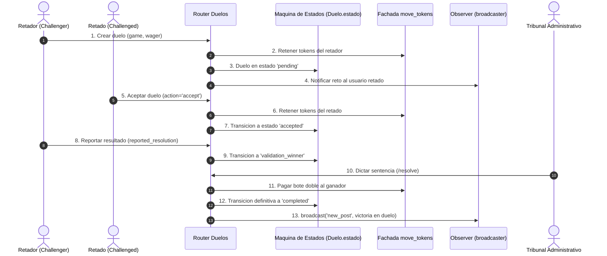

# 07.3 - Patrones de Comportamiento en QuestFest

> Enlace de navegación: Volver al [[07.0 - Indice y Mapa de Patrones Software]]

---

## Explicación Técnica

Los **patrones de comportamiento** se centran en los algoritmos, la asignación de responsabilidades y la dinámica de interacción entre objetos. Estos patrones describen no solo las pautas estructurales de las clases, sino sobre todo los modelos de comunicación y sincronización en tiempo de ejecución, facilitando que múltiples componentes colaboren sin acoplarse directamente entre sí.

En el código fuente de **QuestFest** se implementan de forma explícita cinco patrones de comportamiento canónicos del catálogo GoF:

### 1. Observer (Publicador - Suscriptor)
- **Definición Formal**: Define una dependencia uno-a-muchos entre objetos, de modo que cuando un objeto (el sujeto o publicador) cambia de estado o emite un evento, todos sus dependientes (observadores o suscriptores) son notificados y actualizados de manera automática.
- **Implementación en el Proyecto**:
  - En `backend/app/core/events.py`, la clase `EventBroadcaster` implementa el sujeto:
    ```python
    class EventBroadcaster:
        def __init__(self):
            self.listeners: Set[asyncio.Queue] = set()
        async def subscribe(self) -> asyncio.Queue: ...
        def unsubscribe(self, queue: asyncio.Queue): ...
        async def broadcast(self, event_type: str, data: dict): ...
    ```
  - En `backend/app/api/routers/publicaciones.py`, el endpoint `/stream` suscribe a cada cliente conectado mediante una cola asíncrona dedicada (`queue = await broadcaster.subscribe()`). Cuando se crea un post o respuesta, se invoca `await broadcaster.broadcast(...)`.
  - En `frontend/src/hooks/useFeedStream.ts`, el cliente actúa como observador conectándose a la URL del stream con la API estándar `EventSource`, actualizando reactivamente la lista de publicaciones al recibir eventos `new_post` y `new_reply`.
  - En `frontend/public/sw.js`, el Service Worker actúa como observador de eventos `push` y `notificationclick` disparados por el sistema operativo y el navegador.

### 2. Strategy (Estrategia)
- **Definición Formal**: Define una familia de algoritmos, encapsula cada uno de ellos y los hace intercambiables en tiempo de ejecución. Permite que el algoritmo varíe independientemente de los clientes que lo utilizan.
- **Implementación en el Proyecto**:
  - En `frontend/public/sw.js`, el Service Worker aplica distintas estrategias de red y caché según la naturaleza del recurso interceptado en el evento `fetch`:
    1. *Estrategia Network-First con Fallback Offline*: Aplicada a la navegación HTML (`request.mode === 'navigate'`). Intenta obtener la página fresca de la red; si no hay conectividad, devuelve `/offline`.
    2. *Estrategia Network-First con Fallback a Cache*: Aplicada a los endpoints REST (`url.pathname.startsWith('/api/')`).
    3. *Estrategia Stale-While-Revalidate*: Aplicada a scripts, estilos, iconos e imágenes externas en Cloudinary (`request.destination === 'image'`). Entrega de forma instantánea la versión en caché mientras en segundo plano descarga la actualización.
  - En `backend/app/api/routers/admin.py` (función `preview_audience`), el algoritmo de segmentación de usuarios varía dinámicamente según la estrategia elegida (`all`, `bankrupt`, `specific`, `no_bet`).

### 3. State (Estado / Máquina de Estados Finitos)
- **Definición Formal**: Permite que un objeto altere su comportamiento cuando su estado interno cambia, aparentando que ha modificado su clase o permitiendo únicamente un subconjunto restringido de operaciones válidas.
- **Implementación en el Proyecto**:
  - En `backend/app/models/juegos.py` (modelo `Duelo`), el campo `estado` está gobernado por una restricción de comprobación SQL:
    ```python
    CheckConstraint("estado IN ('pending', 'accepted', 'validation_winner', 'validation_rejected', 'completed', 'penalized_challenger')", name="check_estado_duelo")
    ```
  - El comportamiento de las funciones de negocio en `duelos_crud.py` y `admin.py` depende rígidamente del estado actual:
    - En `pending`: Se permite `accept` (bloqueo de fondos del retado) o `reject` (devolución al retador).
    - En `accepted`: Se permite únicamente `report_duel_outcome`, transitando a `validation_winner`.
    - En `validation_winner`: Se congela la partida y solo el Administrador/Tribunal puede dictar sentencia en `resolve_duel_admin`, liquidando el bote a `completed` o aplicando multas en `penalized_challenger`.

### 4. Chain of Responsibility (Cadena de Responsabilidad)
- **Definición Formal**: Desacopla al emisor de una petición de sus receptores al dar a varios objetos la oportunidad de procesar la petición. Encadena los objetos receptores y pasa la petición a lo largo de la cadena hasta que un objeto la gestiona o la rechaza.
- **Implementación en el Proyecto**:
  - En `backend/app/main.py`, la pila de middlewares de Starlette (`SecurityHeadersMiddleware`, `CORSMiddleware`) procesa la petición de forma secuencial pasando la ejecución al siguiente eslabón mediante `call_next(request)`.
  - En `backend/app/dependencies.py`, el flujo de autorización encadena dependencias jerárquicas:
    `oauth2_scheme` (extrae token Bearer) -> `get_current_user` (descodifica JWT y recupera usuario) -> `get_admin_user` (verifica si el usuario es administrador global o líder de grupo en `MiembroGrupo`). Si cualquier eslabón falla, interrumpe la cadena con un error HTTP 401 o 403.

### 5. Iterator / Generator (Iterador y Generador Asíncrono)
- **Definición Formal**: Proporciona una forma de acceder secuencialmente a los elementos de un objeto agregado sin exponer su representación subyacente, cediendo el control elemento a elemento.
- **Implementación en el Proyecto**:
  - En `backend/app/api/routers/publicaciones.py` (función `stream_feed_events`), la función interna `event_generator` es un generador asíncrono con `yield` que transmite bloques SSE (`data: ...\n\n`) hacia `StreamingResponse` manteniendo el socket abierto sin bloquear el servidor.
  - En `backend/app/core/database.py`, `get_db()` es un generador con `yield session` que cede la sesión ORM a la petición HTTP y garantiza el cierre seguro en el bloque `finally` tras completarse la respuesta.

---

## Modelo Conceptual de Analogía: El Heraldo, los Jueces y el Torneo

Imagine el desarrollo de un gran torneo de combate singular en el festival.

1. **El Heraldo de la Torre (Observer)**:
   Cuando un caballero desafía a otro o derriba a su oponente, el heraldo toca la corneta desde la atalaya y grita el resultado a la multitud reunida. Todos los espectadores que están en la plaza escuchan la proclamación instantáneamente sin necesidad de bajar al campo a preguntar al caballero.

2. **El Escudo de Armas y la Elección de Camino (Strategy)**:
   Los mensajeros del castillo llevan cartas a distintos destinos: si el camino es por tierra firme, van a caballo (Network-First); si el río está crecido y el puente cortado, usan la barcaza de contingencia (Fallback a Offline); y si llevan provisiones no perecederas, descargan las cajas del almacén mientras llega el nuevo cargamento por carretera (Stale-While-Revalidate).

3. **El Veredicto de la Arena (State)**:
   Un duelo no se puede ganar antes de haber sido retado ni se pueden cobrar los premios antes del arbitraje. El combate pasa por fases estrictas: primero el pergamino de desafío ("pending"), luego el choque de lanzas ("accepted"), tras la caída de un jinete la señal de los jueces ("validation"), y finalmente la entrega de la copa o la expulsión por trampa ("completed" o "penalized").

4. **Los Puestos de Guardia Escalonados (Chain of Responsibility)**:
   Para entrar a la carpa de los jueces reales, el visitante debe pasar tres cordones de guardia: el primer guardia comprueba si lleva armas (CORS y Cabeceras); el segundo guardia revisa si su nombre está en el censo del torneo (get_current_user); y el tercer guardia confirma si ostenta título nobiliario o rango de árbitro (get_admin_user). Si cualquiera de ellos dice "no", el visitante queda fuera.

---

## Aplicación en el Proyecto QuestFest

El siguiente diagrama detalla la secuencia de interacción entre los patrones de comportamiento durante el ciclo de vida de un duelo:



### Ventajas Técnicas en QuestFest:
- **Desacoplamiento Productores-Consumidores**: Gracias a `EventBroadcaster`, el controlador que resuelve un duelo no conoce cuántos navegadores móviles están escuchando el feed; solo emite el mensaje y el motor asíncrono se encarga del reparto.
- **Resiliencia Operativa Offline**: El patrón Strategy en el Service Worker garantiza que la aplicación web móvil siga abriendo y mostrando la interfaz incluso en zonas de fiestas con aglomeraciones y pérdida total de cobertura celular.
- **Integridad del Negocio sin Estados Inválidos**: La máquina de estados del modelo `Duelo` impide que un jugador reclame dos veces un premio o que acepte un duelo que ya fue rechazado.

---

## Conceptos Teóricos Relacionados

- [[06.2 - La Asincronia en Python y FastAPI]]
- [[06.7 - Control de Acceso Basado en Roles]]
- [[06.14 - Middleware y Proteccion de Rutas HTTP]]
- [[06.17 - Progressive Web Apps y Service Workers]]
- [[06.20 - Eventos Enviados por el Servidor SSE frente a WebSockets]]
- [[06.27 - Patrones de Diseño Software y Catalogo GoF]]
- [[07.0 - Indice y Mapa de Patrones Software]]

---

## Ficheros Físicos del Código Fuente

- Sujeto Observer (Broadcaster): [backend/app/core/events.py](vscode://file/c:/.d/fiestas26-project/backend/app/core/events.py:5) *(Líneas 5 a 27: Clase EventBroadcaster)*
- Emisión y streaming de eventos Observer: [backend/app/api/routers/publicaciones.py](vscode://file/c:/.d/fiestas26-project/backend/app/api/routers/publicaciones.py:89) *(Líneas 89 a 125: Función stream_feed_events y generador)*
- Suscriptor cliente Observer: [frontend/src/hooks/useFeedStream.ts](vscode://file/c:/.d/fiestas26-project/frontend/src/hooks/useFeedStream.ts:87) *(Líneas 87 a 129: Suscripción EventSource)*
- Estrategias de caché Strategy: [frontend/public/sw.js](vscode://file/c:/.d/fiestas26-project/frontend/public/sw.js:45) *(Líneas 45 a 112: Manejador fetch con estrategias)*
- Modelo y estados de Duelo: [backend/app/models/juegos.py](vscode://file/c:/.d/fiestas26-project/backend/app/models/juegos.py:44) *(Líneas 44 a 67: CheckConstraint de estados de duelo)*
- Transiciones de estado de Duelo: [backend/app/crud/duelos_crud.py](vscode://file/c:/.d/fiestas26-project/backend/app/crud/duelos_crud.py:79) *(Líneas 79 a 153: update_duel_status y report_duel_outcome)*
- Resolución y veredicto de Duelos: [backend/app/api/routers/admin.py](vscode://file/c:/.d/fiestas26-project/backend/app/api/routers/admin.py:359) *(Líneas 359 a 462: resolve_duel_admin)*
- Cadena de dependencias de seguridad: [backend/app/dependencies.py](vscode://file/c:/.d/fiestas26-project/backend/app/dependencies.py:14) *(Líneas 14 a 67: oauth2_scheme, get_current_user, get_admin_user)*

---

> Nota de uso en Obsidian: Consulte la nota siguiente [[07.4 - Patrones Arquitectonicos y Motor Transaccional Ledger]] para estudiar los patrones de robustez y consistencia económica del sistema.
