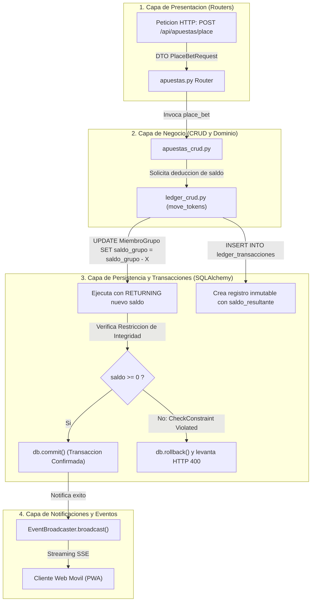

# 07.4 - Patrones Arquitectonicos y Motor Transaccional Ledger

> Enlace de navegación: Volver al [[07.0 - Indice y Mapa de Patrones Software]]

---

## Explicación Técnica

Los **patrones arquitectónicos y de robustez** definen la organización estructural macroscópica de la aplicación, las garantías de integridad transaccional y los principios de diseño que aseguran la tolerancia a fallos, la escalabilidad y la coherencia del estado del sistema.

En el diseño e implementación de **QuestFest** destacan cinco patrones arquitectónicos fundamentales:

### 1. Arquitectura en Capas Limpia (Clean Layered Architecture)
El backend está estructurado mediante una rigurosa separación unidireccional de responsabilidades:
- **Capa de Controladores y Rutas (`app/api/routers/`)**: Expone endpoints HTTP y SSE, parsea las peticiones, gestiona códigos de estado HTTP y delega la ejecución en la capa CRUD.
- **Capa de Lógica de Negocio y Dominio (`app/crud/`)**: Encapsula las reglas operativas del juego (cálculo de recompensas, validación de votos, resolución de desafíos y transferencias de tokens) manteniendo independencia respecto a la tecnología de transporte HTTP.
- **Capa de Modelos de Persistencia (`app/models/`)**: Entidades declarativas SQLAlchemy 2.0 que mapean tablas relacionales, relaciones de clave foránea, restricciones de integridad y cascadas de borrado.
- **Capa de Esquemas y DTOs (`app/schemas/`)**: Modelos Pydantic v2 que actúan como contratos inmutables de validación tipada para peticiones entrantes y serialización de respuestas salientes.

### 2. Patrón Unit of Work y Libro Mayor Inmutable (Ledger Pattern)
En el diseño de sistemas económicos y de juego, modificar directamente saldos mediante sentencias aisladas genera inconsistencias graves ante caídas de red o condiciones de carrera. QuestFest aplica una combinación de **Unit of Work** y **Ledger Contable**:
- La sesión asíncrona de SQLAlchemy (`AsyncSession`) actúa como Unidad de Trabajo (*Unit of Work*), acumulando operaciones de actualización y adición de entidades en memoria hasta que se confirma la transacción mediante `await db.commit()`.
- La función `move_tokens` en `backend/app/crud/ledger_crud.py` garantiza que jamás se actualice un saldo sin crear de forma indivisible un registro de auditoría en la tabla `ledger_transacciones`:
  ```python
  stmt = (
      update(MiembroGrupo)
      .where(MiembroGrupo.usuario_id == user_id, MiembroGrupo.grupo_id == group_id)
      .values(saldo_grupo=MiembroGrupo.saldo_grupo + amount)
      .returning(MiembroGrupo.saldo_grupo)
  )
  result = await db.execute(stmt)
  nuevo_saldo = result.scalar()
  
  transaccion = LedgerTransaccion(
      usuario_id=user_id,
      grupo_id=group_id,
      cantidad=amount,
      concepto=concept,
      saldo_resultante=nuevo_saldo
  )
  db.add(transaccion)
  ```
- **Protección contra Descubiertos (Overdraft)**: La base de datos impone la restricción `CheckConstraint("saldo_actual >= 0")`. Si una deducción resultase en saldo negativo, el motor PostgreSQL aborta con `IntegrityError`, y el bloque `except` ejecuta un `rollback` inmediato, devolviendo una excepción HTTP 400.

### 3. Multi-Tenancy Lógico en Esquema Compartido
El sistema soporta múltiples comunidades o grupos de amigos independientes sin necesidad de crear una base de datos por grupo. Cada registro sensible almacena la columna discriminadora `grupo_id`:
- Cada usuario posee una cuenta con saldos de QuestCoins locales e independientes en cada grupo (`MiembroGrupo.saldo_grupo`), además de un rol específico (`admin` o `member`).
- Las consultas del feed, misiones, apuestas y rankings incorporan el filtro obligatorio `WHERE entidad.grupo_id == :active_group_id`.

### 4. Arquitectura Dirigida por Eventos (EDA) sobre Streaming SSE
En lugar de forzar a cientos de clientes móviles a realizar sondeos continuos por intervalo corto (*short-polling* agresivo) hacia la base de datos, el backend desacopla la producción de eventos mediante `EventBroadcaster`. Las notificaciones y actualizaciones del muro social se transmiten de manera reactiva y eficiente por canales HTTP abiertos con Server-Sent Events (`StreamingResponse`).

### 5. Patrón de Pruebas Aisladas mediante Fixtures y Dependency Override
Para garantizar la verificación continua de funciones críticas sin alterar la base de datos de producción:
- En `backend/tests/conftest.py`, Pytest ejecuta una base de datos SQLite asíncrona en memoria (`sqlite+aiosqlite:///:memory:`).
- Se utiliza el patrón **Dependency Override** de FastAPI (`app.dependency_overrides[get_db] = override_get_db`), redirigiendo todas las consultas de prueba a sesiones efímeras que se destruyen automáticamente tras cada caso de prueba.

---

## Modelo Conceptual de Analogía: El Gran Banco de la Ciudadela y el Notario Real

Imagine la gestión del tesoro en una gran feria comercial histórica.

En la tesorería de la feria no se permite que los mercaderes anoten de memoria en pizarras cuántas monedas tienen. Si un mercader desea transferir oro a otro, ambos deben acudir ante el notario real (Unit of Work).

El notario tiene frente a sí un libro mayor encuadernado en cuero (Ledger). Jamás borra una línea escrita ni tacha números; cada entrada se escribe con tinta indeleble indicando: quién entregó el oro, quién lo recibió, el concepto exacto y el saldo resultante que queda en el cofre del mercader.

Si un mercader intenta pagar con 50 monedas cuando en su cofre solo quedan 20, el guardia de la bóveda (CheckConstraint de saldo no negativo) detiene la pluma del notario en seco: la operación es declarada nula de pleno derecho, no se entrega ninguna moneda y el cofre queda intacto (Rollback atómico).

---

## Aplicación en el Proyecto QuestFest

El siguiente diagrama detalla la arquitectura en capas y el flujo de una transacción en el libro mayor económico:



### Principios de Robustez Demostrados en el Proyecto:
- **Consistencia ACID Absoluta**: Ningún saldo puede quedar inconsistente a mitad de una operación de apuesta o duelo; el compromiso atómico de la sesión garantiza todo o nada.
- **Auditoría Financiera Completa**: Cada QuestCoin en circulación puede rastrearse desde su origen (bono de bienvenida al unirse a un grupo, recompensa por misión aprobada o victoria en duelo) hasta su gasto.
- **Aislamiento Multi-Tenant sin Fugas de Datos**: Los rankings y las apuestas de un grupo son completamente invisibles e inaccesibles para miembros de otros grupos, garantizando privacidad comunitaria.

---

## Conceptos Teóricos Relacionados

- [[06.1 - Que es una API RESTful y como funciona]]
- [[06.8 - Que es un ORM y como funciona SQLAlchemy]]
- [[06.11 - Transacciones Atomicas e Integridad Referencial]]
- [[06.20 - Eventos Enviados por el Servidor SSE frente a WebSockets]]
- [[06.23 - Registro de Auditoria y Trazabilidad en Sistemas Criticos]]
- [[06.24 - Pruebas de Integracion y Cobertura de Codigo]]
- [[06.26 - Patron de Diseño Multi-Tenancy y Modelado Relacional]]
- [[07.0 - Indice y Mapa de Patrones Software]]

---

## Ficheros Físicos del Código Fuente

- Motor económico transaccional: [backend/app/crud/ledger_crud.py](vscode://file/c:/.d/fiestas26-project/backend/app/crud/ledger_crud.py:11) *(Líneas 11 a 95: Función move_tokens)*
- Modelo de tabla de auditoría contable: [backend/app/models/usuario.py](vscode://file/c:/.d/fiestas26-project/backend/app/models/usuario.py:40) *(Líneas 40 a 53: Modelo LedgerTransaccion)*
- Restricciones de integridad de saldo: [backend/app/models/usuario.py](vscode://file/c:/.d/fiestas26-project/backend/app/models/usuario.py:20) *(Líneas 20 a 24: CheckConstraint check_saldo_positivo)*
- Modelo de membresía multi-tenant y saldo local: [backend/app/models/grupo.py](vscode://file/c:/.d/fiestas26-project/backend/app/models/grupo.py:38) *(Líneas 38 a 60: Modelo MiembroGrupo)*
- Fixtures de pruebas y base de datos SQLite aislada: [backend/tests/conftest.py](vscode://file/c:/.d/fiestas26-project/backend/tests/conftest.py:24) *(Líneas 24 a 45: Fixtures db_session y client)*
- Pruebas unitarias de integridad económica: [backend/tests/test_ledger.py](vscode://file/c:/.d/fiestas26-project/backend/tests/test_ledger.py:8) *(Líneas 8 a 46: Tests de sobregiro y registro en libro mayor)*

---

> Nota de uso en Obsidian: Consulte la nota siguiente [[07.5 - Conexion e Inversion de Control en Frameworks del Proyecto]] para analizar cómo los frameworks cooperativos orquestan estos patrones.
