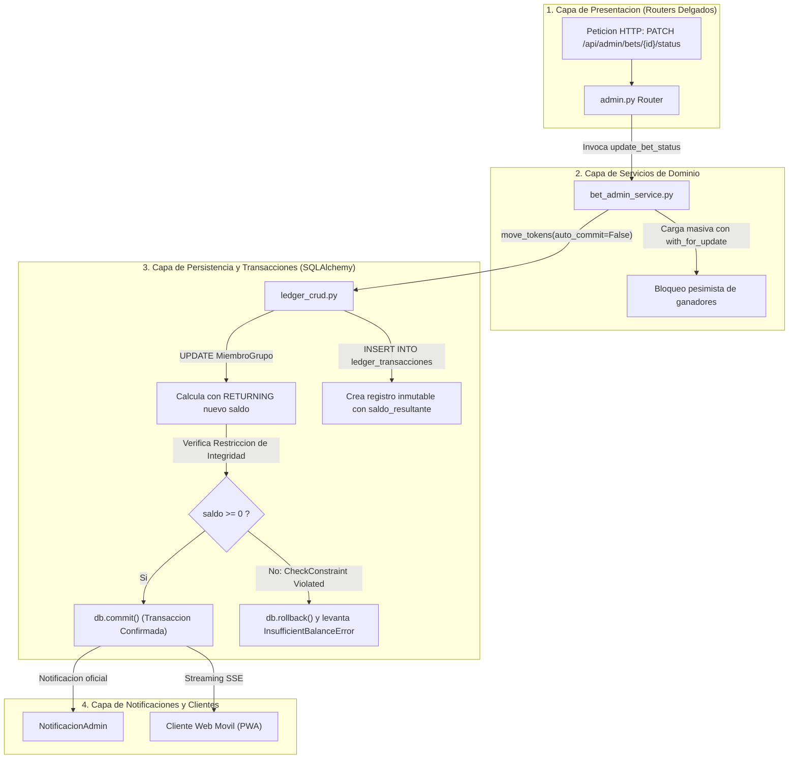

# 07.4 - Patrones Arquitectonicos y Motor Transaccional Ledger

> Enlace de navegación: Volver al [[07.0 - Indice y Mapa de Patrones Software]]

---

## Explicación Técnica

Los **patrones arquitectónicos y de robustez** definen la organización estructural macroscópica de la aplicación, las garantías de integridad transaccional y los principios de diseño que aseguran la tolerancia a fallos, la escalabilidad y la coherencia del estado del sistema.

En el diseño e implementación de **QuestFest** destacan cinco patrones arquitectónicos fundamentales:

### 1. Arquitectura Limpia en Capas y Desacoplamiento de Persistencia
El backend está estructurado mediante una rigurosa separación unidireccional de responsabilidades:
- **Capa de Controladores y Rutas (`app/api/routers/`)**: Controladores REST delgados que reciben las solicitudes HTTP, aplican dependencias de autenticación y jurisdicción territorial (`verify_group_admin`) y delegan la orquestación de negocio en la capa de servicios de dominio.
- **Capa de Servicios de Dominio (`app/services/`)**: Centraliza los casos de uso complejos del sistema:
  - `bet_admin_service.py`: Gestión del mercado de apuestas, edición de cuotas y liquidación masiva atómica con resolución del antipatrón N+1 mediante `Usuario.id.in_(user_ids)` y bloqueo pesimista `with_for_update()`.
  - `duel_tribunal_service.py`: Arbitraje en disputas de duelos PvP, transferencias de bolsas acumuladas y multas disciplinarias.
  - `mission_tribunal_service.py`: Curación comunitaria de retos y validación de evidencias multimedia.
  - `user_stats_service.py`: Agregación de indicadores analíticos y cómputo de balances de juego.
  - `boletin_service.py`: Síntesis de resúmenes diarios y líderes de comunidad.
- **Capa de Persistencia Pura (`app/crud/`)**: Funciones de acceso a datos desacopladas completamente de `fastapi.HTTPException`. Las funciones CRUD lanzan excepciones semánticas de dominio (`EntityNotFoundError`, `InsufficientBalanceError`, `InvalidStateTransitionError`, `PermissionDeniedError`, `UnauthorizedError`, `ConflictError`) definidas en `app/core/exceptions.py`.
- **Capa de Modelos de Persistencia (`app/models/`)**: Entidades declarativas SQLAlchemy 2.0 que mapean tablas relacionales, relaciones de clave foránea, restricciones de integridad y cascadas de borrado.
- **Capa de Esquemas y DTOs (`app/schemas/`)**: Modelos Pydantic v2 que actúan como contratos inmutables de validación tipada para peticiones entrantes y serialización de respuestas salientes.

### 2. Patrón Unit of Work y Libro Mayor Inmutable (Ledger Pattern)
En el diseño de sistemas económicos y de juego, modificar directamente saldos mediante sentencias aisladas genera inconsistencias graves ante caídas de red o condiciones de carrera. QuestFest aplica una combinación de **Unit of Work** y **Ledger Contable**:
- La sesión asíncrona de SQLAlchemy (`AsyncSession`) actúa como Unidad de Trabajo (*Unit of Work*), acumulando operaciones de actualización y adición de entidades en memoria hasta que se confirma la transacción mediante `await db.commit()`.
- La función `move_tokens` en `backend/app/crud/ledger_crud.py` garantiza que jamás se actualice un saldo sin crear de forma indivisible un registro de auditoría en la tabla `ledger_transacciones`:
  ```python
  stmt = (
      update(MiembroGrupo)
      .where(MiembroGrupo.usuario_id == user_id, MiembroGrupo.grupo_id == group_id)
      .values(saldo_grupo=MiembroGrupo.saldo_grupo + amount)
      .returning(MiembroGrupo.saldo_grupo)
  )
  result = await db.execute(stmt)
  nuevo_saldo = result.scalar()
  
  transaccion = LedgerTransaccion(
      usuario_id=user_id,
      grupo_id=group_id,
      cantidad=amount,
      concepto=concept,
      saldo_resultante=nuevo_saldo
  )
  db.add(transaccion)
  ```
- **Protección contra Descubiertos (Overdraft)**: La base de datos impone la restricción `CheckConstraint("saldo_actual >= 0")` y `CheckConstraint("saldo_grupo >= 0")`. Si una deducción resultase en saldo negativo, el motor PostgreSQL aborta con `IntegrityError`, y el bloque `except` ejecuta un `rollback` inmediato, lanzando `InsufficientBalanceError` que se traduce limpiamente en una respuesta HTTP 400.

### 3. Multi-Tenancy Lógico en Esquema Compartido
El sistema soporta múltiples comunidades o grupos de amigos independientes sin necesidad de crear una base de datos por grupo. Cada registro sensible almacena la columna discriminadora `grupo_id`:
- Cada usuario posee una cuenta con saldos de QuestCoins locales e independientes en cada grupo (`MiembroGrupo.saldo_grupo`), además de un rol específico (`admin` o `member`).
- Las consultas del feed, misiones, apuestas y rankings incorporan el filtro obligatorio `WHERE entidad.grupo_id == :active_group_id`.

### 4. Arquitectura Dirigida por Eventos (EDA) sobre Streaming SSE
En lugar de forzar a cientos de clientes móviles a realizar sondeos continuos por intervalo corto (*short-polling* agresivo) hacia la base de datos, el backend desacopla la producción de eventos mediante `EventBroadcaster`. Las notificaciones y actualizaciones del muro social se transmiten de manera reactiva y eficiente por canales HTTP abiertos con Server-Sent Events (`StreamingResponse`).

### 5. Patrón de Pruebas Aisladas mediante Fixtures y Dependency Override
Para garantizar la verificación continua de funciones críticas sin alterar la base de datos de producción:
- En `backend/tests/conftest.py`, Pytest ejecuta una base de datos SQLite asíncrona en memoria (`sqlite+aiosqlite:///:memory:`).
- Se utiliza el patrón **Dependency Override** de FastAPI (`app.dependency_overrides[get_db] = override_get_db`), redirigiendo todas las consultas de prueba a sesiones efímeras que se destruyen automáticamente tras cada caso de prueba.

---

## Modelo Conceptual de Analogía: El Gran Banco de la Ciudadela y el Notario Real

Imagine la gestión del tesoro en una gran feria comercial histórica.

En la tesorería de la feria no se permite que los mercaderes anoten de memoria en pizarras cuántas monedas tienen. Si un mercader desea transferir oro a otro o apostar en el torneo, acude ante los jueces del torneo (Servicios de Dominio). Los jueces verifican las reglas de la competición y luego presentan la orden al notario real (Unit of Work).

El notario tiene frente a sí un libro mayor encuadernado en cuero (Ledger). Jamás borra una línea escrita ni tacha números; cada entrada se escribe con tinta indeleble indicando: quién entregó el oro, quién lo recibió, el concepto exacto y el saldo resultante que queda en el cofre del mercader.

Si un mercader intenta pagar con 50 monedas cuando en su cofre solo quedan 20, el guardia de la bóveda (CheckConstraint de saldo no negativo) detiene la pluma del notario en seco: la operación es declarada nula de pleno derecho, no se entrega ninguna moneda y el cofre queda intacto (Rollback atómico y rechazo controlado).

---

## Aplicación en el Proyecto QuestFest

El siguiente diagrama detalla la arquitectura en capas y el flujo de una transacción en el libro mayor económico:



---

## Ficheros Físicos del Código Fuente

- Router de Administración: [backend/app/api/routers/admin.py](vscode://file/c:/.d/questfest-project/backend/app/api/routers/admin.py:1) *(Controlador delgado de administración y tribunal)*
- Servicio de Administración de Apuestas: [backend/app/services/bet_admin_service.py](vscode://file/c:/.d/questfest-project/backend/app/services/bet_admin_service.py:1) *(Liquidación atómica y resolución N+1)*
- Servicio del Tribunal de Duelos: [backend/app/services/duel_tribunal_service.py](vscode://file/c:/.d/questfest-project/backend/app/services/duel_tribunal_service.py:1) *(Arbitraje y sanciones PvP)*
- Servicio del Tribunal de Misiones: [backend/app/services/mission_tribunal_service.py](vscode://file/c:/.d/questfest-project/backend/app/services/mission_tribunal_service.py:1) *(Curación y validación de pruebas)*
- Servicio de Estadísticas de Usuario: [backend/app/services/user_stats_service.py](vscode://file/c:/.d/questfest-project/backend/app/services/user_stats_service.py:1) *(Agregación analítica y desglose)*
- Persistencia de Ledger y Movimientos: [backend/app/crud/ledger_crud.py](vscode://file/c:/.d/questfest-project/backend/app/crud/ledger_crud.py:1) *(Función atómica move_tokens y asientos)*
- Jerarquía de Excepciones de Dominio: [backend/app/core/exceptions.py](vscode://file/c:/.d/questfest-project/backend/app/core/exceptions.py:1) *(Desacoplamiento de la persistencia de HTTPException)*
