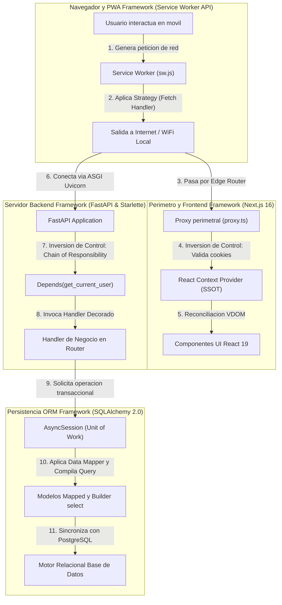

# 07.5 - Conexion e Inversion de Control en Frameworks del Proyecto

> Enlace de navegación: Volver al [[07.0 - Indice y Mapa de Patrones Software]]

---

## Explicación Técnica

En la ingeniería de software, un **framework** se define canónicamente como un *conjunto integrado de clases y objetos cooperativos que define una arquitectura reutilizable para una familia específica de aplicaciones*. A diferencia de una biblioteca o librería convencional (donde el código del desarrollador invoca funciones utilitarias cuando lo necesita), un framework implementa el principio de **Inversión de Control (Inversion of Control - IoC)**, ampliamente sintetizado bajo el *Principio de Hollywood*: *"No nos llames a nosotros; nosotros te llamaremos a ti"* (*Don't call us, we'll call you*).

El framework define el flujo de control global del sistema, el ciclo de vida de los procesos y los puntos de extensión (*hooks* o *callbacks*), mientras que el código de la aplicación rellena los detalles de negocio específicos.

En el ecosistema de **QuestFest** se articulan cuatro frameworks cooperativos principales, cada uno íntimamente conectado con patrones de diseño canónicos:

### 1. FastAPI y Starlette (Framework Web Asíncrono ASGI)
- **Flujo de Control y Arquitectura Reutilizable**:
  Gestiona el ciclo de vida de la conexión HTTP/WebSocket sobre especificación ASGI mediante Uvicorn. Recibe sockets en bruto, parsea las peticiones en hilos asíncronos no bloqueantes y orquesta el orden de ejecución de middlewares y controladores.
- **Conexión con Patrones de Diseño**:
  - **Chain of Responsibility**: A través de su sistema de inyección de dependencias `Depends(...)` y de su pila de middlewares (`BaseHTTPMiddleware`). La petición transita por sucesivos eslabones de verificación antes de alcanzar la función de destino.
  - **Decorator**: Mediante anotaciones declarativas (`@router.post`, `@router.get`, `@limiter.limit`) que asocian metadatos de validación OpenAPI, cuotas de peticiones y contratos Pydantic sin alterar la firma interna de la función.
  - **Iterator / Generator**: Mediante el soporte de generadores con `yield` en `StreamingResponse`, permitiendo emitir flujos continuos de datos en tiempo real (Server-Sent Events).

### 2. SQLAlchemy 2.0 Async (Framework ORM y de Persistencia)
- **Flujo de Control y Arquitectura Reutilizable**:
  Supervisa el estado del grafo de entidades en memoria y coordina su sincronización bidireccional con el motor relacional PostgreSQL/SQLite. Gobierna la apertura de transacciones, la gestión del pool de conexiones y la detección de cambios en los objetos del modelo (*dirty tracking*).
- **Conexión con Patrones de Diseño**:
  - **Data Mapper**: Desacopla la representación de las tablas relacionales de la lógica de objetos en Python mediante `Base = declarative_base()` y el sistema de tipos `Mapped[...]` y `mapped_column(...)`.
  - **Unit of Work**: Encarnado en la clase `AsyncSession`, que centraliza y acumula todas las inserciones, modificaciones y borrados, asegurando que se escriban en la base de datos de manera atómica con `commit` o se descarten por completo con `rollback`.
  - **Builder**: A través de su API fluida de consultas `select(...)`, que permite ensamblar sentencias compuestas de manera modular y tipada.
  - **Composite**: Mediante relaciones autorreferenciales con `remote_side` para modelar estructuras jerárquicas como árboles de publicaciones y respuestas anidadas.

### 3. Next.js 16 y React 19 (Framework de Interfaz de Usuario y SSR)
- **Flujo de Control y Arquitectura Reutilizable**:
  Controla el ciclo de vida del frontend: enrutamiento en el servidor (App Router), generación estática, renderizado en servidor (SSR), streaming de HTML, hidratación en el cliente y reconciliación reactiva del Virtual DOM mediante el motor de React.
- **Conexión con Patrones de Diseño**:
  - **Proxy / Interceptor**: A través del fichero perimetral `frontend/src/proxy.ts`, que intercepta las peticiones en el Edge antes de que React monte los componentes, verificando cookies JWT y redirigiendo rutas no autorizadas.
  - **Observer / State**: Mediante la arquitectura de Contextos (`AuthContext`, `GroupContext`), donde los componentes consumidores se suscriben a mutaciones de estado global y se re-renderizan automáticamente al cambiar los datos.
  - **Composite**: El árbol declarativo de componentes de React modela una estructura jerárquica donde componentes individuales (`BetCard`, `DuelCard`) y contenedores complejos se integran con una interfaz de propiedades unificada.

### 4. Service Worker API y Web Standards (Framework de Navegador PWA)
- **Flujo de Control y Arquitectura Reutilizable**:
  Se ejecuta en un hilo de ejecución independiente en segundo plano del navegador, actuando como un proxy de red programable situado entre la aplicación web móvil, la memoria local del dispositivo y la red externa.
- **Conexión con Patrones de Diseño**:
  - **Strategy**: Implementa estrategias de caché diferenciadas (`Network-First con Fallback Offline`, `Network-First con Fallback a Cache`, `Stale-While-Revalidate`) encapsulando cada política según la ruta interceptada.
  - **Observer**: Se suscribe mediante escuchadores de eventos reactivos (`self.addEventListener('fetch'|'push'|'notificationclick')`) a los estímulos emitidos por el navegador y el sistema operativo móvil.

---

## Modelo Conceptual de Analogía: El Escenario Teatral y los Guiones de los Actores

Imagine la puesta en escena de una gran obra de teatro en un festival.

Una **biblioteca o librería** es como una caja de herramientas o disfraces: un actor acude a la caja, saca una espada cuando la necesita, la empuña y la vuelve a guardar. El actor tiene el control total de cuándo y cómo usa la herramienta.

Un **framework**, por el contrario, es el **teatro completo con su director de escena**:
- El teatro cuenta con un escenario giratorio, focos controlados por poleas y un telón motorizado (la arquitectura integrada del framework).
- El director de escena es quien marca los tiempos: él decide cuándo se abre el telón, cuándo entra cada personaje al escenario y cuándo se apagan las luces (Inversión de Control / Principio de Hollywood).
- El programador no construye el teatro; escribe el papel del personaje y sigue las marcas del suelo indicadas por el director.
- Los **patrones de diseño** son las técnicas consagradas de interpretación y coreografía que el actor utiliza dentro de las pautas fijadas por el teatro para resolver una escena dramática de forma elegante y comprensible.

---

## Aplicación en el Proyecto QuestFest

El siguiente diagrama ilustra cómo los cuatro frameworks se coordinan en QuestFest mediante inversión de control para procesar una interacción crítica de usuario:

### Síntesis de la Cohesión Arquitectónica:
- **Especialización sin Superposición**: Cada framework domina un estrato específico (Service Worker en la red física del cliente, Next.js en la presentación y el routing de cliente, FastAPI en el transporte y seguridad HTTP, SQLAlchemy en la integridad transaccional relacional).
- **Extensibilidad Concurrente**: Al respetar la inversión de control de FastAPI y SQLAlchemy, el sistema ejecuta cientos de operaciones de juego en paralelo sobre el Event Loop asíncrono sin riesgo de bloqueos de I/O.
- **Robustez Garantizada**: La combinación de contratos Pydantic v2 en FastAPI y restricciones relacionales en SQLAlchemy asegura que ningún dato mal formado o transacción corrupta pueda persistirse en el almacenamiento permanente.

---

## Conceptos Teóricos Relacionados

- [[06.1 - Que es una API RESTful y como funciona]]
- [[06.2 - La Asincronia en Python y FastAPI]]
- [[06.8 - Que es un ORM y como funciona SQLAlchemy]]
- [[06.12 - Renderizado en Servidor vs Cliente en Next.js]]
- [[06.13 - Gestion del Estado Global y Context API]]
- [[06.14 - Middleware y Proteccion de Rutas HTTP]]
- [[06.17 - Progressive Web Apps y Service Workers]]
- [[06.27 - Patrones de Diseño Software y Catalogo GoF]]
- [[07.0 - Indice y Mapa de Patrones Software]]

---

## Ficheros Físicos del Código Fuente

- Configuración y ciclo de vida de FastAPI: [backend/app/main.py](vscode://file/c:/.d/fiestas26-project/backend/app/main.py:13) *(Líneas 13 a 71: app = FastAPI(), middlewares y registro de routers)*
- Motor y factoría de sesiones SQLAlchemy: [backend/app/core/database.py](vscode://file/c:/.d/fiestas26-project/backend/app/core/database.py:12) *(Líneas 12 a 34: create_async_engine y async_sessionmaker)*
- Base declarativa de mapeo relacional: [backend/app/models/base.py](vscode://file/c:/.d/fiestas26-project/backend/app/models/base.py:1) *(Líneas 1 a 4: DeclarativeBase de SQLAlchemy 2.0)*
- Proxy perimetral de Next.js: [frontend/src/proxy.ts](vscode://file/c:/.d/fiestas26-project/frontend/src/proxy.ts:11) *(Líneas 11 a 57: Inversión de control en enrutamiento perimetral)*
- Proveedores de contexto de React: [frontend/src/context/GroupContext.tsx](vscode://file/c:/.d/fiestas26-project/frontend/src/context/GroupContext.tsx:37) *(Líneas 37 a 150: GroupProvider y distribución de estado)*
- Service Worker y políticas de red PWA: [frontend/public/sw.js](vscode://file/c:/.d/fiestas26-project/frontend/public/sw.js:35) *(Líneas 35 a 112: Intercepción de eventos de red fetch)*

---

> Nota de uso en Obsidian: Esta nota concluye el recorrido exhaustivo del capítulo 07 de Arquitectura y Patrones Software. Puede regresar al [[00 - Índice General]] para explorar otros módulos del manual.
